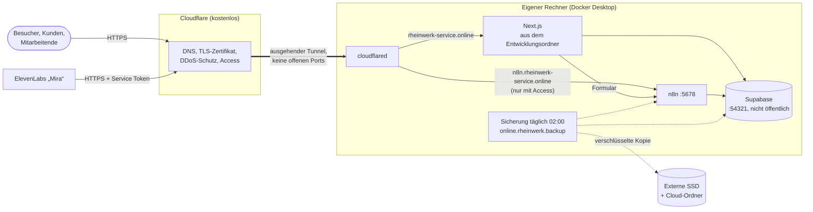

# Betriebskonzept: Betrieb, Datensicherung und Wartung

Diese Seite legt fest, wie RheinWerk dauerhaft läuft, wie Daten gesichert und wiederhergestellt werden und welche Wartung regelmäßig anfällt. Einrichtung der Bausteine: [supabase-lokal.md](supabase-lokal.md), [n8n-workflows.md](n8n-workflows.md), [telefonassistent/setup.md](telefonassistent/setup.md).

## 1. Rahmen und Entscheidung

| Punkt | Festlegung (Nutzerentscheidung 20.10.2026) |
| --- | --- |
| Zweck | Portfolio-Projekt mit Demodaten und realen Testabläufen (Formular, Gmail, Telefonassistent) |
| Kosten | **Stufe 1 ohne laufende Kosten**: keine Server-Miete, kein Supabase-Cloud-Tarif |
| Website | öffentlich unter **`https://rheinwerk-service.online`** |
| n8n und Supabase | vorerst **auf dem eigenen Rechner** (macOS, Docker) |
| Später | **Stufe 2**: Umzug auf einen echten Server, sobald dauerhafte Verfügbarkeit nötig ist |

Bereits vorhanden und genutzt: Domain `rheinwerk-service.online` mit DNS bei Cloudflare, Cloudflare Tunnel (Container `sleepy_margulis`), Cloudflare Access für den n8n-Editor und die Telefon-Webhooks.

## 2. Stufe 1: Betrieb auf dem eigenen Rechner

### 2.1 Aufbau



| Öffentliche Adresse | Ziel im Tunnel | Schutz |
| --- | --- | --- |
| `rheinwerk-service.online` (und `www.`) | noch nicht geschaltet (2.2); vorgesehen: Next.js auf dem Rechner bzw. später auf dem Server | öffentlich; Dashboard nur mit Anmeldung, Pause nach Fehlversuchen, RLS |
| `n8n.rheinwerk-service.online` | `http://host.docker.internal:5678` | Cloudflare Access (Anmeldung); nur `webhook/agent-*` per Service Token für ElevenLabs |
| Supabase | – | **nicht veröffentlicht**: Der Browser spricht nie direkt mit Supabase, nur die App auf dem Server und n8n |

`cloudflared` läuft selbst in Docker; deshalb zeigen die Ziele auf `host.docker.internal` statt `localhost`.

**Warum so:** Der Tunnel baut die Verbindung von innen nach außen auf. Im Router wird kein Port geöffnet, die private IP bleibt verborgen, TLS-Zertifikate verwaltet Cloudflare. Supabase bleibt vollständig im lokalen Netz.

### 2.2 Website unter der Domain schalten

Nutzerentscheidung 21.10.2026 (task-17-17): Bis zum Abschluss des Projekts läuft alles aus dem Entwicklungsordner auf dem eigenen Rechner, die Domain ist noch nicht auf diesen Rechner geschaltet (Cloudflare meldet 522). Die Website kommt erst nach Projektende unter die Domain, Supabase und n8n voraussichtlich auf einen Server (Stufe 2, Abschnitt 3). Dafür dann: gebaute App als Dienst (`next build && next start`), Tunnel-Route bzw. DNS auf das Ziel, eigene `.env.local` für den Betrieb (`N8N_WEBHOOK_URL`, Turnstile-Produktionsschlüssel, `BLOB_READ_WRITE_TOKEN`), Supabase Auth auf die Domain (`site_url`, `additional_redirect_urls`, SMTP nach [setup.md](setup.md#passwort-e-mails-supabase-auth)). Die frühere Produktionskopie auf diesem Rechner (task-17-1 bis 17-6: `~/RheinWerk-Prod` mit Releases je Commit, nächtlichem Code-Update und Rücksetzen) wurde mit task-17-17 entfernt; ihr Code steht in der Git-Historie (bis Commit `284294f`) als Vorlage für den Server.

### 2.3 Dauerbetrieb des Rechners

| Einstellung | Wo | Zweck |
| --- | --- | --- |
| Ruhezustand verhindern | Systemeinstellungen → Energie → „Automatischen Ruhezustand verhindern, wenn das Display aus ist“ | Tunnel, n8n und Zeitpläne laufen weiter |
| Nach Stromausfall starten | Systemeinstellungen → Energie → „Nach Stromausfall automatisch starten“ | Wiederanlauf ohne Eingriff |
| Docker beim Anmelden starten | Docker Desktop → Settings → General → „Start Docker Desktop when you sign in“ | Container starten selbst |
| Container-Neustart | bereits gesetzt: `restart: unless-stopped` für n8n, cloudflared und die Supabase-Container | nach Docker-Neustart automatisch |
| Dienste auf dem Rechner | `npm run ops:install` (unten) | nächtliche Sicherung und Wächter |

**Dienste (task-17-17).** Zwei LaunchAgents laufen aus dem Entwicklungsordner mit dessen `.env.local`; Vorlagen in `ops/launchd/`, eingerichtet und bei Änderung neu geladen mit `npm run ops:install` (wiederholbar; `-- --remove` entfernt beide, alte Dienste der Produktionskopie räumt es mit ab). Protokolle in `~/Library/Logs/RheinWerk/`.

| Dienst | Wann | Skript | Von Hand |
| --- | --- | --- | --- |
| `online.rheinwerk.backup` | täglich 02:00 (verpasste Läufe holt macOS nach dem Aufwachen nach) | `scripts/ops/nightly.mjs`: Sicherung mit Wiederherstellungstest (4.2, 4.3), bei Fehler Warnung `backup:failed` und E-Mail; danach installierte und verfügbare Versionen für den Bereich „System“ (`scripts/ops/versions.mjs`, nur Anzeige, task-17-15) | `npm run nightly` |
| `online.rheinwerk.watchdog` | alle 5 Minuten | `scripts/ops/watchdog.mjs` (Abschnitt 5) | `npm run watchdog` |
| `online.rheinwerk.systemcheck` | alle 20 Sekunden, arbeitet nur bei einer Anfrage | `scripts/ops/check.mjs`: „System prüfen“ aus dem Dashboard (alle Prüfungen einschließlich SMTP und Versionen, task-17-15), Protokoll `systemcheck.log` | `npm run system:check` |

**macOS-Datenschutz:** Ein LaunchAgent darf ohne Freigabe nicht in `~/Documents` lesen (`Operation not permitted`, im Protokoll `node: .env.local: not found`). Deshalb brauchen `/opt/homebrew/bin/node` und `/bin/zsh` „Festplattenvollzugriff“ (Systemeinstellungen → Datenschutz & Sicherheit → Festplattenvollzugriff → „+“, im Dateidialog ⌘⇧G und den Pfad eingeben). Nach `brew upgrade node` ändert sich der Pfad des Programms: Freigabe erneuern, dann `launchctl kickstart gui/$(id -u)/online.rheinwerk.watchdog` und das Protokoll prüfen.

Die Website läuft während der Entwicklung als `next dev` im Terminal (Port 3000) und ist kein Dienst.

### 2.4 Grenzen von Stufe 1 (bewusst akzeptiert)

| Grenze | Folge | Abmilderung |
| --- | --- | --- |
| Rechner aus, im Ruhezustand oder ohne Internet | Website, Dashboard, Formular, Telefonassistent nicht erreichbar | Energieeinstellungen; für Präsentationen vorher prüfen |
| ein Gerät, eine Festplatte | Hardwaredefekt oder Diebstahl = Ausfall | tägliche verschlüsselte Sicherung außerhalb des Rechners (Abschnitt 4) |
| private Internetleitung | begrenzter Upload | für Demo-Last ausreichend; Cloudflare liefert statische Dateien aus dem Cache |
| Wartung am Arbeitsrechner | Neustarts, Updates unterbrechen den Betrieb | Wartung gebündelt (Abschnitt 6) |

**Wiederherstellungsziel Stufe 1:** höchstens 24 Stunden Datenverlust (tägliche Sicherung, RPO), Betrieb auf einem anderen Rechner in etwa 2 Stunden (RTO). E-Mails liegen zusätzlich vollständig in Gmail; die 15-Minuten-Nachlese von Workflow 5 holt Antworten der letzten 7 Tage wieder ein.

## 3. Stufe 2: Umzug auf einen Server

Auslöser für den Umzug: echte Kunden oder Mitarbeitende, Erreichbarkeit rund um die Uhr nötig, oder der Arbeitsrechner soll entlastet werden.

| Variante | Kosten/Monat | Bewertung |
| --- | --- | --- |
| **A. Ein virtueller Server mit Docker Compose** (z. B. Hetzner CX32: 4 vCPU, 8 GB RAM, 80 GB, Rechenzentrum Deutschland) mit Supabase self-hosted, n8n, Next.js, cloudflared | ca. 7–8 € | **empfohlen**: gleiche Container wie heute, Umzug mit den vorhandenen Sicherungsskripten, Daten in Deutschland (DSGVO) |
| B. Oracle Cloud „Always Free“ | 0 € | die kleinen AMD-Instanzen (1 GB RAM) reichen **nicht**; die Ampere-A1-Instanz (bis 4 Kerne, 24 GB RAM) würde reichen, ist aber oft nicht verfügbar, ARM-Images nötig, kein Support |
| C. Verwaltete Dienste: Supabase Cloud (Region Frankfurt) + Vercel + n8n Cloud oder kleiner Server für n8n | 0 € im kostenlosen Umfang, ab ca. 25 € mit Sicherungen | wenig Pflege; kostenloses Supabase pausiert bei Inaktivität und hat keine täglichen Sicherungen |

**Umzug nach Variante A** (mit den Werkzeugen aus Abschnitt 4):

1. Server mit Docker, Firewall (nur SSH mit Schlüssel), automatischen Sicherheitsupdates (`unattended-upgrades`).
2. Repository klonen, Supabase-Stack starten, n8n- und cloudflared-Container wie heute.
3. Letzte Sicherung mit `npm run backup` erstellen, auf den Server kopieren, nach Abschnitt 4.5 wiederherstellen (Postgres, Storage, n8n-Datenbank **mit Schlüssel**).
4. Im Cloudflare-Tunnel die Ziele auf den Server umstellen (oder dort einen neuen Tunnel mit denselben Hostnamen). DNS bleibt unverändert; der Wechsel dauert Minuten.
5. Sicherung auf dem Server per `cron` täglich, Kopie außer Haus (z. B. Hetzner Storage Box, ca. 4 €).

## 4. Datensicherung

### 4.1 Was gesichert wird

| Bestandteil | Inhalt | Wie | Ohne Sicherung verloren? |
| --- | --- | --- | --- |
| Postgres | alle Tabellen inkl. Anmeldedaten (Auth), Storage-Metadaten, Funktionen, pg_cron-Aufträge, Migrationsstand | `pg_dump -Fc` (in sich konsistent, im laufenden Betrieb) | **ja** |
| Storage-Dateien | Formularanhänge, E-Mail-Anhänge, Einsatzfotos (Bucket `dashboard`) | `tar` aus dem Volume des Storage-Containers | **ja** |
| n8n-Datenbank | Workflows, Credentials (verschlüsselt), Ausführungsverlauf | Container `n8n` wird für wenige Sekunden pausiert (`docker pause`), Datenbank samt WAL kopiert, danach lokal zusammengeführt. Die laufende Datenbank wird **nie** vom Rechner aus geöffnet: Am 20.10.2026 hat ein `sqlite3 .backup` vom Mac auf die Live-Datei n8n für zwei Stunden an seiner Schreibsperre hängen lassen (kein Versand, keine Analyse), behoben durch Neustart | Workflows: nein (im Repository), Credentials: **ja** |
| n8n-Schlüssel `~/n8n/data/config` | Schlüssel, mit dem n8n die Credentials verschlüsselt | Dateikopie, **nur in verschlüsselter Sicherung** | **ja** – ohne ihn sind alle Credentials unbrauchbar |
| `.env.local` | Schlüssel für Supabase, Telefonassistent, Cloudflare, Turnstile, Blob | Dateikopie, **nur in verschlüsselter Sicherung** | teilweise neu erzeugbar, aber mühsam |

Nicht in der Sicherung, weil anderswo vorhanden: Quellcode und Workflow-Exporte (GitHub), Docker-Images (werden neu geladen), `node_modules` (`npm ci`), E-Mails (Gmail), Konfiguration der externen Dienste (Cloudflare, Google Cloud, OpenAI, ElevenLabs; in dieser Dokumentation beschrieben).

### 4.2 Sicherung erstellen

```bash
npm run backup
```

Ergebnis: eine Datei `~/RheinWerk-Backups/rheinwerk-<Zeitstempel>.tar.gz.enc` (Stand 20.10.2026: ca. 72 MB, 10 Sekunden) mit `postgres.dump`, `storage.tar.gz`, `n8n-database.sqlite`, `n8n-config`, `env.local` und `manifest.json` (Zeilenzahlen, Prüfsummen).

| Einstellung (`.env.local` oder Umgebung) | Standard | Bedeutung |
| --- | --- | --- |
| `BACKUP_PASSPHRASE` | – | **Pflicht für eine vollständige Sicherung.** Verschlüsselt das Archiv (AES-256, PBKDF2 mit 200 000 Runden). Ohne sie: unverschlüsselt, ohne n8n-Schlüssel und `.env.local`, mit Warnung |
| `BACKUP_DIR` | `~/RheinWerk-Backups` | Zielordner |
| `BACKUP_KEEP_DAYS` | 14 | Aufbewahrung in Tagen; ältere Sicherungen löscht jeder Lauf von `npm run backup`, die neueste bleibt immer |
| `N8N_CONTAINER` | `n8n` | Name des n8n-Containers |

> Die Passphrase gehört in einen Passwort-Manager, **nicht nur** in `.env.local`: Ist der Rechner verloren, ist auch `.env.local` weg, und ohne Passphrase lässt sich keine Sicherung öffnen.

### 4.3 Sicherung prüfen (Wiederherstellungstest)

```bash
npm run backup:check            # neueste Sicherung
npm run backup:check -- <datei> # bestimmte Sicherung
```

Der Test entschlüsselt das Archiv, prüft alle Prüfsummen, stellt Postgres in eine **getrennte Datenbank `backup_check`** wieder her, vergleicht die Zeilenzahlen von elf Kerntabellen mit dem Manifest, prüft Passwort-Hashes, Storage-Dateien, die n8n-Datenbank (`integrity_check`, Workflows) und den n8n-Schlüssel. Danach wird `backup_check` gelöscht; die laufenden Daten werden nicht berührt.

Ergebnis vom 20.10.2026: alle Prüfungen bestanden (829 Anfragen, 113 Konten, 2 950 Nachrichten, 53 Storage-Dateien, 28 n8n-Workflows, davon 8 RheinWerk aktiv), Dauer ca. 5 Sekunden.

> Eine Sicherung gilt erst als vorhanden, wenn ihre Wiederherstellung geprüft ist.

### 4.4 Zeitplan und Aufbewahrung (3-2-1-Regel)

| Was | Wann | Wo |
| --- | --- | --- |
| Sicherung + Prüfung | täglich 02:00 (`launchd` `online.rheinwerk.backup`, Abschnitt 2.3; verpasste Läufe holt macOS nach dem Aufwachen nach) | `~/RheinWerk-Backups`, ältere als 14 Tage löscht jeder Lauf |
| Kopie außer Haus | täglich mit (Ordner in iCloud Drive/Google Drive) oder wöchentlich manuell | Cloud-Ordner, verschlüsselt |
| Monatssicherung | am 1. jedes Monats | externe SSD, 12 Monate aufbewahren |

3 Kopien (Original, lokale Sicherung, extern), 2 Medien (interne SSD, externe SSD/Cloud), 1 außer Haus. Weil die Archive verschlüsselt sind, dürfen sie in einen Cloud-Ordner.

Der Nachtlauf (`scripts/ops/nightly.mjs`, task-17-17; von task-17-5 bis 17-16 war er Teil des nächtlichen Code-Updates der Produktionskopie) sichert mit `backup` und prüft mit `backup:check`. Scheitert eins davon, bekommt der Admin eine Warnung mit E-Mail (`backup:failed`), der nächste gute Lauf behebt sie. Protokoll: `~/Library/Logs/RheinWerk/backup.log`.

### 4.5 Wiederherstellung

**Vorher:** App und n8n anhalten, damit niemand schreibt (`next dev` im Terminal beenden, `docker stop n8n`). Die aktuellen Daten zuerst selbst sichern (`npm run backup`), falls die Wiederherstellung rückgängig gemacht werden muss.

```bash
# 0. Archiv entpacken
openssl enc -d -aes-256-cbc -pbkdf2 -iter 200000 -in rheinwerk-<zeit>.tar.gz.enc -out r.tar.gz -pass env:BACKUP_PASSPHRASE
tar -xzf r.tar.gz && cd rheinwerk-<zeit>

# 1. Postgres (auf neuem Rechner vorher: supabase start)
docker cp postgres.dump supabase_db_A.Sadkovojs_Project:/tmp/r.dump
docker exec supabase_db_A.Sadkovojs_Project pg_restore -U supabase_admin -d postgres --clean --if-exists /tmp/r.dump
#    erwartet: wenige Meldungen "cannot drop inherited constraint messages_<datum>_pkey" (Realtime-Partitionen, harmlos)

# 2. Storage-Dateien
docker exec -i supabase_storage_A.Sadkovojs_Project tar -xzf - -C /mnt < storage.tar.gz

# 3. n8n (Container gestoppt)
cp n8n-database.sqlite ~/n8n/data/database.sqlite && rm -f ~/n8n/data/database.sqlite-wal ~/n8n/data/database.sqlite-shm
cp n8n-config ~/n8n/data/config
docker start n8n

# 4. Umgebung und Neustart
cp env.local <projekt>/.env.local
docker restart supabase_rest_A.Sadkovojs_Project      # Schema-Cache neu laden
npm run supabase:check && npm run demo:verify
```

Danach: Anmeldung im Dashboard, n8n → Executions (Zeitpläne laufen grün), ein Testformular. Das Verfahren (`--clean` über eine bestehende Datenbank) wurde am 20.10.2026 an der Prüfdatenbank getestet: Zeilenzahlen identisch.

**Kompletter Verlust des Rechners:** neuer Rechner → Voraussetzungen und `supabase start` nach [supabase-lokal.md](supabase-lokal.md) → n8n-Container nach [n8n-workflows.md](n8n-workflows.md#7-einrichtung-von-grund-auf) (ohne Workflows zu importieren) → Schritte 0–4 → Cloudflare-Tunnel-Container mit dem Token aus dem Cloudflare-Konto starten. Ziel: etwa 2 Stunden.

## 5. Überwachung

| Was | Wie | Wer reagiert |
| --- | --- | --- |
| Website erreichbar | kostenloser Uptime-Monitor (z. B. UptimeRobot) auf `https://rheinwerk-service.online/api/health` (200 = ok, 503 = Datenbank nicht erreichbar), Benachrichtigung per E-Mail | Betreiber |
| Gesundheitsprüfung | `curl -H "Authorization: Bearer $HEALTH_TOKEN" localhost:3000/api/health`: Commit (`dev` im Entwicklungsordner), Datenbank und n8n mit Laufzeit (task-17-4); ohne Token nur der Status | Betreiber |
| Offene Warnungen | Hinweis oben auf jeder Dashboard-Seite für Manager und Admin, Liste offener und behobener Warnungen im Bereich „System“; Admin kann „Erledigt“ setzen (task-17-10) | Inhaber sieht es, Betreiber handelt |
| E-Mail-Versand | Hinweis „E-Mail-Versand hängt“ oben im Dashboard nach 10 Minuten (task-12-9) | Dispatcher melden, Betreiber verbindet Gmail neu |
| n8n-Läufe | n8n → Executions, rote Läufe; `docker logs n8n --since 1h` | Betreiber |
| Automatisierung | Dashboard → Auswertung → Automatisierung (Anteil, Läufe mit Fehlern) | Manager |
| Automatisierung (task-17-8) | Wächter `online.rheinwerk.watchdog` alle 5 Minuten (`scripts/ops/n8n.mjs`, über die n8n-API mit `N8N_API_KEY`): n8n erreichbar, Workflows aktiv, Zeitpläne laufen, Versandstau > 10 min, KI-Analysen > 15 min offen; fehlgeschlagene Läufe meldet der Error-Workflow „RheinWerk · Fehlermeldung“. Warnung im Bereich „System“, E-Mail an den Admin. Einzelheiten [n8n-workflows.md](n8n-workflows.md#8-überwachung-und-typische-störungen) | Betreiber (E-Mail) |
| Telefonassistent (task-17-9) | Wächter `online.rheinwerk.watchdog` alle 5 Minuten (`scripts/ops/watchdog.mjs`, `npm run watchdog` von Hand, Protokoll `~/Library/Logs/RheinWerk/watchdog.log` nur bei Fehlern): Agent bei ElevenLabs, Guthaben (Schwellwert `MIRA_CREDIT_MIN`, Standard 10 % des Kontingents), Werkzeug-Webhook über Tunnel und Cloudflare Access (Probe `agent-anlage-pruefen`, schreibt nichts), Gesprächsauswertung 30 Minuten nach Gesprächsende, ab 3 fehlgeschlagenen Werkzeugaufrufen in der letzten Stunde. Warnung im Bereich „System“ und E-Mail an den Admin (neuer Vorfall, Erinnerung nach 6 Stunden, „Wieder in Ordnung“); Ergebnis und Guthaben in `system_status.monitoring`. Ohne `ELEVENLABS_API_KEY` „nicht eingerichtet“, ohne Warnung. Einzelheiten `docs/telefonassistent/setup.md` | Betreiber (E-Mail), Inhaber sieht den Zustand |
| Zustand der Systeme (task-17-15) | Wächter `online.rheinwerk.watchdog` alle 5 Minuten (`scripts/ops/systems.mjs`): Website (`/api/health` auf `WEBSITE_URL`, Standard `http://127.0.0.1:3000`), Datenbank (Abfrage mit Dauer), Cloudflare-Tunnel (Container `cloudflare/cloudflared` läuft, offene Verbindungen aus seinem Protokoll), E-Mail-Versand (Anmeldung bei Gmail ohne Versand, nur stündlich, damit Google nicht alle 5 Minuten eine Anmeldung sieht), Docker (Pflicht-Container von Supabase und n8n laufen, kein laufender Container „unhealthy“), Speicherplatz (Warnung unter `DISK_WARN_GB` = 20 GB, kritisch unter `DISK_CRITICAL_GB` = 5 GB). Warnungen mit Schlüssel `system:*` und Quelle „Zustand der Systeme“, E-Mail an den Admin. Fällt die Datenbank aus, geht die E-Mail ohne Warnungseintrag direkt raus (höchstens alle 6 Stunden, gemerkt in `~/Library/Logs/RheinWerk/datenbank-ausfall.json`). „System prüfen“ (nur Admin) startet alle Prüfungen sofort, etwa nach einem manuellen Update von Docker Desktop | Betreiber (E-Mail), Inhaber sieht den Zustand |
| Versionen (task-17-15) | jede Nacht und bei „System prüfen“: Docker Desktop (Appcast von Docker), Supabase CLI (npm-Registry), Supabase-Images (laufende Container gegen `supabase services`), n8n, Node.js (nodejs.org, gleiche Hauptversion, Hinweis auf neuere LTS), npm-Pakete (`npm outdated`). Bereich „System“ zeigt Installiert, Verfügbar, Empfehlung („Aktuell“, „Update empfohlen“, „Neue Hauptversion“) mit Vorgehen und Link zu den Release Notes. Nur Anzeige, das Dashboard installiert nichts (Nutzerentscheidung 21.10.2026) | Betreiber nach Wartungsplan (6) |
| Sicherung | Warnung `backup:failed` mit E-Mail; `~/Library/Logs/RheinWerk/backup.log`: letzte Zeile „Sicherung ist wiederherstellbar“ | Betreiber, wöchentlich |
| Speicherplatz | Warnung `system:speicher` (oben); Ursachen mit `df -h`, `docker system df` | Betreiber |


## 6. Wartungsplan

| Rhythmus | Aufgabe | Befehl / Ort |
| --- | --- | --- |
| täglich 02:00 (automatisch) | Sicherung + Wiederherstellungstest, Versionen für den Bereich „System“ | `launchd` `online.rheinwerk.backup` |
| alle 5 Minuten (automatisch) | Zustand aller Systeme mit Warnung und E-Mail (SMTP stündlich) | `launchd` `online.rheinwerk.watchdog` |
| nach jedem manuellen Update | „System prüfen“ im Bereich „System“ (Admin) oder `npm run system:check`; Zustand und Versionen müssen danach stimmen | Dashboard |
| täglich (automatisch, Datenbank) | Transkripte > 30 Tage, Widget-Sitzungen > 90 Tage löschen; Zahlungserinnerungen; Eskalationen | pg_cron, [supabase-lokal.md](supabase-lokal.md#6-werkzeuge-im-alltag) |
| wöchentlich | `backup.log` prüfen; n8n-Executions auf rote Läufe durchsehen; Dashboard-Hinweise | 5 Minuten |
| monatlich | Bereich „System“ → Systemversionen: Empfehlungen und Release Notes durchsehen; „Update empfohlen“ (gleiche Hauptversion) nach Sicherung einspielen, „Neue Hauptversion“ nur einzeln und mit Tests; Sicherheitsupdates: `npm audit`, Next.js-Patchversion, macOS; Monatssicherung auf externe SSD; Kosten bei OpenAI und ElevenLabs prüfen; `docker system df`, alte Images entfernen (`docker image prune`) | [setup.md](setup.md#abhängigkeiten-und-sicherheitsmeldungen) |
| vierteljährlich | n8n-Update (Image-Version erhöhen, Release Notes lesen, vorher Sicherung, danach Executions prüfen); Supabase CLI und Images (`brew upgrade supabase`, `supabase stop && supabase start`); Benutzerkonten prüfen (ausgeschiedene deaktivieren); vollständige Wiederherstellung auf einem zweiten Rechner oder in einer VM üben | |
| jährlich | Geheimnisse erneuern: `AGENT_WEBHOOK_SECRET` (`n8n/bootstrap_agent_secret.py`), Cloudflare-Service-Token für ElevenLabs (läuft nach der eingestellten Dauer ab), OpenAI- und ElevenLabs-Schlüssel; Domain `rheinwerk-service.online` verlängern; Datenschutz-Löschfristen überprüfen | |
| bei Bedarf | Gmail-Zugang neu verbinden, wenn Google ihn widerruft (Passwortänderung, Sicherheitsprüfung) | Abschnitt 7 |

**Code-Updates (task-17-5 bis 17-6, entfernt mit task-17-17):** Das nächtliche Update aus `origin/main`, die Releases je Commit und das Rücksetzen gehörten zur Produktionskopie `~/RheinWerk-Prod` und entfallen, solange alles aus dem Entwicklungsordner läuft (Nutzerentscheidung 21.10.2026). Die Tabellen `system_releases`, `system_updates` und `update_requests` bleiben ungenutzt erhalten; der Code steht in der Git-Historie bis `284294f`.

**Regeln bei Änderungen:**

1. Prüfungen: `npm run lint && npm run typecheck && npm run test:unit && npm run test:db`.
2. Neue Migrationen nur hinzufügend schreiben und mit `supabase migration up` einspielen (nie `supabase db reset`), danach `npm run db:types`.
3. Geänderte n8n-Workflows aus `n8n/workflows/` importieren.
4. Bei Datenproblemen die Sicherung der Nacht nach 4.5.

**Einmalige Datenübernahmen** laufen nach demselben Muster: Probelauf mit Bericht, Freigabe, Sicherung, Ausführung. Beispiel Kundenstamm (task-14-3): bearbeitete Live-Anfragen ohne Kunden nachträglich zuordnen.

```bash
npm run customers:backfill                            # Probelauf: Bericht, nichts wird geändert
npm run backup && npm run customers:backfill -- --apply  # Ausführung, verlangt eine Sicherung aus der letzten Stunde
```

Ein zweiter Lauf findet nichts mehr (Anfragen mit offenem Vorschlag warten auf die Entscheidung auf der Anfrageseite).

## 7. Notfallanleitungen

| Notfall | Erkennen | Sofortmaßnahme | Danach |
| --- | --- | --- | --- |
| **Gmail-Zugang abgelaufen** (geschehen am 19.10.2026: Versand fiel aus, Eingangsbestätigungen blieben liegen) | Dashboard-Hinweis „E-Mail-Versand hängt“; Logs „needs to be reconnected“ | n8n über `https://n8n.rheinwerk-service.online` öffnen → Credentials → „RheinWerk Gmail“ → *Reconnect* | wartende E-Mails gehen innerhalb einer Minute automatisch raus; Google-Cloud-Projekt muss auf *In production* stehen (sonst Ablauf nach 7 Tagen) |
| **Website nicht erreichbar** (erst nach dem Schalten der Domain, 2.2) | Uptime-Monitor | Rechner wach? `docker ps` (cloudflared läuft?), läuft die App? | App neu starten |
| **Datenbank versehentlich zurückgesetzt** (`supabase db reset`) oder beschädigt | Dashboard leer, Anmeldung scheitert | App und n8n anhalten | Wiederherstellung 4.5 aus der letzten Sicherung |
| **Rechner defekt oder gestohlen** | – | Domain zeigt Fehlerseite von Cloudflare | Abschnitt 4.5 „Kompletter Verlust“ auf neuem Rechner oder direkt Stufe 2 |
| **n8n-Credentials unbrauchbar** („could not decrypt“) | n8n-Fehler in allen Workflows | `~/n8n/data/config` aus der Sicherung zurückkopieren | Schlüssel nie neu erzeugen, solange alte Credentials gebraucht werden |
| **KI-Analyse fällt aus** (OpenAI-Guthaben, Schlüssel) | Erstbearbeitungen bleiben „neu“ | Schlüssel/Guthaben prüfen | Zeitplan holt offene Analysen nach; bis dahin bearbeiten Dispatcher manuell |
| **n8n führt nichts mehr aus** (Logs `LockAcquireTimeoutError … SqliteWriteConnectionMutex`; geschehen am 20.10.2026 nach Zugriff auf die Live-Datenbank vom Rechner aus) | Dashboard-Hinweis „E-Mail-Versand hängt“, n8n-Executions ohne neue Läufe | `docker restart n8n`, danach `pragma integrity_check` auf einer Kopie | wartende E-Mails gehen danach automatisch raus; nie mit Werkzeugen des Rechners auf `~/n8n/data/database.sqlite` zugreifen, solange n8n läuft |
| **Sicherung fehlgeschlagen** | E-Mail „Tägliche Sicherung fehlgeschlagen“, Warnung `backup:failed` | `docker ps` (Supabase und n8n laufen?), `df -h`, `tail -50 ~/Library/Logs/RheinWerk/backup.log` | `npm run nightly` erneut; der gute Lauf behebt die Warnung |
| **Dienst läuft nicht** (Bereich „System“ zeigt „Prüfung veraltet“) | Protokoll `node: .env.local: not found` oder `Operation not permitted` | Festplattenvollzugriff für node und zsh (2.3), `npm run ops:install` | `launchctl kickstart gui/$(id -u)/online.rheinwerk.watchdog` |
| **Festplatte voll** | Docker-Fehler, Sicherung scheitert | `docker image prune`, alte Sicherungen auslagern | `BACKUP_KEEP_DAYS` verkleinern |
| **Verdacht auf kompromittierten Schlüssel** | – | betroffenen Schlüssel beim Anbieter bzw. mit dem Bootstrap-Skript erneuern (Agent-Secret, Cloudflare-Service-Token, OpenAI, ElevenLabs, Google-OAuth-Client); die Supabase-Schlüssel sind in Stufe 1 nur im eigenen Rechner nutzbar, weil Supabase nicht veröffentlicht ist (in Stufe 2 im Supabase-Projekt rotieren) | Zugriffe in Cloudflare Access und n8n-Executions prüfen |

## 8. Zuständigkeit und Zugänge

Betreiber in Stufe 1 ist eine Person (Projektinhaber). Benötigte Konten, deren Zugangsdaten im Passwort-Manager liegen (nicht im Repository):

| Konto | Wofür |
| --- | --- |
| GitHub `FuzzCube/RhenWerk-WebSite` | Quellcode, Workflow-Exporte, Dokumentation |
| Cloudflare | Domain, DNS, Tunnel-Token, Access, Turnstile |
| Google Cloud + Gmail `rheinwerk.industrieservice@gmail.com` | Postfach, OAuth-Client für n8n |
| OpenAI | KI-Analyse (Abrechnung nach Verbrauch) |
| ElevenLabs | Telefonassistentin, Guthaben |
| Vercel | Blob-Speicher für Formular-Uploads |
| Passwort-Manager | `BACKUP_PASSPHRASE`, n8n-Besitzerkonto, Demo-Passwort |
