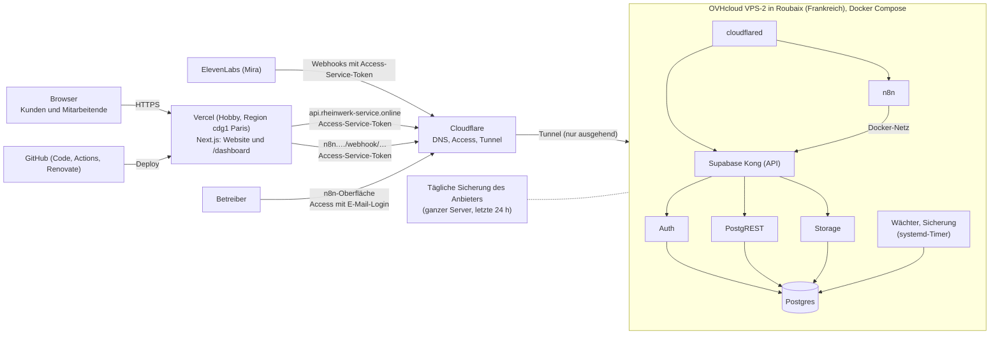

# Betriebskonzept: Betrieb, Datensicherung und Wartung

Diese Seite legt fest, wie RheinWerk dauerhaft läuft, wie Daten gesichert und wiederhergestellt werden und welche Wartung regelmäßig anfällt. Einrichtung der Bausteine: [supabase-lokal.md](supabase-lokal.md), [n8n-workflows.md](n8n-workflows.md), [telefonassistent/setup.md](telefonassistent/setup.md).

## 1. Rahmen und Entscheidung

| Punkt | Festlegung (Nutzerentscheidung 20.10.2026) |
| --- | --- |
| Zweck | Portfolio-Projekt mit Demodaten und realen Testabläufen (Formular, Gmail, Telefonassistent) |
| Kosten | **Stufe 1 ohne laufende Kosten**: keine Server-Miete, kein Supabase-Cloud-Tarif |
| Website | öffentlich unter **`https://rheinwerk-service.online`** |
| n8n und Supabase | vorerst **auf dem eigenen Rechner** (macOS, Docker) |
| Später | **Stufe 2**: Umzug auf einen echten Server, sobald dauerhafte Verfügbarkeit nötig ist |

Bereits vorhanden und genutzt: Domain `rheinwerk-service.online` mit DNS bei Cloudflare, Cloudflare Tunnel (Container `sleepy_margulis`), Cloudflare Access für den n8n-Editor und die Telefon-Webhooks.

## 2. Stufe 1: Betrieb auf dem eigenen Rechner

### 2.1 Aufbau


| Öffentliche Adresse | Ziel im Tunnel | Schutz |
| --- | --- | --- |
| `rheinwerk-service.online` (und `www.`) | noch nicht geschaltet (2.2); vorgesehen: Next.js auf dem Rechner bzw. später auf dem Server | öffentlich; Dashboard nur mit Anmeldung, Pause nach Fehlversuchen, RLS |
| `n8n.rheinwerk-service.online` | `http://host.docker.internal:5678` | Cloudflare Access (Anmeldung); nur `webhook/agent-*` per Service Token für ElevenLabs |
| Supabase | – | **nicht veröffentlicht**: Der Browser spricht nie direkt mit Supabase, nur die App auf dem Server und n8n |

`cloudflared` läuft selbst in Docker; deshalb zeigen die Ziele auf `host.docker.internal` statt `localhost`.

**Warum so:** Der Tunnel baut die Verbindung von innen nach außen auf. Im Router wird kein Port geöffnet, die private IP bleibt verborgen, TLS-Zertifikate verwaltet Cloudflare. Supabase bleibt vollständig im lokalen Netz.

### 2.2 Website unter der Domain schalten

Nutzerentscheidung 21.10.2026 (task-17-17): Bis zum Abschluss des Projekts läuft alles aus dem Entwicklungsordner auf dem eigenen Rechner, die Domain ist noch nicht auf diesen Rechner geschaltet (Cloudflare meldet 522). Die Website kommt erst nach Projektende unter die Domain, Supabase und n8n voraussichtlich auf einen Server (Stufe 2, Abschnitt 3). Dafür dann: gebaute App als Dienst (`next build && next start`), Tunnel-Route bzw. DNS auf das Ziel, eigene `.env.local` für den Betrieb (`N8N_WEBHOOK_URL`, Turnstile-Produktionsschlüssel, `BLOB_READ_WRITE_TOKEN`), Supabase Auth auf die Domain (`site_url`, `additional_redirect_urls`, SMTP nach [setup.md](setup.md#passwort-e-mails-supabase-auth)). Die frühere Produktionskopie auf diesem Rechner (task-17-1 bis 17-6: `~/RheinWerk-Prod` mit Releases je Commit, nächtlichem Code-Update und Rücksetzen) wurde mit task-17-17 entfernt; ihr Code steht in der Git-Historie (bis Commit `284294f`) als Vorlage für den Server.

### 2.3 Dauerbetrieb des Rechners

| Einstellung | Wo | Zweck |
| --- | --- | --- |
| Ruhezustand verhindern | Systemeinstellungen → Energie → „Automatischen Ruhezustand verhindern, wenn das Display aus ist“ | Tunnel, n8n und Zeitpläne laufen weiter |
| Nach Stromausfall starten | Systemeinstellungen → Energie → „Nach Stromausfall automatisch starten“ | Wiederanlauf ohne Eingriff |
| Docker beim Anmelden starten | Docker Desktop → Settings → General → „Start Docker Desktop when you sign in“ | Container starten selbst |
| Container-Neustart | bereits gesetzt: `restart: unless-stopped` für n8n, cloudflared und die Supabase-Container | nach Docker-Neustart automatisch |
| Dienste auf dem Rechner | `npm run ops:install` (unten) | nächtliche Sicherung und Wächter |

**Dienste (task-17-17).** Zwei LaunchAgents laufen aus dem Entwicklungsordner mit dessen `.env.local`; Vorlagen in `ops/launchd/`, eingerichtet und bei Änderung neu geladen mit `npm run ops:install` (wiederholbar; `-- --remove` entfernt beide, alte Dienste der Produktionskopie räumt es mit ab). Protokolle in `~/Library/Logs/RheinWerk/`.

| Dienst | Wann | Skript | Von Hand |
| --- | --- | --- | --- |
| `online.rheinwerk.backup` | täglich 09:00 (Nutzerentscheidung 22.10.2026, der Rechner schläft nachts; verpasste Läufe holt macOS nach dem Aufwachen nach) | `scripts/ops/nightly.mjs`: Sicherung mit Wiederherstellungstest (4.2, 4.3), bei Fehler Warnung `backup:failed` und E-Mail; danach installierte und verfügbare Versionen für den Bereich „System“ (`scripts/ops/versions.mjs`, nur Anzeige, task-17-15) | `npm run nightly` |
| `online.rheinwerk.watchdog` | alle 5 Minuten | `scripts/ops/watchdog.mjs` (Abschnitt 5) | `npm run watchdog` |
| `online.rheinwerk.systemcheck` | alle 20 Sekunden, arbeitet nur bei einer Anfrage | `scripts/ops/check.mjs`: „System prüfen“ aus dem Dashboard (alle Prüfungen einschließlich SMTP und Versionen, task-17-15), Protokoll `systemcheck.log` | `npm run system:check` |

**macOS-Datenschutz:** Ein LaunchAgent darf ohne Freigabe nicht in `~/Documents` lesen (`Operation not permitted`, im Protokoll `node: .env.local: not found`). Deshalb brauchen `/opt/homebrew/bin/node` und `/bin/zsh` „Festplattenvollzugriff“ (Systemeinstellungen → Datenschutz & Sicherheit → Festplattenvollzugriff → „+“, im Dateidialog ⌘⇧G und den Pfad eingeben). Nach `brew upgrade node` ändert sich der Pfad des Programms: Freigabe erneuern, dann `launchctl kickstart gui/$(id -u)/online.rheinwerk.watchdog` und das Protokoll prüfen.

Die Website läuft während der Entwicklung als `next dev` im Terminal (Port 3000) und ist kein Dienst.

### 2.4 Grenzen von Stufe 1 (bewusst akzeptiert)

| Grenze | Folge | Abmilderung |
| --- | --- | --- |
| Rechner aus, im Ruhezustand oder ohne Internet | Website, Dashboard, Formular, Telefonassistent nicht erreichbar | Energieeinstellungen; für Präsentationen vorher prüfen |
| ein Gerät, eine Festplatte | Hardwaredefekt oder Diebstahl = Ausfall | tägliche verschlüsselte Sicherung außerhalb des Rechners (Abschnitt 4) |
| private Internetleitung | begrenzter Upload | für Demo-Last ausreichend; Cloudflare liefert statische Dateien aus dem Cache |
| Wartung am Arbeitsrechner | Neustarts, Updates unterbrechen den Betrieb | Wartung gebündelt (Abschnitt 6) |

**Wiederherstellungsziel Stufe 1:** höchstens 24 Stunden Datenverlust (tägliche Sicherung, RPO), Betrieb auf einem anderen Rechner in etwa 2 Stunden (RTO). E-Mails liegen zusätzlich vollständig in Gmail; die 15-Minuten-Nachlese von Workflow 5 holt Antworten der letzten 7 Tage wieder ein.

## 3. Stufe 2: Umzug auf einen Server

Auslöser für den Umzug: Projektende (Phase 18), echte Kunden oder Mitarbeitende, Erreichbarkeit rund um die Uhr, oder der Arbeitsrechner soll entlastet werden. Zielbild nach Nutzerentscheidung 21.10.2026, ausgearbeitet in task-18-1 (Stand der Preise 21.10.2026, alle Beträge netto ohne MwSt.).

### 3.1 Zielarchitektur



- **Code** auf GitHub (`FuzzCube/RhenWerk-WebSite`), Vercel baut jeden Push auf `main` (task-18-4), GitHub Actions prüfen und spielen Migrationen ein (task-18-5).
- **Website und Dashboard** auf Vercel, Funktionen in Paris (`regions: ["cdg1"]`, wenige Millisekunden vom Server in Roubaix; die Seiten selbst liefert Vercel weiter vom nächsten Knoten aus, für Besucher in Deutschland ohne spürbaren Unterschied). Die Domain `rheinwerk-service.online` und `www` zeigen per DNS auf Vercel.
- **Supabase und n8n** per Docker Compose auf einem VPS. Kein offener Port außer SSH mit Schlüssel; die Dienste sind nur über den Cloudflare-Tunnel erreichbar (ausgehende Verbindung wie heute). Postgres, Studio und die Docker-Ports sind nie öffentlich; Studio bei Bedarf über `ssh -L`.
- **Supabase-API** unter `api.rheinwerk-service.online` hinter Cloudflare Access: nur Anfragen mit Service-Token kommen durch. Das reicht, weil der Browser die API **nie** direkt aufruft (Prüfung task-18-1): alle Zugriffe laufen auf dem Server (Server-Komponenten, Server-Actions, Routen), Dateien über eigene Routen, und der Link zum Zurücksetzen des Passworts führt auf die Website (`/auth/bestaetigen` mit `token_hash`, `verifyOtp` auf dem Server). Realtime wird nicht genutzt.
- **n8n** unter `n8n.rheinwerk-service.online` hinter Cloudflare Access: Oberfläche mit E-Mail-Login des Betreibers, Webhooks nur mit Service-Token (ElevenLabs wie heute, neu auch Vercel für das Anfrageformular und `/api/health`). n8n spricht Supabase im Docker-Netz direkt an, nicht über den Tunnel.
- **Betrieb** auf dem VPS: Wächter, Sicherung und „System prüfen“ als systemd-Timer statt launchd; eigene Sicherung täglich verschlüsselt mit Wiederherstellungstest auf dem VPS (14 Tage), dazu die tägliche Sicherung des ganzen Servers durch den Anbieter (task-18-6). Kein zusätzlicher Speicher außer Haus (Nutzerentscheidung 22.10.2026, Demoprojekt). Warn-E-Mails wie bisher über Gmail SMTP.
- **Bleibt bei externen Diensten:** OpenAI (n8n), ElevenLabs (Mira), Gmail (Versand und Eingang über n8n), Vercel Blob (Uploads des Formulars), Cloudflare Turnstile.

### 3.2 Bedarf und Wahl des Servers

Gemessen am 21.10.2026 auf dem Rechner: alle Container zusammen ca. 3,5 GB RAM, davon für den Betrieb nötig ca. 1,8 GB (Postgres 0,45, n8n 0,5, Kong, PostgREST, Auth, Storage, cloudflared; Studio, Analytics/Logflare, Vector, Inbucket und pg-meta entfallen auf dem Server). Daten: Postgres 68 MB, Dateien 44 MB, n8n 0,8 GB; Docker-Images ca. 15 GB, eine Sicherung ca. 100 MB. Plattenbedarf auf dem Server ca. 15 GB: Images ca. 5,3 GB (Postgres 1,75, Storage 1,4, n8n 1,7, übrige 0,5), vorherige Versionen für den Rückfall ca. 3,5 GB, System ca. 4 GB, Daten 1 GB, eigene Sicherungen 14 × 0,1 GB. Ziel: 4 vCPU, 8 GB RAM (Platz für Sicherung mit Probewiederherstellung und Updates mit Rückfall, task-18-8), ab 40 GB SSD, Rechenzentrum in der EU (DSGVO verlangt EU oder ein Land mit Angemessenheitsbeschluss, nicht Deutschland). Auf jedem Server: 2 GB Swap, `shared_buffers` von Postgres begrenzen, Schwellen des Wächters `DISK_WARN_GB=8`, `DISK_CRITICAL_GB=3`.

| Server | Leistung | Preis/Monat | Stand 21.10.2026 |
| --- | --- | --- | --- |
| **OVHcloud VPS-2** (Roubaix, Frankreich; angeboten außerdem Erith/UK und Warschau, kein deutscher Standort für dieses Angebot) | 4 vCore, 8 GB, 75 GB NVMe, 1 Gbit/s, Traffic unbegrenzt, **tägliche Sicherung inklusive** | 8,58 € inkl. MwSt. (ca. 7,21 € netto) laut Übersicht bei 12 Monaten Vorauszahlung; der Konfigurator zeigte am 22.10.2026 10,10 € inkl. MwSt. (vermutlich ohne Laufzeit), beim Bestellen Modell und Laufzeit prüfen | **gewählt** (Nutzer, 22.10.2026): günstigster Server mit 8 GB, Sicherung des Anbieters ersetzt den Speicher außer Haus |
| OVHcloud VPS-1 | 2 vCore, 4 GB, 40 GB, 500 Mbit/s, tägliche Sicherung | 4,53 € inkl. MwSt. | reicht als Minimum (Betrieb ca. 2,1 GB RAM, Rückfall-Updates knapp); nur mit Swap |
| Hetzner Cloud CX33 | 4 vCPU geteilt, 8 GB, 80 GB NVMe | 8,99 € netto | derzeit „nicht verfügbar“ (alle geteilten Hetzner-Tarife) |
| netcup VPS 1000 G12.5 (Nürnberg) | 4 vCore, 8 GB, 128 GB | 14,50 € netto bei 12 Monaten | Ausweichlösung, bestellbar |
| Supabase Cloud + n8n Cloud | verwaltet | ab ca. 25 € plus n8n Cloud | verworfen: zweite Datenhaltung, Sicherungen erst im bezahlten Tarif, n8n-Workflows müssten umziehen |

Bestellung in task-18-2: OVHcloud VPS-2 in Roubaix (Nutzerentscheidung 22.10.2026; Frankreich ist EU, OVH ist ein französisches Unternehmen, Auftragsverarbeitungsvertrag beim Bestellen annehmen); alle genannten Server sind x86, die heutigen Images laufen unverändert.

### 3.3 Kosten je Monat

| Posten | Betrag | Bemerkung |
| --- | --- | --- |
| VPS OVHcloud VPS-2 (Roubaix) | ca. 7,21 € netto (8,58 € inkl. MwSt.), ohne Laufzeit bis 10,10 € inkl. MwSt. | 12 Monate im Voraus, tägliche Sicherung des Anbieters inklusive |
| Vercel Hobby | 0 € | 100 GB Datenübertragung, 1 Mio. Funktionsaufrufe, 4 h aktive CPU, Laufzeit bis 300 s je Aufruf; bei Überschreitung pausiert das Projekt bis 30 Tage |
| Cloudflare (DNS, Tunnel, Access bis 50 Nutzer) | 0 € | Service-Tokens laufen schon heute im kostenlosen Tarif (Mira) |
| GitHub (öffentliches Repository, Actions, Renovate) | 0 € | |
| **Summe Infrastruktur** | **ca. 7,21 € netto** (8,58 € inkl. MwSt.) | |
| Domain `rheinwerk-service.online` | laut Rechnung des Registrars | jährlich (Abschnitt 6) |
| OpenAI, ElevenLabs | nach Verbrauch und Tarif | unverändert gegenüber heute |
| Bei kommerzieller Nutzung: Vercel Pro | 20 $ je Entwickler-Platz | enthält 20 $ Nutzungsguthaben |

### 3.4 Risiken und Gegenmaßnahmen

| Risiko | Gegenmaßnahme |
| --- | --- |
| **Vercel Hobby nur für nicht-kommerzielle, persönliche Nutzung.** Laut Vercel zählt schon das Bewerben einer Dienstleistung als kommerziell. RheinWerk ist ein fiktives Portfolio-Projekt mit Demodaten, die Website wirbt aber wie ein echter Betrieb. | Auf der Website deutlich als Portfolio- und Demoprojekt kennzeichnen (Hinweis im Fußbereich und im Impressum, task-18-4). Vor jeder echten Nutzung mit Kunden auf Vercel Pro (20 $/Monat) wechseln. |
| **Hobby-Grenzen:** bei Überschreitung pausiert das Projekt bis zu 30 Tage; nur 1 Stunde Laufzeitprotokolle. | Erwartete Last liegt weit darunter (Demo, wenige Aufrufe am Tag; Rechnungs-PDF und Server-Actions brauchen Sekunden, nicht Minuten). Nutzung im Vercel-Dashboard monatlich prüfen (Wartungsplan 6), Bilder statisch. |
| **Öffentliche Supabase-API.** Kong wäre mit dem öffentlichen Schlüssel für jeden erreichbar. | Die API wird nicht öffentlich: Cloudflare Access lässt nur Anfragen mit Service-Token durch (Kopfzeilen im Supabase-Client der Website, task-18-4). Dahinter bleiben RLS, Schreiben nur über RPCs und die Rate-Limits von Auth. Der geheime Schlüssel steht nur als verschlüsselte Umgebungsvariable in Vercel und in `.env` auf dem Server. Neue JWT-Schlüssel statt der Demo-Schlüssel des lokalen Stacks. Service-Token jährlich und bei Verdacht erneuern (Abschnitt 6 und 7). |
| **n8n-Webhooks von Vercel** brauchen nach dem Umzug ebenfalls den Service-Token. | `/api/service-request` und `/api/health` senden die Access-Kopfzeilen mit (task-18-4); die Formular-Probe gehört zur Gesamtprobe (task-18-9). |
| **Ein einzelner Server** ohne Ausfallreserve. | Tägliche Sicherung des ganzen Servers durch den Anbieter (eine Rückkehrmöglichkeit, letzte 24 Stunden) und eigene verschlüsselte Sicherungen mit Wiederherstellungstest auf dem Server (14 Tage, für Datenfehler, die erst später auffallen; task-18-6, 18-7); der Wächter meldet Ausfälle wie heute. |
| **Keine Kopie außer Haus** (Nutzerentscheidung 22.10.2026, Demoprojekt): fällt der Anbieter samt seiner Sicherung aus, sind die Daten weg. | Für Demodaten hingenommen; bei Bedarf eine Sicherung von Hand auf den eigenen Rechner kopieren (`scp`). Vor echter Nutzung einen Speicher außer Haus ergänzen (z. B. Hetzner Storage Box, 3,20 €). |
| **4 GB RAM bei VPS-1** wären knapp. | VPS-2 mit 8 GB gewählt; auf jedem Server 2 GB Swap und begrenzte Postgres-Puffer. |
| **Selbst betriebenes Supabase** unterscheidet sich vom lokalen CLI-Stack (Compose-Datei, Schlüssel, SMTP für Auth-E-Mails, Versionen). | Eigene Compose-Datei im Repository mit festen Image-Versionen wie heute (`supabase services`), SMTP für echte Passwort-Mails (task-18-2); Updates nur mit Sicherung und Rückfall (task-18-8). |
| **Latenz** Vercel ↔ Server über den Tunnel; jede Dashboard-Seite stellt mehrere Abfragen nacheinander. | Vercel-Region `cdg1` (Paris) nahe Roubaix statt `fra1`; nach dem Umzug im Dashboard messen (Gesamtprobe task-18-9). |
| **Server nicht in Deutschland.** | Rechtlich unkritisch: Frankreich ist EU, die DSGVO verlangt keinen deutschen Standort. Hosting (OVHcloud, Frankreich) und Auftragsverarbeitung in der Datenschutzerklärung nennen (task-18-4). Den Standort UK (Erith) nicht wählen: kein EU-Land, nur Angemessenheitsbeschluss. |

**Umzug** (Einzelschritte in task-18-2 bis 18-4): Server mit Docker, Firewall (nur SSH mit Schlüssel) und `unattended-upgrades`; Compose-Stack mit Supabase, n8n und cloudflared; letzte Sicherung vom Rechner nach Abschnitt 4.5 wiederherstellen (Postgres, Storage, n8n-Datenbank **mit Schlüssel**); im Cloudflare-Tunnel die Ziele auf den Server umstellen; Website auf Vercel mit den Umgebungsvariablen; DNS der Domain auf Vercel. Danach Sicherung und Wächter auf dem Server (task-18-6).

### 3.5 Server einrichten (task-18-2)

Eingerichtet am 22.10.2026: OVHcloud VPS-2 `vps-0fcb2edf.vps.ovh.net` (Roubaix), Ubuntu 26.04, 4 vCore, 8 GB RAM, 72 GB. Auf dem Rechner per `ssh vps` erreichbar (Eintrag in `~/.ssh/config`). Auf dem Server können **weitere Projekte** laufen; die Regeln dafür stehen am Ende des Abschnitts.

**Aufbau**

| Was | Wo |
| --- | --- |
| Repository (öffentlich, nur lesend; `git pull`) | `/opt/rheinwerk/app` |
| Geheimnisse für Docker Compose (nur auf dem Server, `chmod 600`) | `/opt/rheinwerk/.env` |
| Umgebung für Wächter und „System prüfen“ | `/opt/rheinwerk/ops.env` |
| Zustand der Dienste (Datei für Datenbank-Ausfall) | `/opt/rheinwerk/state` |
| Compose-Datei, Werkzeuge | `ops/vps/` im Repository |
| Daten | Docker-Volumes `rheinwerk_db-data`, `rheinwerk_db-config`, `rheinwerk_storage-data`, `rheinwerk_n8n-data` |

Compose-Projekt `rheinwerk` (`ops/vps/docker-compose.yml`, Aufruf immer über `ops/vps/compose.sh`): Postgres, API-Gateway (Envoy), Auth, PostgREST, Storage, n8n und cloudflared, alle mit fester Image-Version, `restart: unless-stopped` und Speichergrenze (zusammen höchstens ca. 4,3 GB, im Betrieb ca. 1,2 GB). Abgeleitet aus der offiziellen Compose-Datei von Supabase (Commit `a2ee9a9`, SQL-Dateien und Envoy-Konfiguration unverändert unter `ops/vps/supabase/`); ohne Realtime, Edge Functions, Analytics, Pooler und imgproxy, die RheinWerk nicht nutzt. Die Containernamen beginnen mit `supabase_<dienst>_rheinwerk`, damit Wächter und Sicherung sie wie auf dem Rechner erkennen. Postgres-Puffer begrenzt (`shared_buffers=256MB`).

**Neu aufsetzen** (Voraussetzung: SSH nur mit Schlüssel, `ufw` mit nur `22/tcp`, `unattended-upgrades`; Benutzer mit `sudo`):

```bash
git clone https://github.com/FuzzCube/RhenWerk-WebSite.git /tmp/rw && sh /tmp/rw/ops/vps/setup.sh
# setup.sh (wiederholbar): 2 GB Swap; Docker und Node.js 24 aus den offiziellen Paketquellen; /etc/docker/daemon.json;
# /opt/rheinwerk mit Repository und npm ci; ops/vps/generate-env.sh; systemd-Timer (ops/vps/install-services.sh)
nano /opt/rheinwerk/.env                     # CLOUDFLARE_TUNNEL_TOKEN eintragen (unten)
cd /opt/rheinwerk/app && ops/vps/compose.sh up -d && ops/vps/compose.sh ps
# Schema: Migrationen per psql in Reihenfolge (task-18-2) oder Wiederherstellung einer Sicherung (4.5, task-18-3)
```

`generate-env.sh` erzeugt die Geheimnisse auf dem Server, ohne sie auszugeben, und überschreibt nie eine vorhandene Datei: Postgres-Passwort, neues JWT-Geheimnis mit eigenem Schlüsselpaar (ES256) und neue API-Schlüssel `sb_publishable_…`/`sb_secret_…` statt der Demo-Schlüssel des lokalen Stacks. Für die Website auf Vercel (task-18-4) und n8n gelten diese neuen Schlüssel. Die Werte stehen nur in `/opt/rheinwerk/.env`; anzeigen bei Bedarf mit `grep SUPABASE_ /opt/rheinwerk/.env` auf dem Server.

**Cloudflare-Tunnel des Servers:** Zero Trust → Networks → Tunnels → „Create a tunnel“ (cloudflared), Name `rheinwerk-vps`, den Token aus dem angezeigten Befehl (Teil nach `--token`) in `/opt/rheinwerk/.env` als `CLOUDFLARE_TUNNEL_TOKEN` eintragen, dann `ops/vps/compose.sh up -d cloudflared`. Die öffentlichen Hostnamen bleiben bis zum Umzug (task-18-3) beim Tunnel des Rechners; dann im Tunnel `rheinwerk-vps` eintragen: `api.rheinwerk-service.online` → `http://kong:8000`, `n8n.rheinwerk-service.online` → `http://n8n:5678` (Access-Anwendungen bleiben unverändert).

**Zugang ohne öffentliche Ports:** Postgres `ssh -L 54322:127.0.0.1:54322 vps`, API `ssh -L 54321:127.0.0.1:54321 vps`, n8n `ssh -L 5678:127.0.0.1:5678 vps`. Studio nur bei Bedarf: `ops/vps/compose.sh --profile studio up -d studio`, `ssh -L 54323:127.0.0.1:54323 vps`, http://localhost:54323, danach `ops/vps/compose.sh --profile studio stop studio meta`.

**Wächter und „System prüfen“** laufen als systemd-Timer statt launchd: `rheinwerk-watchdog.timer` (alle 5 Minuten) und `rheinwerk-systemcheck.timer` (alle 20 Sekunden), Units unter `ops/vps/systemd/`, Protokoll `journalctl -u rheinwerk-watchdog`. Umgebung `/opt/rheinwerk/ops.env`: nur Container des Compose-Projekts `rheinwerk` (`DOCKER_COMPOSE_PROJECT`), Supabase-Dienste ohne Realtime (`SUPABASE_REQUIRED_SERVICES`), `DISK_WARN_GB=8`, `DISK_CRITICAL_GB=3`, Website über `WEBSITE_URL` (bis task-18-4 `off`). **Bis zum Umzug (task-18-3) ist `ALERT_EMAILS` leer**, damit Rechner und Server nicht doppelt melden; danach `ALERT_EMAILS`, SMTP-Zugang, `N8N_API_KEY`, ElevenLabs und Access-Token aus `.env.local` ergänzen. Die tägliche Sicherung folgt in task-18-6; die Sicherung des Anbieters lässt sich über die OVHcloud-API abfragen (`GET /1.0/vps/vps-0fcb2edf.vps.ovh.net/automatedBackup` und `…/automatedBackup/restorePoints`, Wiederherstellung `POST …/automatedBackup/restore`, Basis `https://eu.api.ovh.com`; braucht einen API-Schlüssel des OVH-Kontos).

**Updates:** `unattended-upgrades` spielt nur Sicherheitsupdates von Ubuntu ein; Docker, Node.js und die Images werden nicht automatisch aktualisiert (task-18-8). Repository aktualisieren: `git -C /opt/rheinwerk/app pull --ff-only && (cd /opt/rheinwerk/app && npm ci --omit=dev --ignore-scripts)`.

**Weitere Projekte auf dem Server**

- Eigener Ordner `/opt/<projekt>`, eigenes Compose-Projekt (`name:`) und damit eigenes Docker-Netz; keine gemeinsamen Volumes oder Container.
- Keine öffentlichen Ports: `/etc/docker/daemon.json` bindet veröffentlichte Ports standardmäßig an `127.0.0.1` (Docker umgeht `ufw`). Öffentlich nur über einen eigenen Cloudflare-Tunnel je Projekt oder einen gemeinsamen Reverse Proxy; `ufw` bleibt bei `22/tcp`.
- Speichergrenze (`mem_limit`) für jeden Dienst; RheinWerk belegt höchstens ca. 4,3 GB von 8 GB.
- Belegte Ports auf `127.0.0.1` (neue Projekte wählen andere):

| Port | Projekt | Dienst |
| --- | --- | --- |
| 54321 | rheinwerk | Supabase-API (Envoy) |
| 54322 | rheinwerk | Postgres |
| 54323 | rheinwerk | Studio (nur Profil `studio`) |
| 5678 | rheinwerk | n8n |
| 54331 | houseitems | Supabase-API (Envoy) |
| 5679 | houseitems | n8n (Editor per `ssh -L 5679:127.0.0.1:5679 vps`, http://localhost:5679) |
| 54341 | personal-copilot | Supabase-API (Envoy) |

- Eigene systemd-Units mit Präfix `<projekt>-`.

**Projekte auf dem Server** (außer RheinWerk liegen ihre Dateien nur auf dem Server, nicht in diesem Repository; Sicherung bis auf Weiteres nur durch den Anbieter):

| Projekt | Ordner | Inhalt | Öffentlich |
| --- | --- | --- | --- |
| rheinwerk | `/opt/rheinwerk` | Supabase, n8n, Tunnel `rheinwerk-vps` | `n8n.rheinwerk-service.online` (Access) |
| houseitems | `/opt/houseitems` (`docker compose` im Ordner, Geheimnisse in `.env`) | House Items Bot (persönlich, task-18-11): Postgres, PostgREST, Envoy, n8n 2.40.7, Tunnel `houseitems-vps`; ca. 0,6 GB RAM | `bot.rheinwerk-service.online`, nur Pfad `^/webhook/` (Telegram, ohne Access; n8n prüft das Secret-Token von Telegram) |
| personal-copilot | `/opt/personal-copilot` | Personal Copilot (Portfolio, task-18-12): nur Postgres, PostgREST, Envoy; ca. 0,1 GB RAM; Workflows inaktiv im n8n von RheinWerk | nichts (`ssh -L 54341:127.0.0.1:54341 vps`) |

### 3.6 Umzug vom Rechner (task-18-3)

Durchgeführt am 22.10.2026, Unterbrechung von n8n und Mira ca. 15 Minuten. Ablauf (wiederholbar für einen neuen Server):

1. Auf dem Rechner `npm run ops:install -- --remove` (Wächter, „System prüfen“ und Sicherung dort aus), `npm run backup`, sofort danach `docker update --restart=no n8n && docker stop n8n` (sonst laufen Gmail und Zeitpläne doppelt).
2. Archiv per `scp` nach `/opt/rheinwerk/state/import/`, auf dem Server entschlüsseln (Passwort über die Standardeingabe, nicht als Argument) und `sh ops/vps/import-backup.sh <ordner>`: Postgres (`pg_restore --clean`, erwartete Meldungen im Skript erklärt), Storage-Dateien, n8n-Datenbank und Schlüsseldatei; Workflows auf `http://kong:8000`, Credential „RheinWerk Supabase Local“ auf den neuen geheimen Schlüssel. Dann `ops/vps/compose.sh up -d n8n` (fehlende Community-Knoten installiert n8n selbst nach).
3. Cloudflare: Hostname `n8n.rheinwerk-service.online` im alten Tunnel des Rechners löschen und im Tunnel `rheinwerk-vps` mit `HTTP` → `n8n:5678` anlegen; die Access-Anwendung bleibt.
4. `/opt/rheinwerk/ops.env` aus `env.local` der Sicherung ergänzen (SMTP, `N8N_API_KEY`, ElevenLabs, Access-Token, `HEALTH_TOKEN`, `BACKUP_PASSPHRASE`, zuletzt `ALERT_EMAILS`), entschlüsselte Kopie löschen.

Ergebnis: Zeilenzahlen wie im Manifest (1 573 Anfragen, 87 Kunden, 3 197 Nachrichten, 377 Konten, 72 Storage-Objekte, 102 Dateien, 68 Migrationen, 7 pg_cron-Aufträge), 9 Workflows aktiv, `test:agent` über den Tunnel bestanden (150–400 ms je Werkzeug), Testanfrage über den Tunnel angelegt (`RIS-2026-02761`) mit Eingangsbestätigung per Gmail und KI-Entwurf. `api.rheinwerk-service.online` wird erst in task-18-4 zusammen mit seiner Access-Anwendung angelegt.

**Danach auf dem Rechner:** n8n gestoppt (ohne Neustart-Regel), Dienste von launchd entfernt; das lokale Supabase bleibt als Entwicklungsumgebung, seine Daten sind ab dem 22.10.2026 nicht mehr aktuell. Der alte Tunnel (Container `sleepy_margulis`) hat keine Hostnamen mehr und wird in task-18-13 gelöscht.

### 3.7 Website auf Vercel (task-18-4)

Seit 22.10.2026 läuft die Website mit Dashboard auf Vercel (Einrichtung, Variablen, Rückweg und Tarifgrenzen in [setup.md](setup.md#deployment-auf-vercel)); `api.rheinwerk-service.online` im Tunnel `rheinwerk-vps` auf `kong:8000`, geschützt durch die Access-Anwendung „RheinWerk API“ (Service Auth, Token „ElevenLabs Mira“). Ohne Token antworten `api.` und die Webhooks von `n8n.` mit 403, der Browser erreicht beide nie direkt. Die Access-Anwendung für das Formular deckt `webhook/rheinwerk-service-request`, `webhook-test/…` und `healthz` ab (vorher Bypass, seit 22.10.2026 Service Auth). Health-Check `https://rheinwerk-service.online/api/health` (mit `HEALTH_TOKEN`: Commit, Datenbank und n8n mit Dauer, ca. 150–170 ms). Der Wächter auf dem VPS prüft sie alle 5 Minuten (`WEBSITE_URL=https://rheinwerk-service.online` in `/opt/rheinwerk/ops.env`).

### 3.8 Prüfung und Deployment mit GitHub Actions (task-18-5)

`.github/workflows/ci.yml`: Bei jedem Pull Request und Push laufen `lint`, `typecheck`, `test:unit` und `build`. Nur bei einem Push auf `main` und nur wenn alles grün ist, folgen:

1. **Sicherung und Migrationen auf dem VPS**: GitHub meldet sich mit einem eigenen SSH-Schlüssel an, der in `~/.ssh/authorized_keys` nur `ops/vps/migrate.sh` ausführen darf (`command="…",restrict`: keine Shell, keine Weiterleitung); der Commit wird als Argument übergeben. Das Skript setzt `/opt/rheinwerk/app` auf den Commit (nur Commits aus `origin/main`), aktualisiert bei geändertem `package-lock.json` die Pakete der Dienste, sichert die Datenbank (`/opt/rheinwerk/state/pre-migration/`, die letzten 10) und spielt nur Migrationen ein, die noch nicht in `supabase_migrations.schema_migrations` stehen, jede in einer Transaktion; danach lädt PostgREST das Schema neu. Ohne neue Migration keine Sicherung. **Nur hinzufügende Migrationen:** `DROP TABLE/COLUMN/SCHEMA` bricht ab; solche Änderungen von Hand mit Sicherung einspielen (`sh ops/vps/migrate.sh` ist dafür nicht gedacht, sondern psql nach 4.5).
2. **Deployment auf Vercel** mit `vercel deploy --prod` (Token `VERCEL_TOKEN`). Vercel baut Pushes nicht mehr selbst (`vercel.json` `git.deploymentEnabled: false`), damit ein roter Test oder eine gescheiterte Migration das Deployment verhindert.

Geheimnisse im Repository (Settings → Secrets): `VPS_HOST`, `VPS_KNOWN_HOSTS`, `VPS_SSH_KEY` (nur in GitHub, keine Kopie auf dem Rechner), `VERCEL_TOKEN` (Vercel → Account → Tokens, „github-actions“), `VERCEL_ORG_ID`, `VERCEL_PROJECT_ID`. Schlüssel erneuern: neues Paar erzeugen, Zeile mit `github-actions-rheinwerk-deploy` in `authorized_keys` ersetzen, `gh secret set VPS_SSH_KEY < key`, lokale Kopie löschen.

**Updates:** Dependabot (`.github/dependabot.yml`) öffnet montags gesammelte PRs für npm-Pakete und die Images in `ops/vps/docker-compose.yml`, monatlich für die Actions. Jeder PR durchläuft die Prüfungen; gemergt wird von Hand, Images nur mit Sicherung und Rückfall (task-18-8). Nach dem Merge eines Image-Updates zusätzlich auf dem VPS `ops/vps/compose.sh up -d` (das Deployment aktualisiert nur das Repository, nicht die Container).

## 4. Datensicherung

**Seit 22.10.2026 auf dem VPS (task-18-6).** Die Abschnitte 4.1 bis 4.3 gelten unverändert (dieselben Skripte); Unterschiede auf dem Server:

| Was | Auf dem VPS |
| --- | --- |
| Zeitplan | täglich 03:00 (Europe/Berlin), systemd `rheinwerk-backup.timer` → `scripts/ops/nightly.mjs` (Sicherung, Probewiederherstellung, Versionen); Protokoll `journalctl -u rheinwerk-backup` |
| Von Hand | im Dashboard „System“ → **Jetzt sichern** (nur admin; Manager 42501), ausgeführt von `rheinwerk-systemcheck` innerhalb von 20 Sekunden; oder `sudo systemctl start rheinwerk-backup.service` |
| Ablage | `/opt/rheinwerk/backups/rheinwerk-<zeit>.tar.gz.enc`, 14 Tage (`BACKUP_KEEP_DAYS`), verschlüsselt mit `BACKUP_PASSPHRASE` aus `/opt/rheinwerk/ops.env` |
| Inhalt | wie 4.1, statt `.env.local` die Dateien `/opt/rheinwerk/.env` (im Archiv `env`) und `/opt/rheinwerk/ops.env` (`BACKUP_SECRET_FILES`); Storage aus `/var/lib/storage` (`SUPABASE_STORAGE_PATH`); `sqlite3` auf dem Server installiert |
| Vor Migrationen | `ops/vps/migrate.sh` (Deployment, 3.8) sichert nur Postgres nach `/opt/rheinwerk/state/pre-migration/` (die letzten 10), in der Liste als „Vor Migration“ ohne Probewiederherstellung |
| Liste | Tabelle `public.backups` (Zeitpunkt, Anlass, Größe, Inhalt, Prüfung, Fehler; 90 Tage), im Bereich „System“ die letzten 14 Tage; lesen nur admin und manager |
| Wiederherstellen | im Bereich „System“ → Liste der Sicherungen → **Wiederherstellen** (nur admin; Manager 42501), Abschnitt 4.5 |
| Warnungen | `backup:failed` (Sicherung oder Prüfung gescheitert, kritisch, E-Mail), `backup:stale` (letzte geprüfte Sicherung älter als 26 Stunden oder keine; Wächter alle 5 Minuten), `backup:provider` (Sicherung des Anbieters aus, kein Sicherungspunkt der letzten 48 Stunden oder API nicht abrufbar) |
| Sicherung des Anbieters | OVHcloud sichert täglich den ganzen Server (im Tarif). Der Wächter fragt stündlich `GET /vps/vps-0fcb2edf.vps.ovh.net/automatedBackup` und `…/restorePoints` mit einem nur lesenden Schlüssel (`OVH_APPLICATION_KEY`, `OVH_APPLICATION_SECRET`, `OVH_CONSUMER_KEY` in `ops.env`, angelegt am 22.10.2026 über `eu.api.ovh.com/createToken` mit `GET` auf `…/automatedBackup`; das Recht auf `…/restorePoints` fehlt, weil das `*` im Link verloren ging, deshalb wird nur der Zustand geprüft: eingeschaltet, täglich 09:42, 1 Sicherungspunkt). Für die Prüfung des letzten Sicherungspunkts einen Schlüssel mit zusätzlich `GET /vps/vps-0fcb2edf.vps.ovh.net/automatedBackup/restorePoints` anlegen. Wiederherstellen des ganzen Servers nur im OVHcloud-Kundencenter (`POST …/automatedBackup/restore`, setzt den Server auf den Stand des Sicherungspunkts zurück) |

Kopie außer Haus (4.4) entfällt nach Nutzerentscheidung 22.10.2026 (Demoprojekt); bei Bedarf ein Archiv per `scp vps:/opt/rheinwerk/backups/<datei> .` auf den Rechner holen. Wiederherstellung auf dem VPS: im Dashboard (4.5, task-18-7); eine Sicherung des Rechners einmalig mit `ops/vps/import-backup.sh` (3.6).

### 4.1 Was gesichert wird

| Bestandteil | Inhalt | Wie | Ohne Sicherung verloren? |
| --- | --- | --- | --- |
| Postgres | alle Tabellen inkl. Anmeldedaten (Auth), Storage-Metadaten, Funktionen, pg_cron-Aufträge, Migrationsstand | `pg_dump -Fc` (in sich konsistent, im laufenden Betrieb) | **ja** |
| Storage-Dateien | Formularanhänge, E-Mail-Anhänge, Einsatzfotos (Bucket `dashboard`) | `tar` aus dem Volume des Storage-Containers | **ja** |
| n8n-Datenbank | Workflows, Credentials (verschlüsselt), Ausführungsverlauf | Container `n8n` wird für wenige Sekunden pausiert (`docker pause`), Datenbank samt WAL kopiert, danach lokal zusammengeführt. Die laufende Datenbank wird **nie** vom Rechner aus geöffnet: Am 20.10.2026 hat ein `sqlite3 .backup` vom Mac auf die Live-Datei n8n für zwei Stunden an seiner Schreibsperre hängen lassen (kein Versand, keine Analyse), behoben durch Neustart | Workflows: nein (im Repository), Credentials: **ja** |
| n8n-Schlüssel `~/n8n/data/config` | Schlüssel, mit dem n8n die Credentials verschlüsselt | Dateikopie, **nur in verschlüsselter Sicherung** | **ja** – ohne ihn sind alle Credentials unbrauchbar |
| `.env.local` | Schlüssel für Supabase, Telefonassistent, Cloudflare, Turnstile, Blob | Dateikopie, **nur in verschlüsselter Sicherung** | teilweise neu erzeugbar, aber mühsam |

Nicht in der Sicherung, weil anderswo vorhanden: Quellcode und Workflow-Exporte (GitHub), Docker-Images (werden neu geladen), `node_modules` (`npm ci`), E-Mails (Gmail), Konfiguration der externen Dienste (Cloudflare, Google Cloud, OpenAI, ElevenLabs; in dieser Dokumentation beschrieben).

### 4.2 Sicherung erstellen

```bash
npm run backup
```

Ergebnis: eine Datei `~/RheinWerk-Backups/rheinwerk-<Zeitstempel>.tar.gz.enc` (Stand 20.10.2026: ca. 72 MB, 10 Sekunden) mit `postgres.dump`, `storage.tar.gz`, `n8n-database.sqlite`, `n8n-config`, `env.local` und `manifest.json` (Zeilenzahlen, Prüfsummen).

| Einstellung (`.env.local` oder Umgebung) | Standard | Bedeutung |
| --- | --- | --- |
| `BACKUP_PASSPHRASE` | – | **Pflicht für eine vollständige Sicherung.** Verschlüsselt das Archiv (AES-256, PBKDF2 mit 200 000 Runden). Ohne sie: unverschlüsselt, ohne n8n-Schlüssel und `.env.local`, mit Warnung |
| `BACKUP_DIR` | `~/RheinWerk-Backups` | Zielordner |
| `BACKUP_KEEP_DAYS` | 14 | Aufbewahrung in Tagen; ältere Sicherungen löscht jeder Lauf von `npm run backup`, die neueste bleibt immer |
| `N8N_CONTAINER` | `n8n` | Name des n8n-Containers |

> Die Passphrase gehört in einen Passwort-Manager, **nicht nur** in `.env.local`: Ist der Rechner verloren, ist auch `.env.local` weg, und ohne Passphrase lässt sich keine Sicherung öffnen.

### 4.3 Sicherung prüfen (Wiederherstellungstest)

```bash
npm run backup:check            # neueste Sicherung
npm run backup:check -- <datei> # bestimmte Sicherung
```

Der Test entschlüsselt das Archiv, prüft alle Prüfsummen, stellt Postgres in eine **getrennte Datenbank `backup_check`** wieder her, vergleicht die Zeilenzahlen von elf Kerntabellen mit dem Manifest, prüft Passwort-Hashes, Storage-Dateien, die n8n-Datenbank (`integrity_check`, Workflows) und den n8n-Schlüssel. Danach wird `backup_check` gelöscht; die laufenden Daten werden nicht berührt.

Ergebnis vom 20.10.2026: alle Prüfungen bestanden (829 Anfragen, 113 Konten, 2 950 Nachrichten, 53 Storage-Dateien, 28 n8n-Workflows, davon 8 RheinWerk aktiv), Dauer ca. 5 Sekunden.

> Eine Sicherung gilt erst als vorhanden, wenn ihre Wiederherstellung geprüft ist.

### 4.4 Zeitplan und Aufbewahrung (3-2-1-Regel)

| Was | Wann | Wo |
| --- | --- | --- |
| Sicherung + Prüfung | bis 22.10.2026 täglich 09:00 auf dem Rechner (`launchd` `online.rheinwerk.backup`), seitdem auf dem VPS (oben) | `~/RheinWerk-Backups`, ältere als 14 Tage löscht jeder Lauf |
| Kopie außer Haus | täglich mit (Ordner in iCloud Drive/Google Drive) oder wöchentlich manuell | Cloud-Ordner, verschlüsselt |
| Monatssicherung | am 1. jedes Monats | externe SSD, 12 Monate aufbewahren |

3 Kopien (Original, lokale Sicherung, extern), 2 Medien (interne SSD, externe SSD/Cloud), 1 außer Haus. Weil die Archive verschlüsselt sind, dürfen sie in einen Cloud-Ordner.

Der Nachtlauf (`scripts/ops/nightly.mjs`, task-17-17; von task-17-5 bis 17-16 war er Teil des nächtlichen Code-Updates der Produktionskopie) sichert mit `backup` und prüft mit `backup:check`. Scheitert eins davon, bekommt der Admin eine Warnung mit E-Mail (`backup:failed`), der nächste gute Lauf behebt sie. Protokoll: `~/Library/Logs/RheinWerk/backup.log`.

### 4.5 Wiederherstellung

**Auf dem VPS im Dashboard (seit 22.10.2026, task-18-7).** Bereich „System“ → „Sicherungen der letzten 14 Tage“ → **Wiederherstellen** in der Zeile der gewünschten Sicherung → Rückfrage lesen, `WIEDERHERSTELLEN` eingeben → **Wiederherstellen**. Der Knopf steht nur bei Sicherungen, die so wiederhergestellt werden können: geprüft, vollständig (täglich, von Hand oder vor einer Wiederherstellung), höchstens 14 Tage alt und mit demselben Migrationsstand wie die Datenbank. Nur die Rolle Admin sieht ihn.

Ablauf (`scripts/ops/restore-run.mjs`, vom Dienst `rheinwerk-systemcheck` innerhalb von 20 Sekunden übernommen, Protokoll `journalctl -u rheinwerk-systemcheck`):

| Schritt | Was passiert | Bei Fehler |
| --- | --- | --- |
| 1. Sicherung davor | geprüfte Sicherung des aktuellen Stands, in der Liste als „Vor Wiederherstellung“ | Abbruch, nichts verändert |
| 2. Wiederherstellung (`scripts/restore.mjs`) | n8n angehalten; Auth, REST und Storage angehalten; `pg_restore --clean` über `postgres`; Rechte (GRANT/REVOKE) genau wie in der Sicherung (unten); Zeilenzahlen wie im Manifest; Storage-Ordner geleert und aus dem Archiv gefüllt; Datenbank und Schlüssel von n8n ersetzt, n8n gestartet | Rückkehr (Schritt 4) |
| 3. Gesundheitsprüfung | Auth, REST und Storage antworten über das Gateway, n8n `/healthz` | Rückkehr (Schritt 4) |
| 4. Rückkehr | dieselbe Wiederherstellung mit der Sicherung aus Schritt 1, danach dieselbe Prüfung | Warnung `restore:failed`: von Hand weiter (unten) |
| 5. Ergebnis | E-Mail an den Admin; im Bereich „System“ „Letzte Wiederherstellung“ mit Zustand und Fehler; ein Fehlschlag ist die kritische Warnung `restore:failed`, die nächste gelungene Wiederherstellung schließt sie | – |

Unverändert bleiben dabei die Tabellen `backups`, `restores`, `image_updates`, `system_alerts` und `system_status` (Liste, Anfrage und Warnungen gehen nicht zurück) sowie `/opt/rheinwerk/.env` und `ops.env`. Website, Dashboard und n8n sind etwa eine Minute nicht erreichbar; wer sich nach der Sicherung angemeldet hat, muss sich neu anmelden. Während der Wiederherstellung (Datei `/opt/rheinwerk/state/restore.lock`, höchstens 30 Minuten) prüft der Wächter nicht und die tägliche Sicherung entfällt. Rückgängig machen: die Sicherung „Vor Wiederherstellung“ genauso wiederherstellen.

**Rechte nach `pg_restore`:** `pg_restore` legt jedes Objekt als `supabase_admin` neu an, und die Standardrechte von Supabase geben `anon` und `authenticated` dabei alles; der Dump enthält nur die Abweichungen von den Grundrechten, die `revoke`-Anweisungen der Migrationen gingen also verloren (RLS schützt die Zeilen weiter, aber die zweite Schutzschicht fehlt). Gefunden am 22.10.2026: betroffen war der VPS seit dem Import (task-18-3, `import-backup.sh`). `scripts/restore.mjs` setzt deshalb nach `pg_restore` die Rechte aller neu angelegten Objekte (ohne Objekte von Erweiterungen) zurück und spielt die Rechte des Dumps ein; nur die Rechte im Schema `public` aus einer Sicherung mit gleichem Migrationsstand: `node --env-file=<env> scripts/restore.mjs --acl <archiv>`. Prüfen: `supabase test db` (lokal) bzw. `select has_table_privilege('authenticated', 'public.profiles', 'UPDATE')` muss `f` sein.

Probe am 22.10.2026 auf einer Kopie (lokaler Supabase-Stack mit den Daten vom Rechner, n8n in einem eigenen Container ohne Netz): Testkonto und Testdatei nach der Sicherung wieder verschwunden, Liste und Anfrage erhalten, 40 Sekunden; mit absichtlichem Fehler nach `pg_restore` und nach Storage (`RESTORE_FAIL_AFTER=pg_restore|storage`) jeweils Rückkehr zum Stand davor, Zustand „Fehlgeschlagen, Stand davor zurück“, Warnung `restore:failed`. Nach Wiederherstellung und Rückkehr alle 1 170 pgTAP-Tests bestanden (Rechte unverändert).

**Von Hand auf dem VPS** (Sicherung mit anderem Migrationsstand, Sicherung vor einer Migration oder nach `restore:failed`): zuerst „Jetzt sichern“ bzw. `sudo systemctl start rheinwerk-backup.service`. Eine vollständige Sicherung mit gleichem Migrationsstand: `cd /opt/rheinwerk/app && node --env-file=/opt/rheinwerk/ops.env scripts/restore.mjs /opt/rheinwerk/backups/<datei>` (ohne Gesundheitsprüfung und Rückkehr). Eine Sicherung vor einer Migration (`/opt/rheinwerk/state/pre-migration/*.dump`, nur Postgres): wie Schritt 1 unten mit `supabase_db_rheinwerk`, danach `ops/vps/compose.sh restart rest`. Bei einem älteren Migrationsstand danach die fehlenden Migrationen mit `sh ops/vps/migrate.sh <commit>` einspielen.

**Auf dem Rechner (Stufe 1) und von Hand:**

**Vorher:** App und n8n anhalten, damit niemand schreibt (`next dev` im Terminal beenden, `docker stop n8n`). Die aktuellen Daten zuerst selbst sichern (`npm run backup`), falls die Wiederherstellung rückgängig gemacht werden muss.

```bash
# 0. Archiv entpacken
openssl enc -d -aes-256-cbc -pbkdf2 -iter 200000 -in rheinwerk-<zeit>.tar.gz.enc -out r.tar.gz -pass env:BACKUP_PASSPHRASE
tar -xzf r.tar.gz && cd rheinwerk-<zeit>

# 1. Postgres (auf neuem Rechner vorher: supabase start)
docker cp postgres.dump supabase_db_A.Sadkovojs_Project:/tmp/r.dump
docker exec supabase_db_A.Sadkovojs_Project pg_restore -U supabase_admin -d postgres --clean --if-exists /tmp/r.dump
#    erwartet: wenige Meldungen "cannot drop inherited constraint messages_<datum>_pkey" (Realtime-Partitionen, harmlos)

# 2. Storage-Dateien
docker exec -i supabase_storage_A.Sadkovojs_Project tar -xzf - -C /mnt < storage.tar.gz

# 3. n8n (Container gestoppt)
cp n8n-database.sqlite ~/n8n/data/database.sqlite && rm -f ~/n8n/data/database.sqlite-wal ~/n8n/data/database.sqlite-shm
cp n8n-config ~/n8n/data/config
docker start n8n

# 4. Umgebung und Neustart
cp env.local <projekt>/.env.local
docker restart supabase_rest_A.Sadkovojs_Project      # Schema-Cache neu laden
npm run supabase:check && npm run demo:verify
```

Danach: Anmeldung im Dashboard, n8n → Executions (Zeitpläne laufen grün), ein Testformular. Das Verfahren (`--clean` über eine bestehende Datenbank) wurde am 20.10.2026 an der Prüfdatenbank getestet: Zeilenzahlen identisch.

**Kompletter Verlust des Rechners:** neuer Rechner → Voraussetzungen und `supabase start` nach [supabase-lokal.md](supabase-lokal.md) → n8n-Container nach [n8n-workflows.md](n8n-workflows.md#7-einrichtung-von-grund-auf) (ohne Workflows zu importieren) → Schritte 0–4 → Cloudflare-Tunnel-Container mit dem Token aus dem Cloudflare-Konto starten. Ziel: etwa 2 Stunden.

## 5. Überwachung

| Was | Wie | Wer reagiert |
| --- | --- | --- |
| Website erreichbar | kostenloser Uptime-Monitor (z. B. UptimeRobot) auf `https://rheinwerk-service.online/api/health` (200 = ok, 503 = Datenbank nicht erreichbar), Benachrichtigung per E-Mail | Betreiber |
| Gesundheitsprüfung | `curl -H "Authorization: Bearer $HEALTH_TOKEN" localhost:3000/api/health`: Commit (`dev` im Entwicklungsordner), Datenbank und n8n mit Laufzeit (task-17-4); ohne Token nur der Status | Betreiber |
| Offene Warnungen | Hinweis oben auf jeder Dashboard-Seite für Manager und Admin, Liste offener und behobener Warnungen im Bereich „System“; Admin kann „Erledigt“ setzen (task-17-10) | Inhaber sieht es, Betreiber handelt |
| E-Mail-Versand | Hinweis „E-Mail-Versand hängt“ oben im Dashboard nach 10 Minuten (task-12-9) | Dispatcher melden, Betreiber verbindet Gmail neu |
| n8n-Läufe | n8n → Executions, rote Läufe; `docker logs n8n --since 1h` | Betreiber |
| Automatisierung | Dashboard → Auswertung → Automatisierung (Anteil, Läufe mit Fehlern) | Manager |
| Automatisierung (task-17-8) | Wächter `online.rheinwerk.watchdog` alle 5 Minuten (`scripts/ops/n8n.mjs`, über die n8n-API mit `N8N_API_KEY`): n8n erreichbar, Workflows aktiv, Zeitpläne laufen, Versandstau > 10 min, KI-Analysen > 15 min offen; fehlgeschlagene Läufe meldet der Error-Workflow „RheinWerk · Fehlermeldung“. Warnung im Bereich „System“, E-Mail an den Admin. Einzelheiten [n8n-workflows.md](n8n-workflows.md#8-überwachung-und-typische-störungen) | Betreiber (E-Mail) |
| Telefonassistent (task-17-9) | Wächter `online.rheinwerk.watchdog` alle 5 Minuten (`scripts/ops/watchdog.mjs`, `npm run watchdog` von Hand, Protokoll `~/Library/Logs/RheinWerk/watchdog.log` nur bei Fehlern): Agent bei ElevenLabs, Guthaben (Schwellwert `MIRA_CREDIT_MIN`, Standard 10 % des Kontingents), Werkzeug-Webhook über Tunnel und Cloudflare Access (Probe `agent-anlage-pruefen`, schreibt nichts), Gesprächsauswertung 30 Minuten nach Gesprächsende, ab 3 fehlgeschlagenen Werkzeugaufrufen in der letzten Stunde. Warnung im Bereich „System“ und E-Mail an den Admin (neuer Vorfall, Erinnerung nach 6 Stunden, „Wieder in Ordnung“); Ergebnis und Guthaben in `system_status.monitoring`. Ohne `ELEVENLABS_API_KEY` „nicht eingerichtet“, ohne Warnung. Einzelheiten `docs/telefonassistent/setup.md` | Betreiber (E-Mail), Inhaber sieht den Zustand |
| Zustand der Systeme (task-17-15) | Wächter `online.rheinwerk.watchdog` alle 5 Minuten (`scripts/ops/systems.mjs`): Website (`/api/health` auf `WEBSITE_URL`, Standard `http://127.0.0.1:3000`), Datenbank (Abfrage mit Dauer), Cloudflare-Tunnel (Container `cloudflare/cloudflared` läuft, offene Verbindungen aus seinem Protokoll), E-Mail-Versand (Anmeldung bei Gmail ohne Versand, nur stündlich, damit Google nicht alle 5 Minuten eine Anmeldung sieht), Docker (Pflicht-Container von Supabase und n8n laufen, kein laufender Container „unhealthy“), Speicherplatz (Warnung unter `DISK_WARN_GB` = 20 GB, kritisch unter `DISK_CRITICAL_GB` = 5 GB). Warnungen mit Schlüssel `system:*` und Quelle „Zustand der Systeme“, E-Mail an den Admin. Fällt die Datenbank aus, geht die E-Mail ohne Warnungseintrag direkt raus (höchstens alle 6 Stunden, gemerkt in `~/Library/Logs/RheinWerk/datenbank-ausfall.json`). „System prüfen“ (nur Admin) startet alle Prüfungen sofort, etwa nach einem manuellen Update von Docker Desktop | Betreiber (E-Mail), Inhaber sieht den Zustand |
| Versionen (task-17-15) | jede Nacht und bei „System prüfen“: Docker Desktop (Appcast von Docker), Supabase CLI (npm-Registry), Supabase-Images (laufende Container gegen `supabase services`), n8n, Node.js (nodejs.org, gleiche Hauptversion, Hinweis auf neuere LTS), npm-Pakete (`npm outdated`). Bereich „System“ zeigt Installiert, Verfügbar, Empfehlung („Aktuell“, „Update empfohlen“, „Neue Hauptversion“) mit Vorgehen und Link zu den Release Notes. Nur Anzeige, das Dashboard installiert nichts (Nutzerentscheidung 21.10.2026) | Betreiber nach Wartungsplan (6) |
| Sicherung | Warnung `backup:failed` mit E-Mail; `~/Library/Logs/RheinWerk/backup.log`: letzte Zeile „Sicherung ist wiederherstellbar“ | Betreiber, wöchentlich |
| Speicherplatz | Warnung `system:speicher` (oben); Ursachen mit `df -h`, `docker system df` | Betreiber |


## 6. Wartungsplan

**Systemupdates auf dem VPS (seit 22.10.2026, task-18-8).** Neue Versionen von Supabase, n8n und Tunnel kommen als Dependabot-PR für `ops/vps/docker-compose.yml` (montags). Release Notes im PR lesen, mergen; das Deployment bringt die Datei auf den Server, die Container laufen aber weiter mit dem alten Image. Im Bereich „System“ → Systemversionen zeigt die Zeile **Images (Server)** „Update bereit“ mit den Diensten; Admin: **Update einspielen** → Rückfrage → `scripts/ops/update-run.mjs` über `rheinwerk-systemcheck` (Protokoll `journalctl -u rheinwerk-systemcheck`):

| Schritt | Was passiert | Bei Fehler |
| --- | --- | --- |
| 1. Sicherung | geprüfte Sicherung, in der Liste „Vor Systemupdate“ | Abbruch, nichts verändert |
| 2. Images laden | `docker compose pull` der geänderten Dienste, alles läuft weiter | Abbruch, die alten Images bleiben gepinnt |
| 3. Schnappschuss | alle Dienste angehalten, jedes Volume (Datenbank, Konfiguration, Storage, n8n) als tar nach `/opt/rheinwerk/state/snapshots/<zeit>/` (nur der neueste bleibt) | Rückfall |
| 4. Start und Selbsttest | `up -d` mit den neuen Images; nur lesend: Migrationsstand wie im Repository, Rollenrechte (authenticated liest Anfragen, ändert keine Profile; anon liest nichts), REST, Auth (Kontenliste), Storage (neueste Datei laden), n8n `/healthz`, gleiche Zahl aktiver Workflows wie vorher, Workflow **„RheinWerk · Selbsttest“** (`GET http://127.0.0.1:5678/webhook/rheinwerk-selbsttest`, liest mit dem Supabase-Credential eine Zeile) | Rückfall |
| 5. Rückfall | Dienste angehalten, Volumes aus dem Schnappschuss, geänderte Dienste auf das alte Image gepinnt (`/opt/rheinwerk/state/images.override.yml`, liest `compose.sh` mit), Start, Selbsttest | Warnung `update:failed`, von Hand weiter (unten) |
| 6. Ergebnis | E-Mail an den Admin; „Letzte Systemupdates“ unter Systemversionen; Fehlschlag als kritische Warnung `update:failed` | – |

Dauer: einige Minuten, Website und n8n sind dabei kurz nicht erreichbar. Während des Updates prüft der Wächter nicht und die tägliche Sicherung entfällt (Sperre `maintenance.lock`, wie bei der Wiederherstellung). Ein gepinnter Dienst zeigt weiter „Update bereit“: Ursache beheben und erneut einspielen, oder den PR zurücknehmen (`git revert`), danach Pin-Datei löschen. Probe des Rückfalls: `touch /opt/rheinwerk/state/update-fail-selftest` lässt den ersten Selbsttest scheitern (danach Datei löschen). Rückfall von Hand: `ops/vps/compose.sh stop`, je Volume `docker run --rm -v rheinwerk_<volume>:/v -v <schnappschuss>:/s:ro --entrypoint sh <db-image> -c 'find /v -mindepth 1 -delete && tar --numeric-owner -xpf /s/rheinwerk_<volume>.tar -C /v'`, alte Images in `images.override.yml`, `ops/vps/compose.sh up -d`.

Probe am 22.10.2026 auf dem VPS: envoy v1.39.1 → v1.40.0 mit `update-fail-selftest` → Rückfall in 90 Sekunden (Volumes aus dem Schnappschuss, envoy gepinnt, Selbsttest danach bestanden, Warnung `update:failed`); danach dasselbe Update ohne Probe eingespielt (Pin entfernt, Warnung geschlossen). Anschließend Dependabot-PRs #2–#5 in einem Lauf: Postgres 17.6.1.136 → 17.11.0.005, n8n 2.40.7 → 2.44.4, PostgREST v14.18 → v16.4, Storage v1.81.0 → v1.84.1, gut 2 Minuten (davon 1 Minute Images laden), Selbsttest bestanden, alle Systeme in Ordnung.

Website-Assistent (task-18-10): Wissensbasis nach einer Änderung an `n8n/rag-documents` mit `sh ops/vps/rag-import.sh` neu aufbauen ([n8n-workflows.md](n8n-workflows.md#9-website-assistent-task-18-10)).

Der Workflow „RheinWerk · Selbsttest“ (`n8n/generate_selftest_workflow.py`) muss in n8n importiert und aktiv sein, sonst scheitert jedes Update am Selbsttest; der Wächter meldet ihn wie alle Workflows des Repositorys, wenn er fehlt oder inaktiv ist.

| Rhythmus | Aufgabe | Befehl / Ort |
| --- | --- | --- |
| täglich 09:00 (automatisch) | Sicherung + Wiederherstellungstest, Versionen für den Bereich „System“ | `launchd` `online.rheinwerk.backup` |
| alle 5 Minuten (automatisch) | Zustand aller Systeme mit Warnung und E-Mail (SMTP stündlich) | `launchd` `online.rheinwerk.watchdog` |
| nach jedem manuellen Update | „System prüfen“ im Bereich „System“ (Admin) oder `npm run system:check`; Zustand und Versionen müssen danach stimmen | Dashboard |
| täglich (automatisch, Datenbank) | Transkripte > 30 Tage, Widget-Sitzungen > 90 Tage löschen; Zahlungserinnerungen; Eskalationen | pg_cron, [supabase-lokal.md](supabase-lokal.md#6-werkzeuge-im-alltag) |
| wöchentlich | `backup.log` prüfen; n8n-Executions auf rote Läufe durchsehen; Dashboard-Hinweise | 5 Minuten |
| monatlich | Bereich „System“ → Systemversionen: Empfehlungen und Release Notes durchsehen; „Update empfohlen“ (gleiche Hauptversion) nach Sicherung einspielen, „Neue Hauptversion“ nur einzeln und mit Tests; Sicherheitsupdates: `npm audit`, Next.js-Patchversion, macOS; Monatssicherung auf externe SSD; Kosten bei OpenAI und ElevenLabs prüfen; `docker system df`, alte Images entfernen (`docker image prune`) | [setup.md](setup.md#abhängigkeiten-und-sicherheitsmeldungen) |
| wöchentlich (VPS) | Dependabot-PRs: Release Notes lesen, mergen, „Update einspielen“ (oben); Hauptversionen einzeln | GitHub, Bereich „System“ |
| vierteljährlich | lokale Entwicklungsumgebung: Supabase CLI und Images (`brew upgrade supabase`, `supabase stop && supabase start`); Benutzerkonten prüfen (ausgeschiedene deaktivieren); vollständige Wiederherstellung auf einem zweiten Rechner oder in einer VM üben | |
| jährlich | Geheimnisse erneuern: `AGENT_WEBHOOK_SECRET` (`n8n/bootstrap_agent_secret.py`), Cloudflare-Service-Token für ElevenLabs (läuft nach der eingestellten Dauer ab), OpenAI- und ElevenLabs-Schlüssel; Domain `rheinwerk-service.online` verlängern; Datenschutz-Löschfristen überprüfen | |
| bei Bedarf | Gmail-Zugang neu verbinden, wenn Google ihn widerruft (Passwortänderung, Sicherheitsprüfung) | Abschnitt 7 |

**Code-Updates (task-17-5 bis 17-6, entfernt mit task-17-17):** Das nächtliche Update aus `origin/main`, die Releases je Commit und das Rücksetzen gehörten zur Produktionskopie `~/RheinWerk-Prod` und entfallen, solange alles aus dem Entwicklungsordner läuft (Nutzerentscheidung 21.10.2026). Die Tabellen `system_releases`, `system_updates` und `update_requests` bleiben ungenutzt erhalten; der Code steht in der Git-Historie bis `284294f`.

**Regeln bei Änderungen:**

1. Prüfungen: `npm run lint && npm run typecheck && npm run test:unit && npm run test:db`.
2. Neue Migrationen nur hinzufügend schreiben und mit `supabase migration up` einspielen (nie `supabase db reset`), danach `npm run db:types`.
3. Geänderte n8n-Workflows aus `n8n/workflows/` importieren.
4. Bei Datenproblemen die Sicherung der Nacht nach 4.5.

**Einmalige Datenübernahmen** laufen nach demselben Muster: Probelauf mit Bericht, Freigabe, Sicherung, Ausführung. Beispiel Kundenstamm (task-14-3): bearbeitete Live-Anfragen ohne Kunden nachträglich zuordnen.

```bash
npm run customers:backfill                            # Probelauf: Bericht, nichts wird geändert
npm run backup && npm run customers:backfill -- --apply  # Ausführung, verlangt eine Sicherung aus der letzten Stunde
```

Ein zweiter Lauf findet nichts mehr (Anfragen mit offenem Vorschlag warten auf die Entscheidung auf der Anfrageseite).

## 7. Notfallanleitungen

| Notfall | Erkennen | Sofortmaßnahme | Danach |
| --- | --- | --- | --- |
| **Gmail-Zugang abgelaufen** (geschehen am 19.10.2026: Versand fiel aus, Eingangsbestätigungen blieben liegen) | Dashboard-Hinweis „E-Mail-Versand hängt“; Logs „needs to be reconnected“ | n8n über `https://n8n.rheinwerk-service.online` öffnen → Credentials → „RheinWerk Gmail“ → *Reconnect* | wartende E-Mails gehen innerhalb einer Minute automatisch raus; Google-Cloud-Projekt muss auf *In production* stehen (sonst Ablauf nach 7 Tagen) |
| **Website nicht erreichbar** (erst nach dem Schalten der Domain, 2.2) | Uptime-Monitor | Rechner wach? `docker ps` (cloudflared läuft?), läuft die App? | App neu starten |
| **Datenbank versehentlich zurückgesetzt** (`supabase db reset`) oder beschädigt | Dashboard leer, Anmeldung scheitert | App und n8n anhalten | Wiederherstellung 4.5 aus der letzten Sicherung |
| **Daten versehentlich gelöscht oder verfälscht** (VPS) | Rückmeldung von Mitarbeitern, fehlende Anfragen oder Dateien | Zeitpunkt eingrenzen; nichts weiter ändern | Admin: „System“ → letzte Sicherung vor dem Fehler → **Wiederherstellen** (4.5). Alles danach Eingegebene geht verloren; es steht in der Sicherung „Vor Wiederherstellung“ |
| **Systemupdate fehlgeschlagen** | E-Mail und kritische Warnung `update:failed`; „Letzte Systemupdates“ im Bereich „System“ | „Stand von vorher läuft“: nichts tun, die alten Images sind gepinnt | Fehler und Release Notes lesen; beheben und erneut „Update einspielen“ oder den Dependabot-PR zurücknehmen. Ist auch der Rückfall gescheitert: Rückfall von Hand (Abschnitt 6), sonst Wiederherstellung der Sicherung „Vor Systemupdate“ (4.5) |
| **Website-Assistent antwortet nicht** („Der Assistent ist momentan nicht erreichbar“) | Website-Widget; Warnung `n8n:fehler:rwAssistent2026` | `curl` mit Service-Token auf `/webhook/rheinwerk-assistant` (403: Pfad fehlt in Cloudflare Access „RheinWerk Webhook“; 404: Workflow nicht aktiv) | Workflow aktivieren; leere Wissensbasis: `sh ops/vps/rag-import.sh`; OpenAI-Guthaben prüfen |
| **Wiederherstellung fehlgeschlagen** | E-Mail und kritische Warnung `restore:failed`; „Letzte Wiederherstellung“ im Bereich „System“ | Text der Warnung lesen: „Stand davor zurück“ heißt, das System läuft mit den Daten von vorher | Ursache aus dem Fehler und `journalctl -u rheinwerk-systemcheck` beheben, erneut wiederherstellen; ist die Rückkehr gescheitert: `ops/vps/compose.sh ps`, fehlende Container starten, Sicherung „Vor Wiederherstellung“ von Hand wiederherstellen (4.5) |
| **Rechner defekt oder gestohlen** | – | Domain zeigt Fehlerseite von Cloudflare | Abschnitt 4.5 „Kompletter Verlust“ auf neuem Rechner oder direkt Stufe 2 |
| **n8n-Credentials unbrauchbar** („could not decrypt“) | n8n-Fehler in allen Workflows | `~/n8n/data/config` aus der Sicherung zurückkopieren | Schlüssel nie neu erzeugen, solange alte Credentials gebraucht werden |
| **KI-Analyse fällt aus** (OpenAI-Guthaben, Schlüssel) | Erstbearbeitungen bleiben „neu“ | Schlüssel/Guthaben prüfen | Zeitplan holt offene Analysen nach; bis dahin bearbeiten Dispatcher manuell |
| **n8n führt nichts mehr aus** (Logs `LockAcquireTimeoutError … SqliteWriteConnectionMutex`; geschehen am 20.10.2026 nach Zugriff auf die Live-Datenbank vom Rechner aus) | Dashboard-Hinweis „E-Mail-Versand hängt“, n8n-Executions ohne neue Läufe | `docker restart n8n`, danach `pragma integrity_check` auf einer Kopie | wartende E-Mails gehen danach automatisch raus; nie mit Werkzeugen des Rechners auf `~/n8n/data/database.sqlite` zugreifen, solange n8n läuft |
| **Sicherung fehlgeschlagen** | E-Mail „Tägliche Sicherung fehlgeschlagen“, Warnung `backup:failed` | `docker ps` (Supabase und n8n laufen?), `df -h`, `tail -50 ~/Library/Logs/RheinWerk/backup.log` | `npm run nightly` erneut; der gute Lauf behebt die Warnung |
| **Dienst läuft nicht** (Bereich „System“ zeigt „Prüfung veraltet“) | Protokoll `node: .env.local: not found` oder `Operation not permitted` | Festplattenvollzugriff für node und zsh (2.3), `npm run ops:install` | `launchctl kickstart gui/$(id -u)/online.rheinwerk.watchdog` |
| **Festplatte voll** | Warnung „Wenig Speicherplatz“ (`system:speicher`, ab 20 GB frei, kritisch unter 5 GB); sonst Docker-Fehler, Sicherung scheitert | `docker system df`, `docker image prune`, alte Container entfernen (`docker ps -a`), alte Sicherungen auslagern | `BACKUP_KEEP_DAYS` verkleinern, „System prüfen“ |
| **Container ausgefallen** | Warnung „Container … gestört“ (`system:container`), Zeile Docker „Gestört“ | Supabase: `supabase stop && supabase start` im Entwicklungsordner; n8n: `docker start n8n` | „System prüfen“; nach einem Neustart von n8n meldet der Wächter API und Werkzeuge erst nach 3 Minuten wieder (Anlaufzeit) |
| **Verdacht auf kompromittierten Schlüssel** | – | betroffenen Schlüssel beim Anbieter bzw. mit dem Bootstrap-Skript erneuern (Agent-Secret, Cloudflare-Service-Token, OpenAI, ElevenLabs, Google-OAuth-Client); die Supabase-Schlüssel sind in Stufe 1 nur im eigenen Rechner nutzbar, weil Supabase nicht veröffentlicht ist (in Stufe 2 im Supabase-Projekt rotieren) | Zugriffe in Cloudflare Access und n8n-Executions prüfen |

## 8. Zuständigkeit und Zugänge

Betreiber in Stufe 1 ist eine Person (Projektinhaber). Benötigte Konten, deren Zugangsdaten im Passwort-Manager liegen (nicht im Repository):

| Konto | Wofür |
| --- | --- |
| GitHub `FuzzCube/RhenWerk-WebSite` | Quellcode, Workflow-Exporte, Dokumentation |
| Cloudflare | Domain, DNS, Tunnel-Token, Access, Turnstile |
| Google Cloud + Gmail `rheinwerk.industrieservice@gmail.com` | Postfach, OAuth-Client für n8n |
| OpenAI | KI-Analyse (Abrechnung nach Verbrauch) |
| ElevenLabs | Telefonassistentin, Guthaben |
| Vercel | Blob-Speicher für Formular-Uploads |
| Passwort-Manager | `BACKUP_PASSPHRASE`, n8n-Besitzerkonto, Demo-Passwort |
