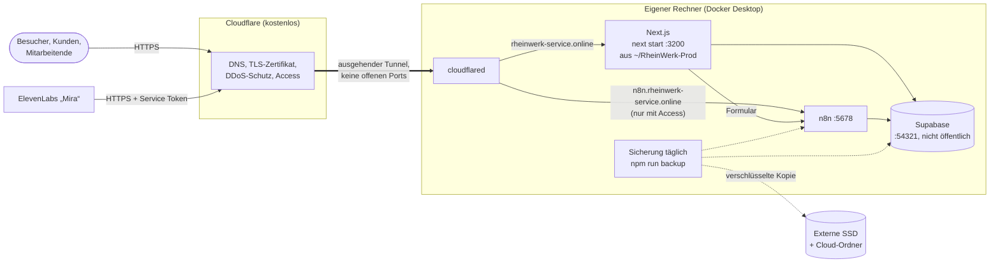

# Betriebskonzept: Betrieb, Datensicherung und Wartung

Diese Seite legt fest, wie RheinWerk dauerhaft läuft, wie Daten gesichert und wiederhergestellt werden und welche Wartung regelmäßig anfällt. Einrichtung der Bausteine: [supabase-lokal.md](supabase-lokal.md), [n8n-workflows.md](n8n-workflows.md), [telefonassistent/setup.md](telefonassistent/setup.md).

## 1. Rahmen und Entscheidung

| Punkt | Festlegung (Nutzerentscheidung 20.10.2026) |
| --- | --- |
| Zweck | Portfolio-Projekt mit Demodaten und realen Testabläufen (Formular, Gmail, Telefonassistent) |
| Kosten | **Stufe 1 ohne laufende Kosten**: keine Server-Miete, kein Supabase-Cloud-Tarif |
| Website | öffentlich unter **`https://rheinwerk-service.online`** |
| n8n und Supabase | vorerst **auf dem eigenen Rechner** (macOS, Docker) |
| Später | **Stufe 2**: Umzug auf einen echten Server, sobald dauerhafte Verfügbarkeit nötig ist |

Bereits vorhanden und genutzt: Domain `rheinwerk-service.online` mit DNS bei Cloudflare, Cloudflare Tunnel (Container `sleepy_margulis`), Cloudflare Access für den n8n-Editor und die Telefon-Webhooks.

## 2. Stufe 1: Betrieb auf dem eigenen Rechner

### 2.1 Aufbau



| Öffentliche Adresse | Ziel im Tunnel | Schutz |
| --- | --- | --- |
| `rheinwerk-service.online` (und `www.`) | `http://host.docker.internal:3200` (Next.js aus der Produktionskopie) | öffentlich; Dashboard nur mit Anmeldung, Pause nach Fehlversuchen, RLS |
| `n8n.rheinwerk-service.online` | `http://host.docker.internal:5678` | Cloudflare Access (Anmeldung); nur `webhook/agent-*` per Service Token für ElevenLabs |
| Supabase | – | **nicht veröffentlicht**: Der Browser spricht nie direkt mit Supabase, nur die App auf dem Server und n8n |

`cloudflared` läuft selbst in Docker; deshalb zeigen die Ziele auf `host.docker.internal` statt `localhost`.

**Warum so:** Der Tunnel baut die Verbindung von innen nach außen auf. Im Router wird kein Port geöffnet, die private IP bleibt verborgen, TLS-Zertifikate verwaltet Cloudflare. Supabase bleibt vollständig im lokalen Netz.

### 2.2 Website unter der Domain schalten

1. **Produktionskopie und Dienst einrichten:** `npm run prod:install && npm run prod:release` (Port 3200, Abschnitt 2.3).
2. **Tunnel-Route anlegen:** Cloudflare Zero Trust → Networks → Tunnels → Tunnel → *Public Hostname* → `rheinwerk-service.online`, Service `HTTP`, URL `host.docker.internal:3200`; ebenso `www`.
3. **`.env.local` für den Betrieb** (`~/RheinWerk-Prod/shared/.env.local`, nicht die des Entwicklungsordners):
   - `N8N_WEBHOOK_URL=http://127.0.0.1:5678/webhook/rheinwerk-service-request` (App und n8n auf demselben Rechner)
   - Turnstile: Produktionsschlüssel für die Domain `rheinwerk-service.online` (`NEXT_PUBLIC_TURNSTILE_SITE_KEY`, `TURNSTILE_SECRET_KEY`)
   - `BLOB_READ_WRITE_TOKEN` bleibt (Vercel Blob, kostenloser Umfang)
4. **Supabase Auth auf die Domain stellen** (Links in Passwort-Mails): in `supabase/config.toml` `site_url = "https://rheinwerk-service.online"` und die Domain in `additional_redirect_urls`; danach `supabase stop && supabase start` (Daten bleiben erhalten). Für echte Passwort-Mails SMTP nach [setup.md](setup.md#passwort-e-mails-supabase-auth).
5. **Prüfen:** `https://rheinwerk-service.online` öffnen, Formular absenden (RIS-Nummer kommt), unter `/login` anmelden.

### 2.3 Dauerbetrieb des Rechners

| Einstellung | Wo | Zweck |
| --- | --- | --- |
| Ruhezustand verhindern | Systemeinstellungen → Energie → „Automatischen Ruhezustand verhindern, wenn das Display aus ist“ | Tunnel, n8n und Zeitpläne laufen weiter |
| Nach Stromausfall starten | Systemeinstellungen → Energie → „Nach Stromausfall automatisch starten“ | Wiederanlauf ohne Eingriff |
| Docker beim Anmelden starten | Docker Desktop → Settings → General → „Start Docker Desktop when you sign in“ | Container starten selbst |
| Container-Neustart | bereits gesetzt: `restart: unless-stopped` für n8n, cloudflared und die Supabase-Container | nach Docker-Neustart automatisch |
| App als Dienst | `launchd`-Auftrag `online.rheinwerk.web` (unten) | `next start` startet beim Anmelden und nach Absturz neu |

**Produktionskopie (task-17-1).** Der Betrieb läuft nicht aus dem Entwicklungsordner, sondern aus `~/RheinWerk-Prod`. So berühren Updates nie laufende Entwicklungsarbeit, und der Rückweg auf eine frühere Version ist nur das Umschalten eines Symlinks.

| Pfad | Inhalt |
| --- | --- |
| `repo/` | Klon von `origin` (GitHub), Quelle jedes Releases |
| `releases/<commit>/` | ein gebautes Release je Commit (`git archive`, `npm ci`, `next build`), `release.json` mit Commit, Betreff, Bauzeit, letzter Migration; die neuesten 3 bleiben (`PROD_KEEP_RELEASES`), das aktive nie gelöscht |
| `current` | Symlink auf das aktive Release (App-Dienst) |
| `tools` | Symlink auf das neueste gebaute Release; Update- und Anfrage-Dienst starten ihre Skripte von dort, damit ein Rücksetzen der App keine älteren Update-Skripte zurückbringt |
| `skip-commit` | nach einem Rücksetzen der Commit, den die Nacht überspringt, bis `origin/main` weiterzieht |
| `shared/.env.local` | Umgebung für alle Releases (Modus 600), jedes Release verlinkt darauf; beim ersten `prod:install` aus dem Entwicklungsordner kopiert |
| `logs/` | `web.log` (Dienst), `release.log` (Umschaltungen), `update.log` (Nachtlauf), `requests.log` (Dashboard-Anfragen), `build-<commit>.log` |

```bash
npm run prod:install                      # einmalig: Ordner, Klon, shared/.env.local, LaunchAgent (wiederholbar)
npm run prod:release                      # origin/main bauen (falls neu), umschalten, Dienst neu starten, prüfen
npm run prod:release -- <commit|branch>   # anderen Stand von origin bauen und aktivieren
npm run prod:release -- --no-switch       # nur bauen
npm run prod:release -- --switch <commit> # auf ein vorhandenes Release zurück, ohne Neubau
```

Ein fehlgeschlagener Build lässt `current` unverändert. Antwortet die App nach dem Umschalten 90 Sekunden lang nicht mit dem Commit des neuen Releases auf `/api/health` (Releases vor task-17-4 ohne diese Route: `/login` mit 200), schaltet das Skript auf das vorherige Release zurück und endet mit Fehler (geprüft am 21.10.2026 mit einem absichtlich leeren Release). Nur ein Lauf gleichzeitig (`~/RheinWerk-Prod/.lock`; bleibt er nach einem Absturz liegen, löschen). Der Rückweg betrifft nur den Code: Migrationen eines späteren Releases bleiben in der Datenbank (Daten zurück nur über 4.5).

**Port 3200:** Port 3000 bleibt `next dev` im Entwicklungsordner vorbehalten. Entwicklung und Betrieb nutzen in Stufe 1 dieselbe lokale Supabase-Datenbank; Testläufe (`test:ui`, `test:api`) hinterlassen ihre Testdaten deshalb auch im Betrieb.

Der LaunchAgent entsteht aus der Vorlage `ops/launchd/online.rheinwerk.web.plist` (`npm run prod:install` setzt Pfad und Port ein): `zsh -lc` lädt das Benutzerprofil, damit `node` im Pfad ist; `cd ~/RheinWerk-Prod/current` löst den Symlink bei jedem Start neu auf; `KeepAlive` startet nach einem Absturz neu (geprüft mit `kill -9`).

Neustart: `launchctl kickstart -k gui/$(id -u)/online.rheinwerk.web`; anhalten: `launchctl bootout gui/$(id -u) ~/Library/LaunchAgents/online.rheinwerk.web.plist`; wieder laden: `npm run prod:install`.

### 2.4 Grenzen von Stufe 1 (bewusst akzeptiert)

| Grenze | Folge | Abmilderung |
| --- | --- | --- |
| Rechner aus, im Ruhezustand oder ohne Internet | Website, Dashboard, Formular, Telefonassistent nicht erreichbar | Energieeinstellungen; für Präsentationen vorher prüfen |
| ein Gerät, eine Festplatte | Hardwaredefekt oder Diebstahl = Ausfall | tägliche verschlüsselte Sicherung außerhalb des Rechners (Abschnitt 4) |
| private Internetleitung | begrenzter Upload | für Demo-Last ausreichend; Cloudflare liefert statische Dateien aus dem Cache |
| Wartung am Arbeitsrechner | Neustarts, Updates unterbrechen den Betrieb | Wartung gebündelt (Abschnitt 6) |

**Wiederherstellungsziel Stufe 1:** höchstens 24 Stunden Datenverlust (tägliche Sicherung, RPO), Betrieb auf einem anderen Rechner in etwa 2 Stunden (RTO). E-Mails liegen zusätzlich vollständig in Gmail; die 15-Minuten-Nachlese von Workflow 5 holt Antworten der letzten 7 Tage wieder ein.

## 3. Stufe 2: Umzug auf einen Server

Auslöser für den Umzug: echte Kunden oder Mitarbeitende, Erreichbarkeit rund um die Uhr nötig, oder der Arbeitsrechner soll entlastet werden.

| Variante | Kosten/Monat | Bewertung |
| --- | --- | --- |
| **A. Ein virtueller Server mit Docker Compose** (z. B. Hetzner CX32: 4 vCPU, 8 GB RAM, 80 GB, Rechenzentrum Deutschland) mit Supabase self-hosted, n8n, Next.js, cloudflared | ca. 7–8 € | **empfohlen**: gleiche Container wie heute, Umzug mit den vorhandenen Sicherungsskripten, Daten in Deutschland (DSGVO) |
| B. Oracle Cloud „Always Free“ | 0 € | die kleinen AMD-Instanzen (1 GB RAM) reichen **nicht**; die Ampere-A1-Instanz (bis 4 Kerne, 24 GB RAM) würde reichen, ist aber oft nicht verfügbar, ARM-Images nötig, kein Support |
| C. Verwaltete Dienste: Supabase Cloud (Region Frankfurt) + Vercel + n8n Cloud oder kleiner Server für n8n | 0 € im kostenlosen Umfang, ab ca. 25 € mit Sicherungen | wenig Pflege; kostenloses Supabase pausiert bei Inaktivität und hat keine täglichen Sicherungen |

**Umzug nach Variante A** (mit den Werkzeugen aus Abschnitt 4):

1. Server mit Docker, Firewall (nur SSH mit Schlüssel), automatischen Sicherheitsupdates (`unattended-upgrades`).
2. Repository klonen, Supabase-Stack starten, n8n- und cloudflared-Container wie heute.
3. Letzte Sicherung mit `npm run backup` erstellen, auf den Server kopieren, nach Abschnitt 4.5 wiederherstellen (Postgres, Storage, n8n-Datenbank **mit Schlüssel**).
4. Im Cloudflare-Tunnel die Ziele auf den Server umstellen (oder dort einen neuen Tunnel mit denselben Hostnamen). DNS bleibt unverändert; der Wechsel dauert Minuten.
5. Sicherung auf dem Server per `cron` täglich, Kopie außer Haus (z. B. Hetzner Storage Box, ca. 4 €).

## 4. Datensicherung

### 4.1 Was gesichert wird

| Bestandteil | Inhalt | Wie | Ohne Sicherung verloren? |
| --- | --- | --- | --- |
| Postgres | alle Tabellen inkl. Anmeldedaten (Auth), Storage-Metadaten, Funktionen, pg_cron-Aufträge, Migrationsstand | `pg_dump -Fc` (in sich konsistent, im laufenden Betrieb) | **ja** |
| Storage-Dateien | Formularanhänge, E-Mail-Anhänge, Einsatzfotos (Bucket `dashboard`) | `tar` aus dem Volume des Storage-Containers | **ja** |
| n8n-Datenbank | Workflows, Credentials (verschlüsselt), Ausführungsverlauf | Container `n8n` wird für wenige Sekunden pausiert (`docker pause`), Datenbank samt WAL kopiert, danach lokal zusammengeführt. Die laufende Datenbank wird **nie** vom Rechner aus geöffnet: Am 20.10.2026 hat ein `sqlite3 .backup` vom Mac auf die Live-Datei n8n für zwei Stunden an seiner Schreibsperre hängen lassen (kein Versand, keine Analyse), behoben durch Neustart | Workflows: nein (im Repository), Credentials: **ja** |
| n8n-Schlüssel `~/n8n/data/config` | Schlüssel, mit dem n8n die Credentials verschlüsselt | Dateikopie, **nur in verschlüsselter Sicherung** | **ja** – ohne ihn sind alle Credentials unbrauchbar |
| `.env.local` | Schlüssel für Supabase, Telefonassistent, Cloudflare, Turnstile, Blob | Dateikopie, **nur in verschlüsselter Sicherung** | teilweise neu erzeugbar, aber mühsam |

Nicht in der Sicherung, weil anderswo vorhanden: Quellcode und Workflow-Exporte (GitHub), Docker-Images (werden neu geladen), `node_modules` (`npm ci`), E-Mails (Gmail), Konfiguration der externen Dienste (Cloudflare, Google Cloud, OpenAI, ElevenLabs; in dieser Dokumentation beschrieben).

### 4.2 Sicherung erstellen

```bash
npm run backup
```

Ergebnis: eine Datei `~/RheinWerk-Backups/rheinwerk-<Zeitstempel>.tar.gz.enc` (Stand 20.10.2026: ca. 72 MB, 10 Sekunden) mit `postgres.dump`, `storage.tar.gz`, `n8n-database.sqlite`, `n8n-config`, `env.local` und `manifest.json` (Zeilenzahlen, Prüfsummen).

| Einstellung (`.env.local` oder Umgebung) | Standard | Bedeutung |
| --- | --- | --- |
| `BACKUP_PASSPHRASE` | – | **Pflicht für eine vollständige Sicherung.** Verschlüsselt das Archiv (AES-256, PBKDF2 mit 200 000 Runden). Ohne sie: unverschlüsselt, ohne n8n-Schlüssel und `.env.local`, mit Warnung |
| `BACKUP_DIR` | `~/RheinWerk-Backups` | Zielordner |
| `BACKUP_KEEP_DAYS` | 14 | Aufbewahrung in Tagen; ältere Sicherungen löscht jeder Lauf von `npm run backup`, die neueste bleibt immer |
| `N8N_CONTAINER` | `n8n` | Name des n8n-Containers |

> Die Passphrase gehört in einen Passwort-Manager, **nicht nur** in `.env.local`: Ist der Rechner verloren, ist auch `.env.local` weg, und ohne Passphrase lässt sich keine Sicherung öffnen.

### 4.3 Sicherung prüfen (Wiederherstellungstest)

```bash
npm run backup:check            # neueste Sicherung
npm run backup:check -- <datei> # bestimmte Sicherung
```

Der Test entschlüsselt das Archiv, prüft alle Prüfsummen, stellt Postgres in eine **getrennte Datenbank `backup_check`** wieder her, vergleicht die Zeilenzahlen von elf Kerntabellen mit dem Manifest, prüft Passwort-Hashes, Storage-Dateien, die n8n-Datenbank (`integrity_check`, Workflows) und den n8n-Schlüssel. Danach wird `backup_check` gelöscht; die laufenden Daten werden nicht berührt.

Ergebnis vom 20.10.2026: alle Prüfungen bestanden (829 Anfragen, 113 Konten, 2 950 Nachrichten, 53 Storage-Dateien, 28 n8n-Workflows, davon 8 RheinWerk aktiv), Dauer ca. 5 Sekunden.

> Eine Sicherung gilt erst als vorhanden, wenn ihre Wiederherstellung geprüft ist.

### 4.4 Zeitplan und Aufbewahrung (3-2-1-Regel)

| Was | Wann | Wo |
| --- | --- | --- |
| Sicherung + Prüfung | täglich 02:00 als erster Schritt des nächtlichen Updates (`launchd` `online.rheinwerk.update`, Abschnitt 6; verpasste Läufe holt macOS nach dem Aufwachen nach) | `~/RheinWerk-Backups`, ältere als 14 Tage löscht jeder Lauf |
| Kopie außer Haus | täglich mit (Ordner in iCloud Drive/Google Drive) oder wöchentlich manuell | Cloud-Ordner, verschlüsselt |
| Monatssicherung | am 1. jedes Monats | externe SSD, 12 Monate aufbewahren |

3 Kopien (Original, lokale Sicherung, extern), 2 Medien (interne SSD, externe SSD/Cloud), 1 außer Haus. Weil die Archive verschlüsselt sind, dürfen sie in einen Cloud-Ordner.

Seit task-17-5 gibt es keinen eigenen Sicherungsauftrag mehr (der frühere `online.rheinwerk.backup` wird nicht eingerichtet): Der nächtliche Update-Lauf sichert jede Nacht zuerst mit `backup` und `backup:check` aus dem aktiven Release, auch ohne neuen Commit. Scheitert die Sicherung, folgt kein Update, und der Admin bekommt eine Warnung mit E-Mail (`backup:failed`). Protokoll: `~/RheinWerk-Prod/logs/update.log`.

### 4.5 Wiederherstellung

**Vorher:** App und n8n anhalten, damit niemand schreibt (`launchctl unload …web.plist`, `docker stop n8n`). Die aktuellen Daten zuerst selbst sichern (`npm run backup`), falls die Wiederherstellung rückgängig gemacht werden muss.

```bash
# 0. Archiv entpacken
openssl enc -d -aes-256-cbc -pbkdf2 -iter 200000 -in rheinwerk-<zeit>.tar.gz.enc -out r.tar.gz -pass env:BACKUP_PASSPHRASE
tar -xzf r.tar.gz && cd rheinwerk-<zeit>

# 1. Postgres (auf neuem Rechner vorher: supabase start)
docker cp postgres.dump supabase_db_A.Sadkovojs_Project:/tmp/r.dump
docker exec supabase_db_A.Sadkovojs_Project pg_restore -U supabase_admin -d postgres --clean --if-exists /tmp/r.dump
#    erwartet: wenige Meldungen "cannot drop inherited constraint messages_<datum>_pkey" (Realtime-Partitionen, harmlos)

# 2. Storage-Dateien
docker exec -i supabase_storage_A.Sadkovojs_Project tar -xzf - -C /mnt < storage.tar.gz

# 3. n8n (Container gestoppt)
cp n8n-database.sqlite ~/n8n/data/database.sqlite && rm -f ~/n8n/data/database.sqlite-wal ~/n8n/data/database.sqlite-shm
cp n8n-config ~/n8n/data/config
docker start n8n

# 4. Umgebung und Neustart
cp env.local <projekt>/.env.local
docker restart supabase_rest_A.Sadkovojs_Project      # Schema-Cache neu laden
npm run supabase:check && npm run demo:verify
```

Danach: Anmeldung im Dashboard, n8n → Executions (Zeitpläne laufen grün), ein Testformular. Das Verfahren (`--clean` über eine bestehende Datenbank) wurde am 20.10.2026 an der Prüfdatenbank getestet: Zeilenzahlen identisch.

**Kompletter Verlust des Rechners:** neuer Rechner → Voraussetzungen und `supabase start` nach [supabase-lokal.md](supabase-lokal.md) → n8n-Container nach [n8n-workflows.md](n8n-workflows.md#7-einrichtung-von-grund-auf) (ohne Workflows zu importieren) → Schritte 0–4 → Cloudflare-Tunnel-Container mit dem Token aus dem Cloudflare-Konto starten. Ziel: etwa 2 Stunden.

## 5. Überwachung

| Was | Wie | Wer reagiert |
| --- | --- | --- |
| Website erreichbar | kostenloser Uptime-Monitor (z. B. UptimeRobot) auf `https://rheinwerk-service.online/api/health` (200 = ok, 503 = Datenbank nicht erreichbar), Benachrichtigung per E-Mail | Betreiber |
| Gesundheitsprüfung | `curl -H "Authorization: Bearer $HEALTH_TOKEN" localhost:3200/api/health`: Commit des laufenden Releases, Datenbank und n8n mit Laufzeit (task-17-4); ohne Token nur der Status | Betreiber |
| E-Mail-Versand | Hinweis „E-Mail-Versand hängt“ oben im Dashboard nach 10 Minuten (task-12-9) | Dispatcher melden, Betreiber verbindet Gmail neu |
| n8n-Läufe | n8n → Executions, rote Läufe; `docker logs n8n --since 1h` | Betreiber |
| Automatisierung | Dashboard → Auswertung → Automatisierung (Anteil, Läufe mit Fehlern) | Manager |
| Telefonassistent (task-17-9) | Wächter `online.rheinwerk.watchdog` alle 5 Minuten (`scripts/prod/watchdog.mjs`, `npm run prod:watchdog` von Hand, Protokoll `logs/watchdog.log` nur bei Fehlern): Agent bei ElevenLabs, Guthaben (Schwellwert `MIRA_CREDIT_MIN`, Standard 10 % des Kontingents), Werkzeug-Webhook über Tunnel und Cloudflare Access (Probe `agent-anlage-pruefen`, schreibt nichts), Gesprächsauswertung 30 Minuten nach Gesprächsende, ab 3 fehlgeschlagenen Werkzeugaufrufen in der letzten Stunde. Warnung im Bereich „System“ und E-Mail an den Admin (neuer Vorfall, Erinnerung nach 6 Stunden, „Wieder in Ordnung“); Ergebnis und Guthaben in `system_status.monitoring`. Ohne `ELEVENLABS_API_KEY` „nicht eingerichtet“, ohne Warnung. Einzelheiten `docs/telefonassistent/setup.md` | Betreiber (E-Mail), Inhaber sieht den Zustand |
| Sicherung | `~/RheinWerk-Backups/backup.log`: letzte Zeile „Sicherung ist wiederherstellbar“ | Betreiber, wöchentlich |
| Speicherplatz | `df -h`, `docker system df` | Betreiber, monatlich |

Nächster sinnvoller Ausbau: ein n8n-*Error Workflow*, der bei jedem fehlgeschlagenen Lauf eine E-Mail an den Betreiber schickt (in n8n unter Settings → Error Workflow je Workflow eintragbar).

## 6. Wartungsplan

| Rhythmus | Aufgabe | Befehl / Ort |
| --- | --- | --- |
| täglich 02:00 (automatisch) | Sicherung + Wiederherstellungstest, danach Update aus `origin/main` (unten) | `launchd` `online.rheinwerk.update` |
| täglich (automatisch, Datenbank) | Transkripte > 30 Tage, Widget-Sitzungen > 90 Tage löschen; Zahlungserinnerungen; Eskalationen | pg_cron, [supabase-lokal.md](supabase-lokal.md#6-werkzeuge-im-alltag) |
| wöchentlich | `backup.log` prüfen; n8n-Executions auf rote Läufe durchsehen; Dashboard-Hinweise | 5 Minuten |
| monatlich | Sicherheitsupdates: `npm audit`, Next.js-Patchversion, macOS; Monatssicherung auf externe SSD; Kosten bei OpenAI und ElevenLabs prüfen; `docker system df`, alte Images entfernen (`docker image prune`) | [setup.md](setup.md#abhängigkeiten-und-sicherheitsmeldungen) |
| vierteljährlich | n8n-Update (Image-Version erhöhen, Release Notes lesen, vorher Sicherung, danach Executions prüfen); Supabase CLI und Images (`brew upgrade supabase`, `supabase stop && supabase start`); Benutzerkonten prüfen (ausgeschiedene deaktivieren); vollständige Wiederherstellung auf einem zweiten Rechner oder in einer VM üben | |
| jährlich | Geheimnisse erneuern: `AGENT_WEBHOOK_SECRET` (`n8n/bootstrap_agent_secret.py`), Cloudflare-Service-Token für ElevenLabs (läuft nach der eingestellten Dauer ab), OpenAI- und ElevenLabs-Schlüssel; Domain `rheinwerk-service.online` verlängern; Datenschutz-Löschfristen überprüfen | |
| bei Bedarf | Gmail-Zugang neu verbinden, wenn Google ihn widerruft (Passwortänderung, Sicherheitsprüfung) | Abschnitt 7 |

**Nächtliches Update (task-17-5).** `scripts/prod/update.mjs`, LaunchAgent `online.rheinwerk.update` täglich 02:00 aus dem aktiven Release mit `shared/.env.local` (Vorlage `ops/launchd/`, eingerichtet von `npm run prod:install`). Quelle ist ausschließlich `origin/main` (Nutzerentscheidung 21.10.2026).

1. `origin/main` holen; verfügbarer Commit, noch nicht installierte Commits und die nur angezeigten Updates (`npm outdated`, n8n-Version gegen `npm view n8n version`) nach `system_status`.
2. Sicherung mit Prüfung (siehe 4.4). Scheitert sie: kein Update.
3. Kein neuer Commit: Eintrag `no_change` (nach 30 Tagen gelöscht); eine offene Update-Warnung wird behoben.
4. Neuer Commit: Release bauen, `supabase migration up --local` aus dem neuen Release, umschalten, `/api/health` mit dem neuen Commit abwarten.
5. Fehler: Build → `current` bleibt; Migration → kein Umschalten, das Release wird verworfen; App antwortet nicht → zurück auf das vorherige Release (`rolled_back`), das Release wird verworfen. Migrationen werden nie zurückgenommen, sie müssen deshalb mit dem vorherigen Code verträglich sein (nur hinzufügen, nicht umbenennen oder löschen). Jeder Fehler: Warnung `update:failed` und E-Mail an `ALERT_EMAILS`; weitere Fehler desselben Vorfalls nur zählen, Erinnerung nach 6 Stunden, „Wieder in Ordnung“ nach dem nächsten erfolgreichen Lauf. Erfolg nur im Dashboard, ohne E-Mail.

Jeder Lauf steht in `system_updates` (mit Logauszug), die Releases in `system_releases`. Geprüft am 21.10.2026: echte Updates b3cda09 → bf76d75 → 12cd0ea, Lauf ohne Änderung (auch über `launchctl kickstart`), absichtlich fehlerhafter Build, Gesundheitsprüfung und Migration (mit lokalen Testzweigen im Klon über `--ref`).

```bash
npm run prod:update -- --dry-run          # zeigt, was der Lauf täte, ändert nichts
npm run prod:update                       # sofort ausführen (trigger cli)
npm run prod:update -- --ref <ref>        # anderen Stand des Klons, nur von Hand (Tests)
launchctl kickstart gui/$(id -u)/online.rheinwerk.update   # den Nachtlauf jetzt starten
tail -f ~/RheinWerk-Prod/logs/update.log
```

**Anfragen aus dem Dashboard (task-17-6).** Seit task-17-12 bietet das Dashboard keine Code-Updates mehr an (Nutzerentscheidung: der Bereich „System“ ist für den Inhaber); Code kommt nur nachts oder über das Terminal in den Betrieb. Der Dienst bleibt für Sicherung, Datenwiederherstellung und Systemupdates (task-17-13 bis 17-16). Anfragen legen nur eine Zeile in `update_requests` an; die Web-App führt keine Befehle aus. LaunchAgent `online.rheinwerk.requests` startet jede Minute `scripts/prod/requests.mjs` aus `tools`: Sperre nehmen (hält ein anderer Lauf sie, wartet die Anfrage bis zur nächsten Minute), abgebrochene Läufe abschließen (`abandon_stale_runs`: Läufe und Anfragen in `running` ohne Prozess → `failed`), älteste Anfrage übernehmen.

- **Jetzt aktualisieren**: derselbe Ablauf wie nachts (mit Sicherung), `trigger = dashboard` mit der anfragenden Person.
- **Wiederherstellen**: Umschalten auf ein vorhandenes Release ohne Build, Sicherung und Migrationen, Gesundheitsprüfung mit Rückfall. Jüngere Migrationen bleiben und stehen als Hinweis im Log. Der verlassene Commit wird danach nachts übersprungen (`skip-commit`), sonst holte das nächste Update ihn sofort zurück; ein neuer Commit auf `origin/main`, `npm run prod:update` oder „Jetzt aktualisieren“ heben das auf.

Geprüft am 21.10.2026 mit Anfragen über die RPCs als Admin: Manager abgewiesen (`42501`), zweite Anfrage `RW422`, „Jetzt aktualisieren“ ohne Änderung (`no_change`) und mit neuem Commit, Rücksetzen auf 12cd0ea und 0a37dba mit Hinweis auf jüngere Migration, Nachtlauf überspringt den verlassenen Commit, unbekanntes Release `RW422`, abgebrochener Lauf nach einer Minute geschlossen.

**Regeln bei Änderungen (Deployment):**

1. Prüfungen: `npm run lint && npm run typecheck && npm run test:unit && npm run test:db`.
2. Neue Migrationen nur hinzufügend schreiben (siehe oben) und im Entwicklungsordner mit `supabase migration up` prüfen (nie `supabase db reset`), danach `npm run db:types`.
3. Nach `origin/main` pushen; die Nacht übernimmt Sicherung, Build, Migrationen und Umschalten. Sofort: `npm run prod:update`.
4. Geänderte n8n-Workflows aus `n8n/workflows/` importieren (nicht Teil des Updates).
5. Rückweg: `npm run prod:release -- --switch <commit>` (vorhandene Releases: `ls ~/RheinWerk-Prod/releases`); bei Datenproblemen die Sicherung der Nacht nach 4.5.

**Einmalige Datenübernahmen** laufen nach demselben Muster: Probelauf mit Bericht, Freigabe, Sicherung, Ausführung. Beispiel Kundenstamm (task-14-3): bearbeitete Live-Anfragen ohne Kunden nachträglich zuordnen.

```bash
npm run customers:backfill                            # Probelauf: Bericht, nichts wird geändert
npm run backup && npm run customers:backfill -- --apply  # Ausführung, verlangt eine Sicherung aus der letzten Stunde
```

Ein zweiter Lauf findet nichts mehr (Anfragen mit offenem Vorschlag warten auf die Entscheidung auf der Anfrageseite).

## 7. Notfallanleitungen

| Notfall | Erkennen | Sofortmaßnahme | Danach |
| --- | --- | --- | --- |
| **Gmail-Zugang abgelaufen** (geschehen am 19.10.2026: Versand fiel aus, Eingangsbestätigungen blieben liegen) | Dashboard-Hinweis „E-Mail-Versand hängt“; Logs „needs to be reconnected“ | n8n über `https://n8n.rheinwerk-service.online` öffnen → Credentials → „RheinWerk Gmail“ → *Reconnect* | wartende E-Mails gehen innerhalb einer Minute automatisch raus; Google-Cloud-Projekt muss auf *In production* stehen (sonst Ablauf nach 7 Tagen) |
| **Website nicht erreichbar** | Uptime-Monitor | Rechner wach? `docker ps` (cloudflared läuft?), `curl localhost:3200/login`, `tail ~/RheinWerk-Prod/logs/web.log` | ggf. `launchctl kickstart -k gui/$(id -u)/online.rheinwerk.web` |
| **Datenbank versehentlich zurückgesetzt** (`supabase db reset`) oder beschädigt | Dashboard leer, Anmeldung scheitert | App und n8n anhalten | Wiederherstellung 4.5 aus der letzten Sicherung |
| **Rechner defekt oder gestohlen** | – | Domain zeigt Fehlerseite von Cloudflare | Abschnitt 4.5 „Kompletter Verlust“ auf neuem Rechner oder direkt Stufe 2 |
| **n8n-Credentials unbrauchbar** („could not decrypt“) | n8n-Fehler in allen Workflows | `~/n8n/data/config` aus der Sicherung zurückkopieren | Schlüssel nie neu erzeugen, solange alte Credentials gebraucht werden |
| **KI-Analyse fällt aus** (OpenAI-Guthaben, Schlüssel) | Erstbearbeitungen bleiben „neu“ | Schlüssel/Guthaben prüfen | Zeitplan holt offene Analysen nach; bis dahin bearbeiten Dispatcher manuell |
| **n8n führt nichts mehr aus** (Logs `LockAcquireTimeoutError … SqliteWriteConnectionMutex`; geschehen am 20.10.2026 nach Zugriff auf die Live-Datenbank vom Rechner aus) | Dashboard-Hinweis „E-Mail-Versand hängt“, n8n-Executions ohne neue Läufe | `docker restart n8n`, danach `pragma integrity_check` auf einer Kopie | wartende E-Mails gehen danach automatisch raus; nie mit Werkzeugen des Rechners auf `~/n8n/data/database.sqlite` zugreifen, solange n8n läuft |
| **Nächtliches Update fehlgeschlagen** | E-Mail „Update auf … fehlgeschlagen/zurückgerollt“, Warnung `update:failed` | nichts sofort: es läuft weiter das vorherige Release. `tail -100 ~/RheinWerk-Prod/logs/update.log`, bei Build-Fehlern `logs/build-<commit>.log` | Fehler beheben und pushen; die nächste Nacht (oder `npm run prod:update`) versucht es erneut und behebt die Warnung |
| **Sicherung fehlgeschlagen** | E-Mail „Tägliche Sicherung fehlgeschlagen“ | `docker ps` (Supabase und n8n laufen?), `df -h` | `npm run prod:update` erneut; bis dahin kein Update |
| **Update-Lauf hängt** (`Ein anderer Lauf ist aktiv`) | Meldung beim Start | `cat ~/RheinWerk-Prod/.lock/pid`, läuft der Prozess? | eine Sperre ohne laufenden Prozess übernimmt der nächste Lauf selbst |
| **Festplatte voll** | Docker-Fehler, Sicherung scheitert | `docker image prune`, alte Sicherungen auslagern | `BACKUP_KEEP_DAYS` verkleinern |
| **Verdacht auf kompromittierten Schlüssel** | – | betroffenen Schlüssel beim Anbieter bzw. mit dem Bootstrap-Skript erneuern (Agent-Secret, Cloudflare-Service-Token, OpenAI, ElevenLabs, Google-OAuth-Client); die Supabase-Schlüssel sind in Stufe 1 nur im eigenen Rechner nutzbar, weil Supabase nicht veröffentlicht ist (in Stufe 2 im Supabase-Projekt rotieren) | Zugriffe in Cloudflare Access und n8n-Executions prüfen |

## 8. Zuständigkeit und Zugänge

Betreiber in Stufe 1 ist eine Person (Projektinhaber). Benötigte Konten, deren Zugangsdaten im Passwort-Manager liegen (nicht im Repository):

| Konto | Wofür |
| --- | --- |
| GitHub `FuzzCube/RhenWerk-WebSite` | Quellcode, Workflow-Exporte, Dokumentation |
| Cloudflare | Domain, DNS, Tunnel-Token, Access, Turnstile |
| Google Cloud + Gmail `rheinwerk.industrieservice@gmail.com` | Postfach, OAuth-Client für n8n |
| OpenAI | KI-Analyse (Abrechnung nach Verbrauch) |
| ElevenLabs | Telefonassistentin, Guthaben |
| Vercel | Blob-Speicher für Formular-Uploads |
| Passwort-Manager | `BACKUP_PASSPHRASE`, n8n-Besitzerkonto, Demo-Passwort |
