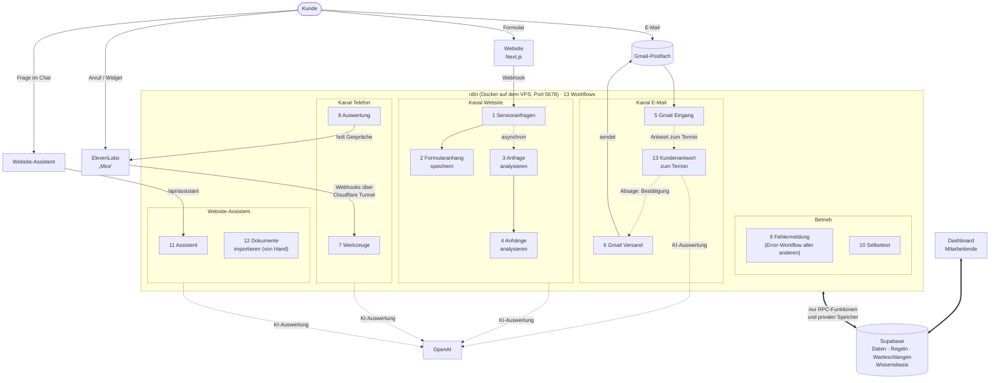
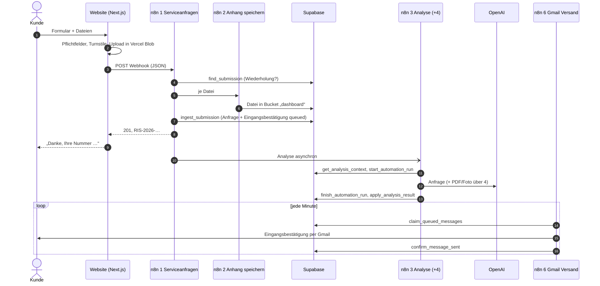
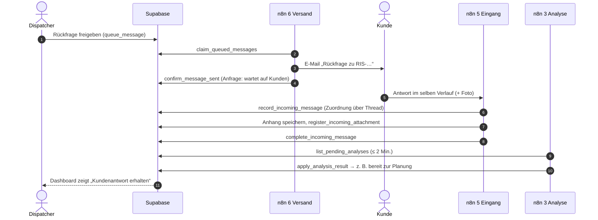
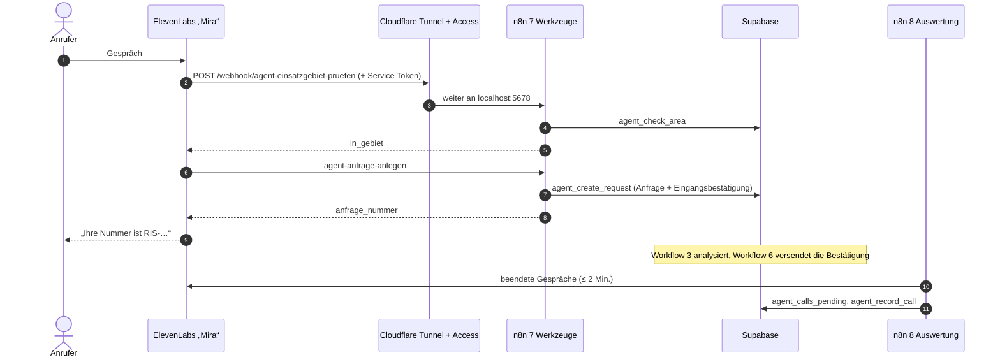

# n8n-Workflows: Aufbau, Verbindungen und Einrichtung

Diese Seite erklärt, welche Workflows RheinWerk in n8n betreibt, was jeder tut, wie sie miteinander und mit Supabase, Gmail, OpenAI und ElevenLabs verbunden sind und wie man sie von Grund auf einrichtet. Den genauen Datenvertrag jeder Datenbankfunktion (Ein- und Ausgaben, Idempotenz, Fehlercodes) beschreibt [n8n-contract.md](n8n-contract.md); die Datenbank selbst [supabase-lokal.md](supabase-lokal.md) und [database.md](database.md).

Stand: 23.10.2026, n8n 2.44.6 im Docker-Container `rheinwerk-n8n` auf dem VPS, 13 Workflows (12 veröffentlicht, 1 von Hand), alle Angaben gegen das laufende n8n und die Exporte in `n8n/workflows/` geprüft.

## 1. Grundidee in drei Sätzen

1. **n8n ist der Bote, die Datenbank entscheidet.** Jeder fachliche Schritt (Anfrage speichern, Analyse übernehmen, E-Mail als gesendet markieren) ist eine RPC-Funktion in Supabase, die Rechte, Zustand und Protokoll in einer Transaktion prüft. n8n schreibt nie direkt in Tabellen.
2. **Jede Aktion darf wiederholt werden.** Jeder Aufruf trägt einen stabilen Schlüssel (Formular-ID, Gmail-Nachrichten-ID, Nachrichten-ID). Läuft ein Workflow doppelt oder nach einem Absturz erneut, liefert die Datenbank das bestehende Ergebnis statt eines Duplikats.
3. **Zeitpläne holen Liegengebliebenes nach.** Neben den direkten Auslösern (Webhook, neue E-Mail) suchen Zeitpläne alle 1–15 Minuten nach offenen Aufgaben. Fällt ein Teil kurz aus, arbeitet das System danach von selbst weiter.

## 2. Die Workflows im Überblick

Es sind **13 Workflows**. Sechs bilden den Kern (Website-Anfragen, KI-Analyse, E-Mail, 1–6); zwei gehören zum Telefonassistenten (Phase 13, 7 und 8), dazu kommen der Error-Workflow (task-17-8, 9), der Selbsttest für Systemupdates (task-18-8, 10), der Website-Assistent mit seinem Import (task-18-10, 11 und 12) und die Auswertung von Kundenantworten zu geplanten Terminen (task-20-10, 13). **12 sind veröffentlicht (aktiv)**; nur 12 „Dokumente importieren“ läuft von Hand und ist nicht veröffentlicht. Andere Workflows im selben n8n gehören nicht zum Projekt und werden nicht überwacht.

| # | Workflow (Name in n8n) | ID | Auslöser | Aufgabe in einem Satz |
| --- | --- | --- | --- | --- |
| 1 | RheinWerk · Serviceanfragen | `lw1QxoJbeSU0H17E` | Webhook `POST /webhook/rheinwerk-service-request` | nimmt das Website-Formular an, speichert die Anfrage und startet Ablage der Anhänge und Analyse |
| 2 | RheinWerk · Formularanhang speichern | `Tr5Ird7F1iSTQe0o` | Aufruf aus 1 | kopiert eine hochgeladene Datei aus Vercel Blob in den privaten Supabase-Speicher |
| 3 | RheinWerk · Anfrage analysieren | `wO3EgSMM8l1wRKsc` | Aufruf aus 1 **und** Zeitplan alle 2 Minuten | prüft Anfrage bzw. Kundenantwort mit OpenAI und Anlagenkatalog, schreibt das Ergebnis versionssicher zurück |
| 4 | RheinWerk · Anhänge analysieren | `RE6MpFCDoYXgVyIm` | Aufruf aus 3 | liest PDF oder Typenschild-Foto mit OpenAI aus |
| 5 | RheinWerk · Gmail Eingang | `rGQGvOLDJUuHt4bO` | Gmail-Trigger jede Minute, Zeitpläne 5 und 15 Minuten | holt Kunden-E-Mails ab, ordnet sie der Anfrage zu oder legt sie in den Posteingang |
| 6 | RheinWerk · Gmail Versand | `IlH4b7AKuSXyMiOd` | Zeitplan jede Minute | versendet freigegebene E-Mails (Bestätigung, Rückfrage, Rechnung, Erinnerung) genau einmal |
| 7 | RheinWerk · Telefonassistent Werkzeuge | `rwAgentTools2026` | 12 Webhooks `POST /webhook/agent-*` | Werkzeuge der Telefonassistentin „Mira“ (Einsatzgebiet, freie Termine, Anfrage anlegen …) |
| 8 | RheinWerk · Telefonassistent Auswertung | `rwCallAnalysis26` | Zeitplan alle 2 Minuten | holt beendete Gespräche aus ElevenLabs, fasst sie mit OpenAI zusammen und speichert sie |
| 9 | RheinWerk · Fehlermeldung | `rwFehlerMeldung1` | Error Trigger (Error-Workflow aller übrigen zwölf) | schreibt jeden fehlgeschlagenen Lauf als Warnung `n8n:fehler:<id>` über `raise_alert` (kritisch bei 1, 6, 7); die E-Mail schickt der Wächter (`n8n/generate_error_workflow.py`) |
| 10 | RheinWerk · Selbsttest | `rwSelbsttest2026` | Webhook `GET /webhook/rheinwerk-selbsttest` | liest eine Zeile aus `system_status` mit dem Supabase-Credential und antwortet `{"ok": true}`; Selbsttest nach einem Systemupdate (task-18-8, `docs/betrieb.md` 6, `n8n/generate_selftest_workflow.py`) |
| 11 | RheinWerk · Assistent | `rwAssistent2026` | Webhook `POST /webhook/rheinwerk-assistant` | Website-Assistent: beantwortet Fragen aus der Wissensbasis `rag_documents` (Supabase Vector Store, `text-embedding-3-large`, Sprachmodell `gpt-5.6-luna`), Gesprächsverlauf je Besucher (`session_id`); Aufruf nur über `/api/assistant` der Website (task-18-10, Abschnitt 9) |
| 12 | RheinWerk · Dokumente importieren | `rwRagImport2026` | von Hand (`sh ops/vps/rag-import.sh`) | leert `rag_documents` und schreibt die Abschnitte aus `n8n/rag-documents/*.md` mit Embedding und `metadata.file` neu; nicht veröffentlicht, vom Wächter nicht erwartet |
| 13 | RheinWerk · Kundenantwort zum Termin | `rwVisitReply2026` | Zeitplan alle 2 Minuten | liest Antworten auf Anfragen mit kommendem Termin (`visit_replies_pending`), lässt OpenAI die Absicht erkennen und übergibt sie `apply_visit_reply`: eindeutige Absage storniert den Termin, Verschiebewunsch wird markiert (`n8n/generate_visit_reply_workflow.py`) |

## 3. Gesamtbild



Die Workflows rufen sich **nicht gegenseitig über die Datenbank** auf (keine Datenbank-Trigger oder Webhooks auf Tabellenänderungen). Die einzigen direkten Aufrufe sind 1 → 2, 1 → 3 und 3 → 4 („Execute Workflow“). Alle anderen Übergaben laufen über einen **Zustand in der Datenbank**, den ein Zeitplan abholt:

| Übergabe | Zustand in Supabase | abgeholt von |
| --- | --- | --- |
| Kundenantwort ist vollständig (inkl. Anhängen) | eingehende Nachricht `complete_incoming_message` | 3 (alle 2 Min., `list_pending_analyses`) |
| neue Anfrage, deren direkte Analyse ausfiel | `intake_status = new` ohne Lauf | 3 (alle 2 Min.) |
| Mitarbeiter gibt Rückfrage/Rechnung frei, Bestätigung oder Erinnerung entsteht | Nachricht `status = queued` mit Freigabe | 6 (jede Minute, `claim_queued_messages`) |
| Telefonassistent legt Anfrage an | Anfrage + Eingangsbestätigung `queued` | 3 und 6 wie oben |
| Gespräch beendet | Gespräch in ElevenLabs, aber nicht in `phone_calls.analyzed_at` | 8 (alle 2 Min., `agent_calls_pending`) |
| Kunde antwortet auf einen Termin | eingehende Nachricht einer Anfrage mit kommendem Termin, noch nicht ausgewertet | 13 (alle 2 Min., `visit_replies_pending`) |
| eindeutige Absage zum Termin | Termin storniert, Bestätigung `queued` | 6 wie oben |
| Workflow schlägt fehl | Fehlerlauf in n8n | 9 (Error Trigger, schreibt die Warnung `n8n:fehler:<id>`) |

Vorteil: Fällt ein Workflow aus, gehen keine Aufträge verloren; sie warten in der Datenbank. Die Warteschlange des Versands ist im Dashboard überwacht (Hinweis „E-Mail-Versand hängt“ nach 10 Minuten, task-12-9).

## 4. Verbindungen auf einen Blick

### Zugangsdaten (Credentials) in n8n

| Credential | Typ | Benutzt von | Einrichtung |
| --- | --- | --- | --- |
| RheinWerk Supabase Local | Supabase API (geheimer Schlüssel, Host `http://kong:8000` im Docker-Netz des VPS; bis 22.10.2026 `http://host.docker.internal:54321` auf dem Rechner) | allen 13 | `python3 n8n/bootstrap_credentials.py`, beim Umzug `ops/vps/import-backup.sh` |
| RheinWerk Gmail (`rw46346a76655347`) | Gmail OAuth2 | 1 (Diagnose), 5, 6 | in n8n „Sign in with Google“; Google-Cloud-Projekt im Status *In production* (sonst läuft der Zugang nach 7 Tagen ab) |
| OpenAI account 3 | OpenAI API | 3, 4, 8, 11, 12, 13 | API-Schlüssel in n8n |
| RheinWerk Agent-Secret (`rwAgentSecret001`) | Header Auth `x-agent-secret` | 7 (alle Webhooks) | `python3 n8n/bootstrap_agent_secret.py` |
| RheinWerk ElevenLabs (`rwElevenLabs0001`) | Header Auth `xi-api-key` | 8 | `python3 n8n/bootstrap_elevenlabs.py` |

Kein Schlüssel steht im Repository oder in Workflow-Parametern; n8n verschlüsselt Credentials mit dem Schlüssel in `~/.n8n/config` (Sicherung siehe [betrieb.md](betrieb.md)).

### Datenbankfunktionen je Workflow

| Workflow | RPC-Funktionen (`/rest/v1/rpc/…`) | Storage |
| --- | --- | --- |
| 1 Serviceanfragen | `find_submission`, `ingest_submission` | – |
| 2 Formularanhang speichern | – | schreibt `dashboard/…` |
| 3 Anfrage analysieren | `list_pending_analyses`, `get_analysis_context`, `start_automation_run`, `finish_automation_run`, `apply_analysis_result` | – |
| 4 Anhänge analysieren | – | liest `dashboard/…` |
| 5 Gmail Eingang | `record_incoming_message`, `register_incoming_attachment`, `complete_incoming_message`, `list_incomplete_incoming` | schreibt `dashboard/messages/…` |
| 6 Gmail Versand | `claim_queued_messages`, `confirm_message_sent`, `mark_message_failed` | – |
| 7 Telefon Werkzeuge | `agent_check_area`, `agent_check_contract`, `agent_free_slots`, `agent_create_request`, `agent_find_request`, `agent_request_callback`, `agent_service_hours`, `agent_request_service_callback`, `agent_find_customer`, `agent_check_email`, `agent_forward` (Werkzeug `anlage-pruefen` arbeitet ohne Datenbank, Katalog im Workflow) | – |
| 8 Telefon Auswertung | `agent_calls_pending`, `agent_record_call` | – |
| 9 Fehlermeldung | `raise_alert` | – |
| 10 Selbsttest | – (liest die Tabelle `system_status`) | – |
| 11 Assistent | – (Vector Store `rag_documents` mit `match_rag_documents`) | – |
| 12 Dokumente importieren | – (leert und füllt `rag_documents`) | liest `n8n/rag-documents/*.md` |
| 13 Kundenantwort zum Termin | `visit_replies_pending`, `apply_visit_reply` (mit Wunschtag und -zeit) | – |

### Netzwerk

| Von → Nach | Adresse | Warum so |
| --- | --- | --- |
| Next.js → n8n (Formular) | `N8N_WEBHOOK_URL` = `https://n8n.rheinwerk-service.online/webhook/rheinwerk-service-request` mit Access-Service-Token (ab task-18-4; bis dahin lokal `http://127.0.0.1:5678/…`) | n8n läuft seit 22.10.2026 auf dem VPS |
| n8n → Supabase | `http://kong:8000` | beide im Compose-Projekt `rheinwerk` auf dem VPS (betrieb.md 3.5) |
| ElevenLabs → n8n | `https://n8n.rheinwerk-service.online/webhook/agent-*` über Cloudflare Tunnel und Cloudflare Access (Service Token) | ElevenLabs braucht eine öffentliche HTTPS-Adresse; Tunnel `rheinwerk-vps` des Servers, keine offenen Ports |
| n8n → Gmail, OpenAI, ElevenLabs | öffentliche HTTPS-APIs | ausgehend, keine Freigabe nötig |
| Editor `n8n.rheinwerk-service.online` | Cloudflare Access mit Anmeldung | Editor nicht öffentlich |

## 5. Steckbriefe

Jeder Steckbrief: **Zweck – Auslöser – Schritte – Ergebnis – Fehlerverhalten – Prüfen.** Die Knotennamen in n8n sind deutsch und entsprechen den Schritten.

### 1 · Serviceanfragen (`lw1QxoJbeSU0H17E`, 23 Knoten)

- **Zweck:** einzige Eingangstür für Anfragen über das Website-Formular.
- **Auslöser:** `POST /webhook/rheinwerk-service-request` von `app/api/service-request/route.ts`. Die Website hat Pflichtfelder, Turnstile-Spamschutz und Anhänge (bis 3 × 5 MB, PDF/JPG/PNG in Vercel Blob) bereits geprüft.
- **Schritte:**
  1. *Formular prüfen* – Vertrag `ServiceRequestPayload` (`lib/form-contract.ts`, `schema_version 1.0`); ungültig → HTTP 400 mit `invalid_fields`.
  2. *Vorhandene Anfrage suchen* (`find_submission`) – gleiche `submission_id` schon gespeichert → bestehende Anfragenummer zurück, nichts doppelt.
  3. *Formularanhänge nacheinander* → ruft je Datei Workflow 2 auf.
  4. *Anfrage in Supabase speichern* (`ingest_submission`) – legt Anfrage, Anhänge, Ereignis und die **Eingangsbestätigung** (Nachricht `receipt`, `queued`) in einer Transaktion an.
  5. *Eingang bestätigen* – HTTP 201 mit `request_number` (z. B. `RIS-2026-00356`) an die Website.
  6. *Analyse asynchron starten* – ruft Workflow 3 auf, ohne auf ihn zu warten (nur bei neuer Anfrage, nicht bei Wiederholung).
- **Ergebnis:** Anfrage im Dashboard unter „Erstbearbeitung“, Bestätigung in der Versand-Warteschlange (Workflow 6).
- **Fehlerverhalten:** Datenbank nicht erreichbar → HTTP 503 „Die Anfrage konnte nicht gespeichert werden“; die Website zeigt den Fehler, der Kunde kann erneut senden (gleiche `submission_id` → kein Duplikat).
- **Nebenpfad *Verbindungen prüfen*:** manueller Start prüft Supabase und das richtige Gmail-Postfach.
- **Prüfen:** Formular auf `localhost:3000` absenden → Antwort mit RIS-Nummer; in n8n *Executions* grün.

### 2 · Formularanhang speichern (`Tr5Ird7F1iSTQe0o`, 5 Knoten)

- **Zweck:** Dateien aus dem öffentlichen Upload-Zwischenspeicher in den privaten Bucket `dashboard` übernehmen.
- **Auslöser:** Aufruf aus Workflow 1, je Datei.
- **Schritte:** Datei von der privaten Blob-Adresse laden (Workflow 1 lässt nur HTTPS-Adressen des privaten Vercel-Blob-Speichers zu; Weiterleitungen sind verboten) → *Dateiinhalt prüfen* (Dateisignatur passt zu PDF/PNG/JPEG, Größe) → nach `dashboard/<pfad>` hochladen → Statuscode prüfen (409 = schon vorhanden gilt als Erfolg).
- **Fehlerverhalten:** Fehler bricht Workflow 1 ab, bevor die Anfrage gespeichert ist → 503 an die Website; erneutes Senden ist gefahrlos.

### 3 · Anfrage analysieren (`wO3EgSMM8l1wRKsc`, 18 Knoten)

- **Zweck:** Erstbearbeitung automatisieren: Ist die Anfrage vollständig, passt die Anlage zum Leistungsangebot, braucht es eine Rückfrage oder einen Menschen?
- **Auslöser:** direkt aus Workflow 1 **oder** *Offene Analysen alle 2 Minuten* (`list_pending_analyses`: neue Anfragen ohne Lauf und vollständige Kundenantworten aus Workflow 5).
- **Schritte:**
  1. *Analysekontext laden* (`get_analysis_context`) – Anfrage, letzte 20 Nachrichten, Anhänge, aktuelle `version`.
  2. *Analyselauf reservieren* (`start_automation_run`, Schlüssel je Anfrage und Version) – läuft schon eine Analyse derselben Version, endet dieser Durchlauf.
  3. Anhänge vorhanden → je Datei Workflow 4.
  4. *Serviceanfrage inhaltlich prüfen* – OpenAI `gpt-4.1-mini`, striktes JSON-Schema, `store: false`; nur technische Felder und Nachrichtentexte, keine separaten Kontaktfelder.
  5. *Modell abgleichen und Regeln anwenden* – deterministischer Abgleich mit dem Anlagenkatalog (`n8n/workflows/catalog.json`, 74 Serien) und festen Regeln (z. B. „kaputt“ reicht bei Reparaturen nicht).
  6. *Analyseergebnis speichern* (`finish_automation_run`) und *Ergebnis versionssicher anwenden* (`apply_analysis_result` mit `expected_version`).
- **Ergebnis:** je nach Entscheidung `ready_for_planning` (Einsatzplanung), Entwurf einer Rückfrage (Mitarbeiter gibt frei) oder `human_review` (Prüfung durch Dispatcher).
- **Fehlerverhalten:** Hat ein Mitarbeiter die Anfrage inzwischen geändert, meldet die Datenbank `RW409`; das KI-Ergebnis wird verworfen und überschreibt keine menschliche Entscheidung. OpenAI-Fehler → Lauf `failed`, der nächste Zeitplan versucht es erneut.

### 4 · Anhänge analysieren (`RE6MpFCDoYXgVyIm`, 7 Knoten)

- **Zweck:** Hersteller, Modell, Seriennummer und Fehlercodes aus Dokumenten und Fotos lesen.
- **Auslöser:** Aufruf aus Workflow 3 je Anhang.
- **Schritte:** *Privaten Anhang laden* (Storage, authentifiziert) → *Dateiinhalt prüfen* → *PDF-Dokument?* → *PDF auswerten* bzw. *Foto und Typenschild auswerten* (OpenAI, JSON-Schema) → *Extraktion normalisieren*.
- **Ergebnis:** strukturierte Angaben zurück an Workflow 3; keine eigene Datenbankänderung.

### 5 · Gmail Eingang (`rGQGvOLDJUuHt4bO`, 27 Knoten)

- **Zweck:** Kunden-E-Mails ins System holen.
- **Auslöser (drei Zweige):**
  - *Neue Gmail-Antwort* – Gmail-Trigger jede Minute, Filter `in:inbox -from:rheinwerk.industrieservice@gmail.com`.
  - *Unvollständige Antworten alle 5 Minuten* – nimmt E-Mails wieder auf, deren Anhänge nicht fertig gespeichert wurden (`list_incomplete_incoming`).
  - *Verpasste Antworten alle 15 Minuten* – liest die letzten bis zu 100 Antworten mit RIS-Nummer der letzten 7 Tage erneut ein (z. B. nach einem Ausfall); Duplikate erkennt die Datenbank.
- **Schritte:** Postfach bestätigen (richtiges Konto?) → *Gmail-Antwort normalisieren* → *Gmail-Nachricht speichern und zuordnen* (`record_incoming_message`): Zuordnung über Gmail-Thread, dann `In-Reply-To`/`References`, dann RIS-Nummer im Betreff; die Absenderadresse allein reicht nie → je Anhang prüfen, privat speichern, registrieren → *Antwort für Analyse freigeben* (`complete_incoming_message`).
- **Ergebnis:** zugeordnet → Nachricht an der Anfrage, Workflow 3 analysiert die Antwort; nicht zugeordnet → Posteingang des am wenigsten ausgelasteten Dispatchers im Dashboard.
- **Fehlerverhalten:** Die Antwort wird erst nach allen Anhängen zur Analyse freigegeben; Abbrüche holt der 5-Minuten-Zweig nach.

### 6 · Gmail Versand (`IlH4b7AKuSXyMiOd`, 19 Knoten)

- **Zweck:** jede freigegebene E-Mail **genau einmal** versenden.
- **Auslöser:** *Freigegebene E-Mails jede Minute*.
- **Schritte:**
  1. *Versandpostfach prüfen* – richtiges Gmail-Konto.
  2. *Freigegebene Nachrichten reservieren* (`claim_queued_messages`, bis 5 Stück, Sperrfrist 10 Minuten) – nur Nachrichten an echte Anfragen (keine Demo), freigegeben von einem Mitarbeiter oder automatisch (Eingangsbestätigung, Zahlungserinnerung).
  3. *MIME mit stabiler Nachrichten-ID* – Text + HTML, eigener Header `X-RheinWerk-Message-Id`, bei Antworten im selben Gmail-Verlauf.
  4. *Bereits gesendete Nachricht suchen* – nach einem unklaren Abbruch wird erst im Ordner „Gesendet“ nach der internen ID gesucht; gefunden → nur bestätigen, **nicht** erneut senden.
  5. *Freigegebene E-Mail senden* (Gmail API) → *Bestätigten Versand speichern* (`confirm_message_sent`) bzw. *Versandfehler für Wiederholung speichern* (`mark_message_failed`).
- **Ergebnis:** Nachricht `sent` mit Gmail-IDs; bei Rechnungen Status „versendet“; Rückfragen setzen die Frist „erste inhaltliche Antwort“.
- **Fehlerverhalten:** vorübergehender Fehler → bleibt `queued`, neuer Versuch nach Ablauf der Sperrfrist; endgültiger Fehler (ungültige Adresse) → `failed`, sichtbar an der Anfrage. **Bekannter Ausfallgrund:** abgelaufener Google-Zugang (am 19.10.2026 passiert) → Credential neu verbinden; die wartenden E-Mails gehen dann automatisch raus.

### 7 · Telefonassistent Werkzeuge (`rwAgentTools2026`, 36 Knoten)

- **Zweck:** Die Sprachassistentin „Mira“ (ElevenLabs) fragt während des Gesprächs Daten ab bzw. legt Anfragen an.
- **Auslöser:** 12 Webhooks `POST /webhook/agent-<werkzeug>`, jeweils geschützt durch Header `x-agent-secret` und davor Cloudflare Access (Service Token).
- **Aufbau:** je Werkzeug drei Knoten: *Webhook → Datenbank (RPC) → Antwort*. Bei jedem Datenbankfehler antwortet der Workflow `{ok:false, fehler:"werkzeug_gestoert"}` mit HTTP 200, damit Mira höflich auf einen Rückruf ausweicht, statt abzubrechen.
- **Werkzeuge:** einsatzgebiet-pruefen, sla-pruefen, freie-termine, anfrage-anlegen, anfrage-finden, rueckrufbitte-techniker, servicezeit, rueckruf-service-desk, kunde-finden, email-pruefen, weiterleiten, anlage-pruefen.
- **Datenschutz:** Ausführungsdaten werden nur bei Fehlern gespeichert (`saveDataSuccessExecution: none`).
- Details, Regeln und Agent-Konfiguration: [telefonassistent/setup.md](telefonassistent/setup.md), [telefonassistent/regeln.md](telefonassistent/regeln.md).

### 8 · Telefonassistent Auswertung (`rwCallAnalysis26`, 10 Knoten)

- **Zweck:** Jedes Gespräch erscheint im Dashboard unter „Anrufe“ mit Zusammenfassung, Kategorie und ggf. Rückrufbitte.
- **Auslöser:** *Alle 2 Minuten*.
- **Schritte:** *Gespräche abrufen* (ElevenLabs API) → *Beendete Gespräche* → *Noch nicht ausgewertet* (`agent_calls_pending`) → höchstens 10 je Lauf: *Gespräch laden* → *Transkript aufbereiten* → *Auswerten (OpenAI)* → *Speichern* (`agent_record_call`, einmal je Gespräch).
- **Fehlerverhalten:** nicht gespeicherte Gespräche bleiben „nicht ausgewertet“ und werden beim nächsten Lauf erneut versucht. Transkripte löscht die Datenbank nach 30 Tagen.

### 9 · Fehlermeldung (`rwFehlerMeldung1`, 3 Knoten)

- **Zweck:** Jeder fehlgeschlagene Lauf eines anderen RheinWerk-Workflows wird zur Warnung im Bereich „System“.
- **Auslöser:** Error Trigger; als Error-Workflow bei allen übrigen zwölf eingetragen (`n8n/assign_error_workflow.mjs`) und selbst veröffentlicht, sonst ruft n8n 2.x ihn nicht auf.
- **Schritte:** *Fehler in einem Workflow* → *Warnung aufbauen* → *Warnung speichern (`raise_alert`)*; Schlüssel `n8n:fehler:<id>`, kritisch bei 1, 6 und 7.
- **Hinweis:** Die E-Mail schickt nicht dieser Workflow, sondern der Wächter (`alerts_to_notify`). Ausführungsdaten werden nur bei Fehlern gespeichert.

### 10 · Selbsttest (`rwSelbsttest2026`, 3 Knoten)

- **Zweck:** Nach einem Systemupdate prüfen, ob n8n läuft und mit dem Supabase-Credential Daten lesen kann (`docs/betrieb.md` 6).
- **Auslöser:** Webhook `GET /webhook/rheinwerk-selbsttest`.
- **Schritte:** *Selbsttest aufrufen* → *Supabase lesen (`system_status`)* → *Ergebnis*; Antwort `{"ok": true}`.

### 11 · Assistent (`rwAssistent2026`, 7 Knoten)

- **Zweck:** Der Website-Assistent beantwortet Fragen zum Unternehmen aus der Wissensbasis (task-18-10, Abschnitt 9).
- **Auslöser:** Webhook `POST /webhook/rheinwerk-assistant`; Aufruf nur über `/api/assistant` der Website mit Cloudflare-Access-Service-Token.
- **Aufbau:** *Frage annehmen* → *Assistent* (Agent mit Sprachmodell, Gesprächsverlauf je Besucher über `session_id` und der Wissensbasis `rag_documents` als Werkzeug mit Embeddings) → *Antwort*.
- **Datenschutz:** Ausführungsdaten werden nur bei Fehlern gespeichert.

### 12 · Dokumente importieren (`rwRagImport2026`, 6 Knoten)

- **Zweck:** Wissensbasis des Assistenten aus den Dokumenten im Repository neu aufbauen.
- **Auslöser:** von Hand (`sh ops/vps/rag-import.sh`); als einziger Workflow **nicht veröffentlicht** und vom Wächter nicht erwartet.
- **Schritte:** *Start* → *Wissensbasis leeren* → *Dokumente lesen* (`n8n/rag-documents/*.md`) → *Abschnitte mit Quelldatei* → *Embeddings* → *Wissensbasis füllen (`rag_documents`)*.

### 13 · Kundenantwort zum Termin (`rwVisitReply2026`, 6 Knoten)

- **Zweck:** Antwortet ein Kunde auf die Terminbestätigung, erkennt OpenAI die Absicht samt Wunschtag und Uhrzeit (task-20-10, task-20-16): eine eindeutige Absage storniert den Termin; ein Verschiebewunsch wird zur Änderungsanfrage (`visit_change_requests`) mit automatischer Eingangsbestätigung („Wir prüfen und melden uns“), die der Dispatcher auf der Plantafel bestätigt oder mit einem Alternativtermin beantwortet; ein „Ja“ oder „Nein“ zu einem solchen Vorschlag wird angewendet (bei „Ja“ verschiebt die Datenbank den Termin selbst, wenn er noch frei ist).
- **Auslöser:** *Alle 2 Minuten*.
- **Schritte:** *Offene Antworten laden* (`visit_replies_pending`) → *Einzeln* → *Absicht erkennen (OpenAI)* → *Ergebnis prüfen* → *Anwenden* (`apply_visit_reply`).
- **Zusätzlich:** `visit_replies_pending` liefert das heutige Datum, den Wochentag und einen offenen Vorschlag (`offer`); `apply_visit_reply` bekommt `wished_day` und `wished_time`. Absicht `decline` gibt es nur zu einem Vorschlag. Eine Erinnerung an unbeantwortete Vorschläge schickt nicht n8n, sondern ein pg_cron-Auftrag (`run_visit_change_reminders`, stündlich, einmal je Vorschlag: zwei Tage nach dem Angebot oder einen Tag vor dem Termin).
- **Fehlerverhalten:** Die Datenbank entscheidet (Absage und Zusage nur von der Adresse des Kunden); eine Antwort ohne gültiges Ergebnis von OpenAI bleibt offen und wird beim nächsten Lauf erneut versucht, eine gespeicherte nie zweimal ausgewertet. Der Kunde bekommt die Bestätigung über 6.

## 6. Drei Abläufe Schritt für Schritt

### Anfrage über die Website



### Rückfrage und Antwort des Kunden per E-Mail



### Anruf bei der Telefonassistentin



## 7. Einrichtung von Grund auf

Voraussetzung: Supabase läuft ([supabase-lokal.md](supabase-lokal.md)).

*Seit 22.10.2026 läuft das produktive n8n im Compose-Projekt `rheinwerk` auf dem VPS (Container `rheinwerk-n8n`, Version 2.44.6, Dienst `n8n` in `ops/vps/docker-compose.yml`, Steuerung mit `ops/vps/compose.sh`, [betrieb.md](betrieb.md)). Die folgende Einrichtung beschreibt den Aufbau von Grund auf auf einem Rechner (Container `n8n`); sie gilt entsprechend für den VPS.*

1. **n8n starten** (Daten im Ordner `~/n8n/data` des Rechners, Neustart automatisch):

   ```bash
   docker run -d --name n8n --restart unless-stopped -p 5678:5678 \
     -v ~/n8n/data:/home/node/.n8n \
     -e N8N_EDITOR_BASE_URL=https://n8n.rheinwerk-service.online \
     -e N8N_WEBHOOK_URL=https://n8n.rheinwerk-service.online/ \
     -e N8N_PROXY_HOPS=1 \
     n8nio/n8n:2.40.7
   ```

   Ohne Tunnel genügt es, die drei `-e`-Zeilen wegzulassen (dann `http://localhost:5678`). Beim ersten Aufruf den Besitzer-Account anlegen.
2. **Credentials anlegen** (Abschnitt 4): `python3 n8n/bootstrap_credentials.py`, Gmail per „Sign in with Google“, OpenAI-Schlüssel, für das Telefon `bootstrap_agent_secret.py` und `bootstrap_elevenlabs.py`. Die Skripte zeigen keine Geheimnisse an.
3. **Workflows importieren:** importierbare Exporte liegen in `n8n/workflows/*.workflow.json` (erzeugt aus `n8n/generate_*.py`).

   ```bash
   for f in n8n/workflows/*.workflow.json; do
     docker cp "$f" n8n:/tmp/wf.json && docker exec n8n n8n import:workflow --input=/tmp/wf.json
   done
   ```

   Die Exporte verweisen auf Credentials über deren ID. Auf einem neuen n8n haben die Credentials andere IDs: dann in den betroffenen Knoten (rot markiert) das Credential einmal neu auswählen. Danach jeden Workflow **veröffentlichen** (Schalter *Active*). Die Reihenfolge ist egal; die Workflow-IDs bleiben erhalten, deshalb funktionieren die Aufrufe 1 → 2/3 und 3 → 4 ohne Anpassung.
4. **Website verbinden:** in `.env.local` `N8N_WEBHOOK_URL=http://127.0.0.1:5678/webhook/rheinwerk-service-request`, App neu starten.
5. **Gmail-Konto bestätigen:** Workflow 1 öffnen → *Verbindungen prüfen* manuell ausführen → beide Prüfungen grün.
6. **Telefon (optional):** Cloudflare Tunnel und Access nach [telefonassistent/setup.md](telefonassistent/setup.md), danach `npm run agent:sync`.

**Error-Workflow zuweisen** (task-17-8): nach dem Import `node --env-file=.env.local n8n/assign_error_workflow.mjs`. Das Skript veröffentlicht „RheinWerk · Fehlermeldung“ (n8n 2.x ruft einen Error-Workflow nur auf, wenn er veröffentlicht ist) und setzt `settings.errorWorkflow` bei 1–8 über die n8n-API und in den Exporten; wiederholbar. Braucht `N8N_API_KEY` (n8n → Settings → n8n API → Create an API key, ohne Ablauf) in `.env.local`, den auch der Wächter nutzt.

**Änderungen an Workflows** werden im Repository gepflegt: Generator unter `n8n/generate_*.py` anpassen, ausführen, Export erneut importieren. So bleibt der Stand in Git nachvollziehbar und lässt sich nach einem Verlust des n8n-Ordners wiederherstellen.

## 8. Überwachung und typische Störungen

**Wächter (task-17-8):** `scripts/ops/watchdog.mjs` (alle 5 Minuten, Prüfungen in `scripts/ops/n8n.mjs`) prüft nur über die n8n-API und die Datenbank, nie über `~/n8n/data/database.sqlite`: n8n erreichbar (`/healthz`, kritisch), alle Workflows aus `n8n/workflows/` außer 12 aktiv (kritisch; 7 und 8 nur mit `ELEVENLABS_API_KEY`), letzter Lauf von 6 (≤ 10 min), 3 (≤ 10 min) und 5 (≤ 30 min), Versandstau > 10 Minuten (kritisch, Regel wie der Dashboard-Hinweis), KI-Analysen > 15 Minuten offen (`monitor_n8n_queues`). Warnungen des Error-Workflows mailt der Wächter (`alerts_to_notify`) und schließt sie nach einer Stunde ohne neuen Fehlerlauf des Workflows. Ohne `N8N_API_KEY` nur Erreichbarkeit und Warteschlangen. Zustand im Dashboard-Bereich „System“ (Zeile „Automatisierung (n8n)“).

| Wo sehen? | Was |
| --- | --- |
| E-Mail an `ALERT_EMAILS`, Bereich „System“ | Warnungen des Wächters und des Error-Workflows (task-17-8) |
| n8n → *Executions* | jeder Lauf mit Status; rote Läufe zeigen den fehlerhaften Knoten |
| Dashboard, Hinweis oben | „E-Mail-Versand hängt“, wenn freigegebene E-Mails > 10 Minuten warten |
| Dashboard → Auswertung → Automatisierung | Anteil automatischer Erstbearbeitungen, Läufe mit Status |
| `docker logs n8n --since 30m` | z. B. „The credential … needs to be reconnected“ |

| Symptom | Ursache | Lösung |
| --- | --- | --- |
| E-Mails bleiben in der Warteschlange, Hinweis im Dashboard | Google-Zugang abgelaufen/widerrufen | n8n → Credentials → „RheinWerk Gmail“ → *Reconnect*; Editor dabei über `https://n8n.rheinwerk-service.online` öffnen (die OAuth-Rückleitung geht an diese Adresse) |
| Reconnect meldet „Unauthorized“ | Editor über `127.0.0.1` geöffnet, Rückleitung auf die Tunnel-Adresse ohne Anmeldung | Editor über die Tunnel-Adresse öffnen und dort anmelden |
| Website: „Die Anfrage konnte nicht gespeichert werden“ (503) | n8n oder Supabase aus | `docker ps`, `supabase status`; Kunde kann erneut senden |
| Website: 503 `not_configured` | `N8N_WEBHOOK_URL` fehlt | `.env.local` setzen, App neu starten |
| Analysen bleiben aus | OpenAI-Guthaben/Schlüssel | Executions von Workflow 3 ansehen; nach Behebung holt der Zeitplan alles nach |
| Mira sagt „Werkzeug gestört“ | Tunnel, Access oder Datenbank | `AGENT_BASE_URL=https://n8n.rheinwerk-service.online npm run test:agent` |
| Anrufe erscheinen nicht im Dashboard | ElevenLabs-Schlüssel oder Workflow 8 inaktiv | Executions von Workflow 8 |

## 9. Website-Assistent (task-18-10)

Bis 22.10.2026 lief der Assistent der Website auf dem Oracle-Server (n8n „RheinWerk Local Assistant“, Tabelle `rheinwerk` mit 36 Abschnitten, Aufruf direkt aus dem Browser über `rheinwerk-rag.130-61-221-231.sslip.io` mit CORS). Seitdem in RheinWerk:

| Teil | Wo |
| --- | --- |
| Dokumente | `n8n/rag-documents/*.md` (sieben fiktive Unternehmensdokumente, unverändert vom Oracle-Server) |
| Wissensbasis | Tabelle `rag_documents` (pgvector, 3 072 Dimensionen, kein Index nötig) und `match_rag_documents`; nur `service_role` (Migration `20261022200000`) |
| Systemprompt | `n8n/assistant_prompt.md` (unverändert vom Oracle-Server) |
| Workflows | `n8n/generate_assistant_workflows.py` → 11 und 12 |
| Website | `components/assistant.tsx` → `POST /api/assistant` (`app/api/assistant/route.ts`): Frage 1–500 Zeichen, `session_id` je Browser-Tab, 20 Fragen je Besucher in 10 Minuten; weiter an n8n mit Access-Service-Token (`N8N_ASSISTANT_URL`, sonst `/webhook/rheinwerk-assistant` auf dem Host von `N8N_WEBHOOK_URL`) |
| Cloudflare Access | Pfad `n8n.rheinwerk-service.online/webhook/rheinwerk-assistant` in der Anwendung „RheinWerk Webhook“ (Service Auth) |

Behoben beim Umzug: Der Gesprächsverlauf auf Oracle hatte einen festen Schlüssel (`rheinwerk-test`) für alle Besucher; jetzt eigener Verlauf je Browser-Tab. Die Quelldatei steht in `metadata.file` (auf Oracle nur `blob`).

**Dokument ändern:** Datei unter `n8n/rag-documents/` bearbeiten, committen und pushen; nach dem Deployment auf dem VPS `sh /opt/rheinwerk/app/ops/vps/rag-import.sh` (leert die Wissensbasis und baut sie neu auf, etwa 5 Sekunden; Ausgabe: Abschnitte je Datei). Stand 22.10.2026: 29 Abschnitte aus 7 Dateien.

Vergleich am 22.10.2026 (gleiche Fragen an Oracle und RheinWerk: Preis einer Inspektion, Notfallkanal, betreute Anlagen, kritische Fälle, Geschäftsführung, themenfremde Frage): inhaltlich gleiche Antworten, 1–7 Sekunden.

