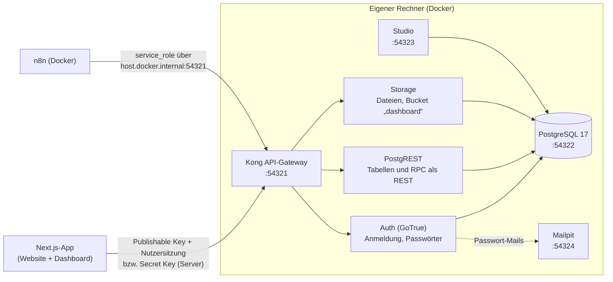

# Lokales Supabase: Einrichtung und Betrieb

Diese Anleitung führt Schritt für Schritt von einem leeren Rechner zu einer laufenden Datenbank mit Demodaten, an der Website, Dashboard und n8n hängen. Sie ergänzt [setup.md](setup.md) (Kurzfassung für den Start der App). Was in der Datenbank steht, beschreibt [database.md](database.md); wie n8n sie nutzt, [n8n-workflows.md](n8n-workflows.md).

## 1. Was „lokales Supabase“ hier bedeutet

Supabase ist eine Sammlung von Diensten rund um eine PostgreSQL-Datenbank. Die Supabase CLI startet sie als Docker-Container auf dem eigenen Rechner. Es gibt kein Cloud-Projekt und keine Kosten; alle Daten liegen in Docker-Volumes auf dem Rechner.



| Dienst | Container | Port am Rechner | Wofür im Projekt |
| --- | --- | --- | --- |
| API-Gateway (Kong) | `supabase_kong_A.Sadkovojs_Project` | 54321 | einzige Adresse für App und n8n (`/auth/v1`, `/rest/v1`, `/storage/v1`) |
| PostgreSQL 17 | `supabase_db_A.Sadkovojs_Project` | 54322 | Daten, RLS, RPC-Funktionen, pg_cron |
| Studio | `supabase_studio_A.Sadkovojs_Project` | 54323 | Weboberfläche: Tabellen, SQL-Editor, Auth-Nutzer |
| Mailpit | `supabase_inbucket_A.Sadkovojs_Project` | 54324 | fängt Passwort-Mails ab (kein echter Versand) |
| Auth, PostgREST, Storage, Realtime, Meta, Analytics | `supabase_*_A.Sadkovojs_Project` | nur intern | hinter Kong |

Alle Ports und Einstellungen stehen in [`supabase/config.toml`](../supabase/config.toml). Projektkennung: `project_id = "A.Sadkovojs_Project"` (daher die Containernamen).

## 2. Voraussetzungen

| Werkzeug | Geprüfte Version | Installation (macOS) |
| --- | --- | --- |
| Docker Desktop | 29.8 | <https://www.docker.com/products/docker-desktop/>, danach starten; mindestens 4 GB RAM für Docker |
| Supabase CLI | 2.120 | `brew install supabase/tap/supabase` |
| Node.js | 20.9 oder neuer (geprüft 26.7) | `brew install node` |

Prüfen:

```bash
docker info --format '{{.ServerVersion}}'   # Docker läuft
supabase --version                          # 2.x
node --version
```

## 3. Erststart

```bash
git clone https://github.com/FuzzCube/RhenWerk-WebSite.git
cd RhenWerk-WebSite
npm install
supabase start
```

`supabase start` lädt beim ersten Mal die Container-Images (einige GB, mehrere Minuten), legt die Datenbank an und wendet **alle Migrationen** aus `supabase/migrations/` in Namensreihenfolge an (Stand: 52 Dateien). Danach ist das komplette Schema da: Tabellen, Rechte (RLS), Funktionen, Storage-Bucket `dashboard` und die pg_cron-Aufträge. Daten gibt es noch keine.

Am Ende zeigt die CLI die Zugangsdaten. Jederzeit erneut abrufbar mit:

```bash
supabase status
```

## 4. Schlüssel in `.env.local` eintragen

```bash
cp .env.example .env.local
```

| Variable in `.env.local` | Wert aus `supabase status` | Hinweis |
| --- | --- | --- |
| `NEXT_PUBLIC_SUPABASE_URL` | `API URL` (`http://127.0.0.1:54321`) | |
| `NEXT_PUBLIC_SUPABASE_PUBLISHABLE_KEY` | `Publishable key` | öffentlich; Zugriff nur nach RLS-Regeln |
| `SUPABASE_SECRET_KEY` | `Secret key` | umgeht RLS; **nur serverseitig**, nie mit `NEXT_PUBLIC_`, nie ins Repository |
| `DEMO_USER_PASSWORD` | frei wählen, mindestens 12 Zeichen | Passwort aller Demo-Nutzer |

Verbindung prüfen:

```bash
npm run supabase:check     # erwartet: Auth health HTTP 200, Admin API OK
```

Die Schlüssel ändern sich nicht bei einem Neustart, wohl aber bei einer Neuinstallation der CLI-Umgebung. Dann `.env.local` und die n8n-Zugangsdaten (Abschnitt 8) nachziehen.

## 5. Demo-Nutzer und Demodaten

```bash
npm run demo:users    # 8 Konten: 1 Admin, 1 Manager, 3 Dispatcher, 3 Techniker
npm run demo:seed     # rund 600 Anfragen über 24 Monate, Kunden, Einsätze, Rechnungen; idempotent
npm run demo:verify   # jede Zeile muss "ok" zeigen
```

Anmeldung unter `http://localhost:3000/login` mit `admin.demo@example.com`, `manager.demo@example.com`, `dispo1.demo@example.com` … `technik3.demo@example.com` und `DEMO_USER_PASSWORD`. Demodaten tragen `is_demo = true`: Sie werden **nie** per E-Mail versendet und nie von der KI analysiert. Details: [demo-data.md](demo-data.md).

## 6. Werkzeuge im Alltag

| Aufgabe | Weg |
| --- | --- |
| Daten ansehen, SQL ausführen | Studio `http://127.0.0.1:54323` → Table Editor bzw. SQL Editor |
| SQL im Terminal | `docker exec -it supabase_db_A.Sadkovojs_Project psql -U postgres` (ein lokales `psql` ist nicht nötig) |
| Passwort-Mails lesen | Mailpit `http://127.0.0.1:54324` |
| Hochgeladene Dateien | Studio → Storage → Bucket `dashboard` (privat; Zugriff im Dashboard nur über die App) |
| Geplante Aufträge | `select jobname, schedule from cron.job;` |
| Stack anhalten / starten | `supabase stop` / `supabase start` – **Daten bleiben erhalten** |

Geplante Aufträge in der Datenbank (pg_cron, Zeiten in UTC):

| Auftrag | Zeitplan | Wirkung |
| --- | --- | --- |
| `callback-escalation` | jede Minute | unbestätigte Rückrufbitten nach 15 Minuten an den Dispatcher eskalieren |
| `visit-holds-expire` | stündlich :05 | Terminvormerkungen des Telefonassistenten nach zwei Werktagen freigeben |
| `payment-reminders` | täglich 06:00 | Zahlungserinnerungen für überfällige Rechnungen in die Versand-Warteschlange |
| `call-transcripts-30-days` | täglich 02:30 | Gesprächstranskripte nach 30 Tagen löschen (Datenschutz) |
| `calls-without-request-12-months` | täglich 02:40 | Anrufe ohne Anfrage 12 Monate nach Gesprächsende löschen (Datenschutz, task-16-1) |
| `widget-sessions-90-days` | täglich 02:45 | Sitzungen des Web-Widgets nach 90 Tagen löschen |
| `system-history-cleanup` | täglich 02:50 | Update-Läufe ohne Änderung nach 30 Tagen, behobene Warnungen nach 90 Tagen, übrige Läufe nach 12 Monaten löschen (task-17-2) |

## 7. Schemaänderungen

Regel des Projekts: Das Schema ändert sich **nur über neue Migrationsdateien**, nie per Klick in Studio.

```bash
supabase migration new kurzer_name      # legt supabase/migrations/<Zeitstempel>_kurzer_name.sql an
# SQL schreiben, dann nur die neue Migration anwenden – ohne Datenverlust:
supabase migration up
npm run db:types                         # TypeScript-Typen lib/supabase/database.types.ts neu erzeugen
npm run test:db                          # pgTAP-Tests (supabase/tests/database, 37 Dateien)
```

> **Achtung: `supabase db reset` löscht alle Daten** (Anfragen, Nutzer, hochgeladene Dateien, echte Testanfragen) und spielt das Schema neu ein. Nur verwenden, wenn ein leerer Stand gewollt ist; danach `npm run demo:users && npm run demo:seed`. Vorher eine Sicherung anlegen (`npm run backup`, siehe [betrieb.md](betrieb.md)).

Wurde eine bereits angewandte Migration nachträglich korrigiert (z. B. eine Funktion), wird nur die geänderte Funktion eingespielt:

```bash
docker exec -i supabase_db_A.Sadkovojs_Project psql -U postgres -d postgres -v ON_ERROR_STOP=1 < supabase/migrations/<datei>.sql
```

## 8. Verbindung zu n8n

n8n läuft in einem eigenen Docker-Container. „127.0.0.1“ wäre dort der Container selbst; deshalb erreicht n8n Supabase über **`http://host.docker.internal:54321`** (Docker Desktop leitet diese Adresse an den Rechner weiter).

- Zugangsdaten in n8n: Credential **„RheinWerk Supabase Local“** vom Typ *Supabase API* mit Host `http://host.docker.internal:54321` und dem `service_role`-Schlüssel (`SERVICE_ROLE_KEY` aus `supabase status -o json`; wirkt wie der `Secret key`).
- Anlegen ohne den Schlüssel anzuzeigen: `python3 n8n/bootstrap_credentials.py` (liest `supabase status`, importiert per `n8n import:credentials`).
- n8n schreibt **nie direkt in Tabellen**, sondern ruft ausschließlich RPC-Funktionen auf (`/rest/v1/rpc/<funktion>`), die nur mit `service_role` ausführbar sind. Welche Funktion welcher Workflow nutzt: [n8n-workflows.md](n8n-workflows.md#4-verbindungen-auf-einen-blick).

## 9. Prüfliste „läuft alles?“

```bash
supabase status                    # alle Dienste "running"
npm run supabase:check             # Auth 200, Admin API OK
npm run demo:verify                # Demodaten vollständig
npm run test:db                    # Datenbanktests
curl -s -o /dev/null -w '%{http_code}\n' http://127.0.0.1:54321/rest/v1/ -H "apikey: $(supabase status -o json | jq -r .PUBLISHABLE_KEY)"   # 200
```

## 10. Fehlerbehebung

| Symptom | Ursache | Lösung |
| --- | --- | --- |
| `supabase start`: „Cannot connect to the Docker daemon“ | Docker Desktop läuft nicht | Docker starten, warten bis „Engine running“ |
| `supabase start`: „port is already allocated“ (54321–54324) | anderer Supabase-Stack oder Programm auf dem Port | `supabase stop --project-id <anderes>` bzw. Programm beenden; Ports notfalls in `config.toml` ändern (dann auch `.env.local` und n8n) |
| App: „Fehlende Umgebungsvariablen“ / 500 auf `/login` | `.env.local` fehlt oder unvollständig | Abschnitt 4; danach `npm run dev` neu starten |
| Anmeldung schlägt mit richtigem Passwort fehl | Demo-Nutzer nicht angelegt oder anderes `DEMO_USER_PASSWORD` | `npm run demo:users` erneut (setzt Passwörter) |
| n8n: `ECONNREFUSED 127.0.0.1:54321` | Credential nutzt `127.0.0.1` statt `host.docker.internal` | Host im Credential korrigieren |
| n8n: HTTP 401/403 bei RPC | falscher Schlüssel (z. B. Publishable statt `service_role`) | Credential mit `bootstrap_credentials.py` neu anlegen |
| Neue Spalte/Funktion „not found in schema cache“ | PostgREST kennt die Änderung noch nicht | `docker restart supabase_rest_A.Sadkovojs_Project` |
| TypeScript-Fehler nach Migration | Typen veraltet | `npm run db:types` |
| Passwort-Link führt auf `127.0.0.1` | `site_url` lokal | für die echte Domain `site_url`/`additional_redirect_urls` in `config.toml` setzen ([betrieb.md](betrieb.md)) |
| Docker-Speicher voll | alte Images | `docker system df`, `docker image prune` (**nicht** `docker volume prune` – löscht die Datenbank) |
