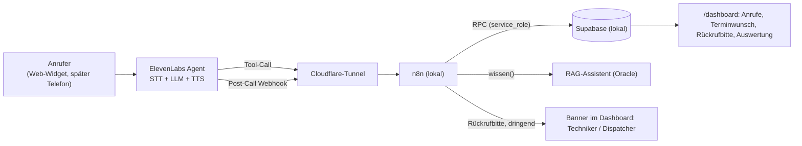

# План: KI-Telefonassistent для RheinWerk Industrieservice

Адаптация «Проекта 1» (Haustechnik Becker) под наш кейс. Задачи — фаза 13 в `.workshop/roadmap.json`. Агент говорит только по-немецки.

Концепция (task-13-1, на немецком): [leitfaden.md](telefonassistent/leitfaden.md), [systemprompt.md](telefonassistent/systemprompt.md), [wissensbasis.md](telefonassistent/wissensbasis.md) с перечнем оборудования, [regeln.md](telefonassistent/regeln.md) с правилами и контрактами инструментов, [einsatzgebiet.json](telefonassistent/einsatzgebiet.json), [datenschutz.md](telefonassistent/datenschutz.md).

## 1. Что меняется по сравнению с исходным планом

| Исходный план (Handwerk, B2C) | Наш кейс (RheinWerk, B2B) |
|---|---|
| Звонит частный клиент | Звонит сотрудник предприятия (Instandhaltung, Einkauf, Schichtleiter) по насосу, компрессору или вентиляции |
| Агент сам бронирует время в Google Calendar | Агент смотрит **наш календарь** (рабочие часы техников, выезды, отсутствия) и **резервирует** свободное время. Окончательно подтверждает или отклоняет **диспетчер** |
| Итог звонка: строка в отдельной таблице и сообщение в Telegram | Итог звонка — **заявка в нашем дашборде** (Erstbearbeitung, анализ, Eingangsbestätigung) плюс запись звонка |
| Дашборд на Streamlit | Новые экраны в **существующем** `/dashboard` |
| Авария: газ, прорыв трубы | Авария: **Produktionsstillstand**, **Sicherheitsgefahr**; 24/7 только с Notfall-SLA |
| — | Новый сценарий: **«Техник опаздывает»** — агент находит выезд, успокаивает клиента и сразу шлёт технику просьбу перезвонить |
| Мультиязычность как расширение | **Только немецкий** |

## 2. Факты фирмы для базы знаний (из сайта)

- RheinWerk Industrieservice GmbH, Rheinwerkstraße 12, 68169 Mannheim, Service Desk +49 621 00000-0.
- Servicezeiten: Mo–Fr 07:00–18:00, без праздников Baden-Württemberg. Вне этого времени заявки проверяются в следующий рабочий день.
- 24/7-Notfallkanal только для клиентов с договорным Notfall-SLA.
- Einsatzgebiet: Rhein-Neckar, выезд из Mannheim. Регулярно: Mannheim, Ludwigshafen, Heidelberg, Speyer, Worms, Weinheim, Schwetzingen, Hockenheim. За пределами региона — только по договору.
- Leistungen: Inspektion, planmäßige Wartung, Fehlerdiagnose und Reparatur для насосов, компрессоров и вентиляции.
- Цены — ориентиры, не обещания. Например, Reparatur 145 EUR netto за час, минимум 290 EUR. Anfahrt 1,20 EUR/km, минимум 45 EUR.
- На сайте уже есть информационный ассистент (RAG в n8n на Oracle). Агент использует его как инструмент базы знаний, поэтому сайт и телефон отвечают одинаково.

Имя агента — **«Mira»**: «Lena» уже занято, так зовут Geschäftsführerin Dr. Lena Hartmann.

## 3. Сценарии звонка

### 3.1 Новая заявка с желаемым сроком (главный сценарий)

1. Агент собирает поля формы с сайта:
   - фирма, контактное лицо, телефон, e-mail;
   - адрес установки (PLZ сверяется с районом);
   - оборудование, производитель и модель (если знает), вид услуги, описание;
   - срочность, Sicherheitsgefahr, номер клиента или SLA.
2. Клиент называет срок: «nächste Woche Mittwoch».
   - Агент знает текущую дату и переводит её в конкретный день.
   - Вызывает `freie_termine(tag, leistung, plz)`.
   - Получает 2–3 окна, например 08:00–10:00 и 13:00–15:00, и предлагает их.
3. Клиент выбирает окно. Агент повторяет дату, время, адрес и оборудование и ждёт «ja».
4. `anfrage_anlegen` создаёт заявку и **резервирует окно** (Terminvormerkung).
   - Резерв блокирует окно для других звонящих, пока диспетчер не решит.
   - Резерв действует 2 рабочих дня.
5. Агент говорит клиенту, например: «Ihre Anfrage RIS-2026-00123 ist angelegt, Mittwoch, der 21. Oktober, 13 bis 15 Uhr, ist für Sie vorgemerkt. Der Service Desk prüft den Termin und bestätigt ihn per E-Mail – oder meldet sich mit einem anderen Vorschlag.»
6. В дашборде диспетчер видит заявку с меткой «Terminwunsch (Telefon)».
   - **Bestätigen** → выезд планируется на это окно, с проверкой конфликтов, как на Plantafel. Клиенту уходит e-mail с подтверждением: клик диспетчера и есть одобрение.
   - **Ablehnen** → диспетчер указывает причину и, если есть, другой вариант. Резерв снимается, клиенту уходит e-mail.
   - Если диспетчер ничего не решил, резерв истекает, а заявка остаётся в Erstbearbeitung с пометкой.

Окна считаются как в подсказке слотов на Plantafel: рабочие часы техников минус выезды, отсутствия и чужие резервы, длительность по виду услуги. Агент не называет имена техников и не обещает, что срок окончательный.

### 3.2 «Wann kommt Ihr Techniker?» / техник опаздывает

1. Агент находит заявку: по номеру; иначе по фирме и PLZ; иначе по адресу и имени. Подтверждает её коротко: «Es geht um die Pumpe in der Hafenstraße 12, richtig?»
2. Дальше по состоянию выезда:
   - **Выезд в будущем** → называет день и окно.
   - **Выезд уже идёт** (статус «läuft») → «Der Techniker ist bereits bei Ihnen vor Ort eingetragen.»
   - **Время прошло, выезд не начат** (пример: план на 11:00, звонок в 11:05):
     - агент говорит: «Ihr Techniker ist für 11 Uhr eingeplant und auf dem Weg. Ich habe ihn eben benachrichtigt, er meldet sich in den nächsten Minuten bei Ihnen.»;
     - **одновременно** `rueckrufbitte_techniker` отправляет технику просьбу: «Kunde XY (Tel. …) wartet seit 11:00 – bitte kurz anrufen.»;
     - техник видит просьбу в своём дашборде (баннер на каждой странице, без Telegram — решение 15.10.2026), и отмечает «Kunde angerufen»;
     - если техник не ответил за 15 минут, просьба уходит диспетчеру как срочная.
   - **Выезда нет** → статус заявки простыми словами («wird geprüft», «wartet auf Teile» …) и обещание, что Service Desk свяжется.
3. Агент никогда не называет внутренние заметки, цены из заявки и чужие данные. Если заявку не удалось однозначно найти, он только обещает обратный звонок.

### 3.3 Остальные сценарии

- **Вопрос** (часы, район, цены, SLA) — ответ из базы знаний, без выдумок.
- **Авария**:
  - **угроза людям** (пожар, утечка, травма) — фиксированный текст: «Bringen Sie sich in Sicherheit, Notruf 112, Anlage nur gefahrlos abschalten». Конец разговора, срочное уведомление;
  - **Produktionsstillstand или Sicherheitsgefahr**:
    - в рабочее время — перевод на Service Desk;
    - вне рабочего времени с SLA — перевод на Bereitschaft;
    - вне рабочего времени без SLA — срочная заявка и обещание проверить её в 07:00.
- **Не наш район** — вежливый отказ (заявка только по договору).
- **Жалоба или «хочу человека»** — перевод в рабочее время, иначе отметка «Rückruf nötig».
- **Спам** — вежливое завершение без записи.

## 4. Архитектура



**Инструменты агента** (каждый — вебхук n8n и RPC в базе; ответ быстрее 1–2 секунд; доступ по общему секрету в заголовке):

| Инструмент | Что делает |
|---|---|
| `wissen(frage)` | ответ из базы знаний (RAG сайта) |
| `anlage_pruefen(anlagenart, hersteller, typ)` | работаем ли с этим оборудованием: тот же детерминированный подбор по каталогу, что в анализе заявок (20 производителей, 74 серии) |
| `einsatzgebiet_pruefen(plz)` | в районе или нет |
| `sla_pruefen(nummer, firma, plz)` | проверка Notfall-SLA по таблице договоров (task-13-9); тестовые номера в [testdaten.md](telefonassistent/testdaten.md) |
| `freie_termine(tag, leistung, plz)` | 2–3 свободных окна на день или ближайшие дни |
| `anfrage_anlegen(felder, termin, call_id)` | создаёт заявку и резерв окна, возвращает номер; повтор с тем же `call_id` не создаёт дубль |
| `anfrage_finden(nummer \| firma+plz \| adresse)` | находит заявку и ближайший выезд; отдаёт только то, что можно сказать клиенту |
| `rueckrufbitte_techniker(anfrage, rueckrufnummer)` | просьба технику перезвонить, эскалация через 15 минут |
| `weiterleiten(ziel)` | Service Desk или Bereitschaft по времени и SLA |
| `gespraech_beenden` | конец звонка |

**После звонка** n8n:
1. Получает транскрипт.
2. Делает из него JSON через LLM.
3. Сохраняет звонок в `phone_calls` и привязывает его к заявке.
4. При аварии отправляет срочное сообщение.

Схема итога:

```json
{
  "kategorie": "neue_anfrage | termin | status | verspaetung | frage | notfall | beschwerde | ausserhalb_gebiet | spam | sonstiges",
  "dringlichkeit": "planbar | zeitnah | erheblich | production_stop",
  "sicherheitsgefahr": "none_known | known | unclear",
  "firma": "string|null", "kontakt": "string|null", "rueckrufnummer": "string|null",
  "anfrage_nummer": "string|null",
  "termin_vorgemerkt": "boolean",
  "zusammenfassung": "1–2 Sätze",
  "rueckruf_noetig": "boolean", "weitergeleitet": "boolean", "ausserhalb_servicezeit": "boolean",
  "stimmung": "positiv | neutral | negativ"
}
```

## 5. Где работает (инфраструктура)

- **Сейчас всё локально**: Supabase (127.0.0.1:54321), n8n (127.0.0.1:5678), дашборд. Платформа ElevenLabs должна достучаться до n8n из интернета.
- **Cloudflare-туннель к локальному n8n этого достаточно** для разработки, тестов и показа, пока ноутбук включён.
  - Нужен **именной туннель** с постоянным адресом. Быстрый туннель (`trycloudflare.com`) меняет адрес при каждом запуске, и инструменты агента пришлось бы перенастраивать.
  - Наружу открываем только вебхуки агента (`/webhook/agent-*`), не весь n8n и не Supabase.
- **Oracle** (там уже работают n8n и RAG): перенести вебхуки агента туда имеет смысл, только если агент должен работать 24/7 без ноутбука. Тогда базе тоже нужен постоянный адрес (Supabase Cloud). Это отдельный шаг после MVP, не в фазе 13.

## 6. Веб-виджет или настоящий номер

- **Веб-виджет** — это кнопка на веб-странице («Mit Mira sprechen»). Нажимаешь, браузер спрашивает доступ к микрофону, и ты говоришь с агентом голосом, как по телефону.
  - Агент, инструменты, календарь, заявки и итоги звонка точно те же. Отличается только канал: интернет вместо телефонной сети.
  - Виджет можно поставить на страницу «Kontakt» нашего сайта, и рекрутер попробует сам.
  - Ставим лимит минут, чтобы не уйти в расходы.
  - **Чтобы показать умение и всё протестировать, этого достаточно.**
- **Настоящий номер** подключается позже и без изменений в агенте: номер Twilio или sipgate привязывается к тому же агенту.
  - Для немецкого городского номера нужны документы и адрес в этом Ortsnetz, одобрение занимает несколько дней. Есть и ежемесячная плата.
  - Плюс номера: можно проверить реальное телефонное качество звука (8 кГц) и шум. Это хорошая тема для README, но не обязательна.
- **Решение:** в фазе 13 делаем веб-виджет, номер — по желанию потом.

## 7. Задачи фазы 13 «KI-Telefonassistent»

| Task | Содержание |
|---|---|
| 13-1 Konzept | Gesprächsleitfaden со всеми ветками; база знаний; немецкий системный промпт; список PLZ; правила перевода; правила, что агент может говорить о заявке; Datenschutzkonzept |
| 13-2 Daten für den Agenten | таблица `phone_calls` с RLS; RPC для инструментов (`anfrage_anlegen` идемпотентно, `anfrage_finden`, проверка PLZ) только для service_role; хранение транскриптов 30 дней (pg_cron); pgTAP |
| 13-3 Termine | свободные окна из рабочих часов, выездов, отсутствий и резервов; резерв окна у заявки; в дашборде «Terminwunsch»: подтвердить (выезд с проверкой конфликтов, e-mail клиенту) или отклонить (причина, альтернатива, e-mail); резерв истекает |
| 13-4 Rückrufbitte an Techniker | поиск опоздавшего выезда; просьба технику (баннер в дашборде техника, без Telegram), «Kunde angerufen»; эскалация диспетчеру через 15 минут |
| 13-5 Agent und Werkzeuge | вебхуки n8n для всех инструментов за именным Cloudflare-туннелем, секрет; агент в ElevenLabs: промпт, голос, словарь произношения, инструменты; тесты в браузере |
| 13-6 Gesprächsauswertung | post-call webhook → JSON через LLM → `phone_calls` → привязка к заявке → срочные уведомления |
| 13-7 Dashboard | «Anrufe» (список, резюме, «Rückruf erledigt»), блок «Telefonat» в карточке заявки, KPI «Telefon» в Auswertung, демо-звонки, test:ui, 390/1440 px |
| 13-8 Test und Demo | протокол тестов (ниже), замер задержки, виджет на странице «Kontakt» с лимитом минут, документация |

Сценарии теста:
1. Новая заявка с резервом окна.
2. «Nächste Woche Mittwoch», когда всё занято.
3. Перебивание и смена окна.
4. Статус по номеру заявки.
5. Статус по фирме и PLZ.
6. Опоздание техника → просьба перезвонить → эскалация.
7. Вопрос о цене.
8. Produktionsstillstand днём.
9. Produktionsstillstand ночью с SLA и без SLA.
10. Вне района.
11. Злой клиент.
12. Инструмент недоступен.
13. Тишина.
14. Спам.

## 8. DSGVO и AI Act

- В первой фразе агент говорит, что он ИИ (AI Act, ст. 50), плюс короткое предупреждение о Datenschutz.
- Аудио не храним (§ 201 StGB), только транскрипт и резюме. Транскрипт удаляется через 30 дней.
- Имена и номера контактных лиц — персональные данные и в B2B. Собираем только поля заявки.
- AVV с ElevenLabs, LLM-провайдером и Supabase. Проверить хостинг и передачу данных в США.
- О заявке агент говорит только после того, как она однозначно найдена. Никаких внутренних заметок и имён техников.
- Номер клиента в просьбе технику — только для обратного звонка по этому выезду.
