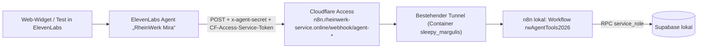

# Einrichtung des Telefonassistenten „Mira“ (task-13-5)

Sprachagent in ElevenLabs, Werkzeuge als n8n-Webhooks, Zugriff über den bestehenden Cloudflare-Tunnel. Keine Geheimnisse im Repository: Werte stehen in `.env.local` (Namen in `.env.example`), in n8n-Credentials und in den Workspace-Secrets von ElevenLabs.

## Aufbau



## Bestandteile

| Teil | Wo | Quelle im Repository |
| --- | --- | --- |
| Workflow „RheinWerk · Telefonassistent Werkzeuge“ (`rwAgentTools2026`), elf Webhooks `/webhook/agent-<werkzeug>` | n8n | `n8n/generate_agent_tools.py` → `n8n/workflows/rheinwerk-agent-tools.workflow.json` |
| Header-Auth `x-agent-secret` (Credential `rwAgentSecret001`) | n8n, `.env.local` `AGENT_WEBHOOK_SECRET` | `n8n/bootstrap_agent_secret.py` |
| Workflow „RheinWerk · Telefonassistent Auswertung“ (`rwCallAnalysis26`), alle 2 Minuten, ElevenLabs-API → OpenAI → `agent_record_call` | n8n, Credential „RheinWerk ElevenLabs“ (`rwElevenLabs0001`, Header `xi-api-key`) | `n8n/generate_call_analysis.py`, `n8n/bootstrap_elevenlabs.py` |
| Datenbankfunktionen | Supabase | Migrationen task-13-2 bis 13-5, `docs/n8n-contract.md` Abschnitt 6 |
| Access-Anwendung für den Pfad `webhook/agent-*` mit Policy „Service Auth“ (Service Token „ElevenLabs Mira“) | Cloudflare Zero Trust | `.env.local` `CF_ACCESS_CLIENT_ID`, `CF_ACCESS_CLIENT_SECRET` |
| Agent, elf Webhook-Werkzeuge, Aussprache-Wörterbuch, Workspace-Secrets | ElevenLabs | `scripts/elevenlabs-agent.mjs`, IDs in `elevenlabs.json` |
| Prompt | ElevenLabs | `systemprompt.md` + `wissensbasis.md` (als Abschnitt „Wissen“), Begrüßung aus `leitfaden.md` |

Der Rest von `n8n.rheinwerk-service.online` (Editor, andere Webhooks) bleibt hinter der bisherigen Access-Anmeldung; der Service Token öffnet nur `webhook/agent-*`.

## Agent

- Name „RheinWerk Mira“, Sprache Deutsch, LLM `claude-sonnet-4-5` (Temperatur 0,2; vorher `claude-haiku-4-5`, ersetzt am 19.10.2026, weil Haiku Buchstabiertes und frühere Angaben im Gespräch schlecht verknüpfte), TTS `eleven_v3_conversational` mit Expressive Mode, Stabilität 0,4, Latenzoptimierung 2 (Nutzerentscheidung 19.10.2026: lebendigere Betonung, etwas mehr Verzögerung akzeptiert; Modell in `elevenlabs.json` `tts_model`, vorher `eleven_flash_v2_5`), Stimme `LB5G0Z4EP98YaEgL654m` („Mira (Laura)“, deutsch), Aussprache-Wörterbuch „RheinWerk Mira“ (RheinWerk, RIS, KAESER, KSB, SLA, PLZ …). Spracherkennung mit Schlüsselwörtern (`asr.keywords`: Hersteller mit Schreibvarianten und Baureihen ab drei Zeichen aus `catalog.json`), Sprecherwechsel `turn_eagerness: patient` (wartet bei „äh“-Pausen länger).
- Systemwerkzeug `end_call`. Keine Weiterleitung im Web-Widget: an ihrer Stelle `rueckruf_service_desk` (Rückruf durch einen Menschen, dringend bei Notfällen).
- Wissen (Leistungen, Preise, Servicezeiten, Einsatzgebiet) steht im Prompt statt in einem eigenen Werkzeug `wissen`: kurz genug und ohne zusätzlichen Aufruf schneller.
- Grenzen: höchstens 10 Minuten je Gespräch, 2 gleichzeitige Gespräche, 30 Gespräche am Tag; keine Sprachaufnahme, Gesprächsdaten bei ElevenLabs 30 Tage.
- Gesprächs-ID: jedes Werkzeug erhält `call_id` aus `system__conversation_id`.

## Werkzeuge

| ElevenLabs | Webhook | Datenbank |
| --- | --- | --- |
| `servicezeit` | `agent-servicezeit` | `agent_service_hours` |
| `anlage_pruefen` | `agent-anlage-pruefen` | Katalogabgleich in n8n (`catalog.json`), ähnliche Baureihen als `rueckfrage` |
| `email_pruefen` | `agent-email-pruefen` | `agent_check_email` |
| `kunde_finden` | `agent-kunde-finden` | `agent_find_customer` |
| `einsatzgebiet_pruefen` | `agent-einsatzgebiet-pruefen` | `agent_check_area` |
| `sla_pruefen` | `agent-sla-pruefen` | `agent_check_contract` |
| `freie_termine` | `agent-freie-termine` | `agent_free_slots` |
| `anfrage_anlegen` | `agent-anfrage-anlegen` | `agent_create_request` |
| `anfrage_finden` | `agent-anfrage-finden` | `agent_find_request` |
| `rueckrufbitte_techniker` | `agent-rueckrufbitte-techniker` | `agent_request_callback` |
| `rueckruf_service_desk` | `agent-rueckruf-service-desk` | `agent_request_service_callback` |

## Ändern und prüfen

```bash
python3 n8n/bootstrap_agent_secret.py          # Geheimnis anlegen/übernehmen (einmalig)
python3 n8n/generate_agent_tools.py            # Workflow erzeugen
docker cp n8n/workflows/rheinwerk-agent-tools.workflow.json n8n:/tmp/agent-tools.json
docker exec n8n n8n import:workflow --input=/tmp/agent-tools.json --projectId=tNNYO9peZDHcZ20n
docker exec n8n n8n publish:workflow --id=rwAgentTools2026 && docker restart n8n
npm run test:agent                             # lokal: Geheimnis, Antworten, Zeit ≤ 1,5 s
AGENT_BASE_URL=https://n8n.rheinwerk-service.online npm run test:agent   # durch Tunnel und Access
npm run agent:sync                             # Prompt, Werkzeuge, Stimme, Wörterbuch nach ElevenLabs
npm run agent:simulate                         # Textsimulation der Szenarien aus testprotokoll.md (16 Fälle)
npm run agent:latency -- --markdown            # Latenz: Metriken der Live-Gespräche und Webhooks lokal/Tunnel
python3 n8n/bootstrap_elevenlabs.py            # API-Schlüssel als n8n-Credential (Auswertung), einmalig
python3 n8n/generate_call_analysis.py          # Workflow Gesprächsauswertung erzeugen
docker cp n8n/workflows/rheinwerk-call-analysis.workflow.json n8n:/tmp/call-analysis.json
docker exec n8n n8n import:workflow --input=/tmp/call-analysis.json --projectId=tNNYO9peZDHcZ20n
docker exec n8n n8n publish:workflow --id=rwCallAnalysis26 && docker restart n8n
npm run test:calls                             # nach einem Lauf: alle Gespräche ausgewertet, Wiederholung ohne Wirkung
```

`agent:simulate` nutzt als Werkzeugantworten die echten Antworten der lokalen Webhooks (die Simulation von ElevenLabs ruft keine Webhooks auf); `anfrage_anlegen` ist dort fest vorgegeben, damit keine Anfrage und keine E-Mail entsteht. Den vollständigen Weg mit echter Anfrage prüft ein Demo-Anruf im Browser (Klick auf die Service-Desk-Nummer der Website) oder in ElevenLabs (Agents → „RheinWerk Mira“ → Test AI agent) mit eigener E-Mail-Adresse, denn die Eingangsbestätigung wird wirklich versendet. Protokoll: [testprotokoll.md](testprotokoll.md).

Benötigte Rechte des ElevenLabs-API-Schlüssels: Agents (Conversational AI) lesen/schreiben, Voices schreiben (Stimme aus der Bibliothek übernehmen), Pronunciation Dictionaries schreiben.

## Demo-Anruf über die Service-Desk-Nummer (task-13-8, task-13-11)

RheinWerk ist ein Portfolio-Projekt ohne Telefonleitung (Nutzerentscheidung 19.10.2026). Jeder Link auf die Service-Desk-Nummer `tel:+4962100000` (Kopfzeile, Kontaktseite, untere Leiste auf dem Telefon, Formularhinweise) öffnet deshalb einen simulierten Anruf (`components/demo-call.tsx`, in `components/site-shell.tsx`); ohne JavaScript bleibt es ein normaler Telefonlink. Ablauf:

1. Der Dialog zeigt den Hinweis (Demo-Projekt, KI nach AI Act Art. 50, Mikrofon, Verarbeitung bei ElevenLabs, Text 30 Tage, Link zum Datenschutz) und die Restminuten des Tages (`GET /api/mira`); ohne Budget ist „Einverstanden, anrufen“ gesperrt.
2. Nach der Bestätigung: Mikrofon freigeben, Freizeichen (425 Hz, zweimal) und parallel `POST /api/mira` (nur von der eigenen Seite, `Origin` = Host): `widget_session_start` reserviert die Minuten, der Server holt bei ElevenLabs eine signierte Adresse (`/v1/convai/conversation/get-signed-url`). Der API-Schlüssel bleibt auf dem Server.
3. Der Browser lädt erst jetzt `@elevenlabs/client` und verbindet sich per WebSocket; Anzeige „Mira spricht/hört zu“ mit Gesprächszeit, „Stumm“, „Auflegen“. Nach dem Verbindungsaufbau meldet er die Gesprächs-ID (`PATCH /api/mira`, `widget_session_bind`); sobald die Auswertung (task-13-6) das Gespräch gespeichert hat, zählt dessen echte Dauer statt der Reservierung.

Weiterleitung an einen Menschen ist eine Demo: das Werkzeug `weiterleiten` (`agent_forward`, [regeln.md](regeln.md#weiterleitung)) markiert den Anruf und liefert die Ansage „Dies ist ein Demo-Projekt. In einem echten Betrieb würde ich Sie jetzt mit unserem Service Desk verbinden …“; danach nimmt Mira einen Rückruf auf. Mit einer echten Nummer (Twilio-Integration oder SIP-Trunk in ElevenLabs) würde an dieser Stelle die Systemfunktion `transfer_to_number` stehen; der Rückruf bliebe der Ausweg, wenn niemand annimmt.

Grenzen (Nutzerentscheidung 19.10.2026, `lib/mira-widget.ts`): höchstens 3 Minuten je Gespräch (`max_duration_seconds: 180` im Agenten), 10 Minuten je Tag für alle zusammen, höchstens 3 Gespräche je Anschluss und Stunde (gesalzener SHA-256-Wert der IP-Adresse, `MIRA_WIDGET_SALT`, ersatzweise `SUPABASE_SECRET_KEY`; Sitzungen werden nach 90 Tagen gelöscht). Der Agent nimmt nur signierte Adressen an (`platform_settings.auth.enable_auth`), ein Gespräch ohne unseren Server ist also nicht möglich; ElevenLabs begrenzt zusätzlich auf 2 gleichzeitige und 30 Gespräche je Tag. Nach 30 Sekunden Stille beendet Mira das Gespräch (`silence_end_call_timeout`), nach 7 Sekunden fragt sie nach.

Umgebung: `ELEVENLABS_API_KEY` (Recht „Conversational AI“ genügt für die signierte Adresse), optional `ELEVENLABS_AGENT_ID` (sonst `elevenlabs.json`) und `MIRA_WIDGET_SALT`. Das Budget liegt in Supabase (`widget_sessions`, Migration `20261019150000_widget_sessions.sql`); auf der öffentlichen Website funktioniert das Widget erst, wenn sie an diese Datenbank angebunden ist.
