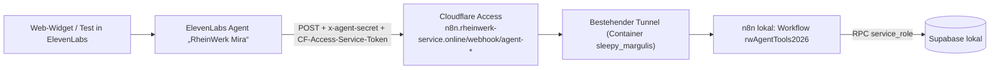

# Einrichtung des Telefonassistenten „Mira“ (task-13-5)

Sprachagent in ElevenLabs, Werkzeuge als n8n-Webhooks, Zugriff über den bestehenden Cloudflare-Tunnel. Keine Geheimnisse im Repository: Werte stehen in `.env.local` (Namen in `.env.example`), in n8n-Credentials und in den Workspace-Secrets von ElevenLabs.

## Aufbau



## Bestandteile

| Teil | Wo | Quelle im Repository |
| --- | --- | --- |
| Workflow „RheinWerk · Telefonassistent Werkzeuge“ (`rwAgentTools2026`), neun Webhooks `/webhook/agent-<werkzeug>` | n8n | `n8n/generate_agent_tools.py` → `n8n/workflows/rheinwerk-agent-tools.workflow.json` |
| Header-Auth `x-agent-secret` (Credential `rwAgentSecret001`) | n8n, `.env.local` `AGENT_WEBHOOK_SECRET` | `n8n/bootstrap_agent_secret.py` |
| Datenbankfunktionen | Supabase | Migrationen task-13-2 bis 13-5, `docs/n8n-contract.md` Abschnitt 6 |
| Access-Anwendung für den Pfad `webhook/agent-*` mit Policy „Service Auth“ (Service Token „ElevenLabs Mira“) | Cloudflare Zero Trust | `.env.local` `CF_ACCESS_CLIENT_ID`, `CF_ACCESS_CLIENT_SECRET` |
| Agent, neun Webhook-Werkzeuge, Aussprache-Wörterbuch, Workspace-Secrets | ElevenLabs | `scripts/elevenlabs-agent.mjs`, IDs in `elevenlabs.json` |
| Prompt | ElevenLabs | `systemprompt.md` + `wissensbasis.md` (als Abschnitt „Wissen“), Begrüßung aus `leitfaden.md` |

Der Rest von `n8n.rheinwerk-service.online` (Editor, andere Webhooks) bleibt hinter der bisherigen Access-Anmeldung; der Service Token öffnet nur `webhook/agent-*`.

## Agent

- Name „RheinWerk Mira“, Sprache Deutsch, LLM `claude-haiku-4-5` (Temperatur 0,2), TTS `eleven_flash_v2_5`, Stimme `LB5G0Z4EP98YaEgL654m` („Mira (Laura)“, deutsch), Aussprache-Wörterbuch „RheinWerk Mira“ (RheinWerk, RIS, KAESER, KSB, SLA, PLZ …).
- Systemwerkzeug `end_call`. Keine Weiterleitung im Web-Widget: an ihrer Stelle `rueckruf_service_desk` (Rückruf durch einen Menschen, dringend bei Notfällen).
- Wissen (Leistungen, Preise, Servicezeiten, Einsatzgebiet) steht im Prompt statt in einem eigenen Werkzeug `wissen`: kurz genug und ohne zusätzlichen Aufruf schneller.
- Grenzen: höchstens 10 Minuten je Gespräch, 2 gleichzeitige Gespräche, 30 Gespräche am Tag; keine Sprachaufnahme, Gesprächsdaten bei ElevenLabs 30 Tage.
- Gesprächs-ID: jedes Werkzeug erhält `call_id` aus `system__conversation_id`.

## Werkzeuge

| ElevenLabs | Webhook | Datenbank |
| --- | --- | --- |
| `servicezeit` | `agent-servicezeit` | `agent_service_hours` |
| `anlage_pruefen` | `agent-anlage-pruefen` | Katalogabgleich in n8n (`catalog.json`) |
| `einsatzgebiet_pruefen` | `agent-einsatzgebiet-pruefen` | `agent_check_area` |
| `sla_pruefen` | `agent-sla-pruefen` | `agent_check_contract` |
| `freie_termine` | `agent-freie-termine` | `agent_free_slots` |
| `anfrage_anlegen` | `agent-anfrage-anlegen` | `agent_create_request` |
| `anfrage_finden` | `agent-anfrage-finden` | `agent_find_request` |
| `rueckrufbitte_techniker` | `agent-rueckrufbitte-techniker` | `agent_request_callback` |
| `rueckruf_service_desk` | `agent-rueckruf-service-desk` | `agent_request_service_callback` |

## Ändern und prüfen

```bash
python3 n8n/bootstrap_agent_secret.py          # Geheimnis anlegen/übernehmen (einmalig)
python3 n8n/generate_agent_tools.py            # Workflow erzeugen
docker cp n8n/workflows/rheinwerk-agent-tools.workflow.json n8n:/tmp/agent-tools.json
docker exec n8n n8n import:workflow --input=/tmp/agent-tools.json --projectId=tNNYO9peZDHcZ20n
docker exec n8n n8n publish:workflow --id=rwAgentTools2026 && docker restart n8n
npm run test:agent                             # lokal: Geheimnis, Antworten, Zeit ≤ 1,5 s
AGENT_BASE_URL=https://n8n.rheinwerk-service.online npm run test:agent   # durch Tunnel und Access
npm run agent:sync                             # Prompt, Werkzeuge, Stimme, Wörterbuch nach ElevenLabs
npm run agent:simulate                         # Textsimulation: Status, Anlage, neue Anfrage, Notfall
```

`agent:simulate` nutzt als Werkzeugantworten die echten Antworten der lokalen Webhooks (die Simulation von ElevenLabs ruft keine Webhooks auf); `anfrage_anlegen` ist dort fest vorgegeben, damit keine Anfrage und keine E-Mail entsteht. Den vollständigen Weg mit echter Anfrage prüft ein Test im Browser (ElevenLabs → Agents → „RheinWerk Mira“ → Test AI agent) mit eigener E-Mail-Adresse, denn die Eingangsbestätigung wird wirklich versendet.

Benötigte Rechte des ElevenLabs-API-Schlüssels: Agents (Conversational AI) lesen/schreiben, Voices schreiben (Stimme aus der Bibliothek übernehmen), Pronunciation Dictionaries schreiben.
